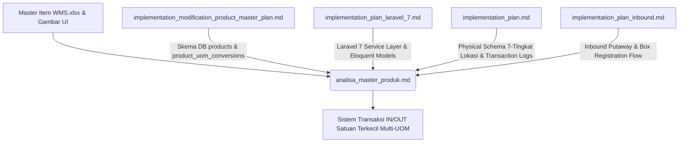
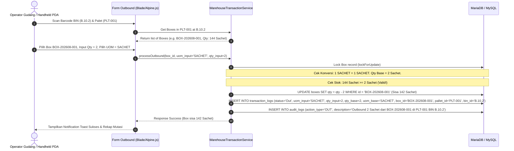

# Analisis Komprehensif Master Produk & Fitur IN/OUT Gudang Satuan Terkecil
## Warehouse Management System (WMS) Indraco

Dokumen ini menyajikan analisis mendalam terkait struktur **Master Data Produk (Product Master)** berdasarkan spesifikasi pada [`implementation_modification_product_master_plan.md`](file:///C:/laragon/www/WMS%20Indraco/implementation_modification_product_master_plan.md), data riil pada berkas [`Master Item WMS.xlsx`](file:///C:/laragon/www/WMS%20Indraco/Master%20Item%20WMS.xlsx), serta antarmuka UI Multi-UOM. 

Dokumen ini juga merancang arsitektur pencatatan transaksi **Masuk (IN) dan Keluar (OUT) gudang hingga satuan terkecil** (*Multi-UOM Granular Tracking*) dengan integrasi penuh terhadap rencana fungsi yang telah disusun sebelumnya pada:
- [`implementation_plan_laravel_7.md`](file:///C:/laragon/www/WMS%20Indraco/implementation_plan_laravel_7.md)
- [`implementation_plan.md`](file:///C:/laragon/www/WMS%20Indraco/implementation_plan.md)
- [`implementation_plan_inbound.md`](file:///C:/laragon/www/WMS%20Indraco/implementation_plan_inbound.md)

---

## 1. Analisis Field dan Fungsi Field Master Data Produk

Berdasarkan struktur data pada berkas Excel `Master Item WMS.xlsx` (total 302 baris konversi, 114 SKU produk unik) dan antarmuka manajemen master produk, berikut adalah analisis rinci untuk setiap kolom dan fungsinya:

| No | Kolom UI / Excel | Field Database (`products` / `product_uom_conversions`) | Tipe Data | Fungsi & Aturan Bisnis |
|:---|:---|:---|:---|:---|
| 1 | **Kode Item** | `products.id` / `item_code` | `VARCHAR(50)` | **Primary Key Unik**. Berfungsi sebagai ID SKU produk (contoh: `FGD00519`, `FGD00001`). Menjadi acuan relasi (*Foreign Key*) pada tabel transaksi, box, dan konversi UOM. |
| 2 | **Nama Item** | `products.name` | `VARCHAR(255)` | **Nama Lengkap Produk**. Menyimpan deskripsi nama produk secara detail (contoh: *IntiRasa Santan Bubuk Original R10: 5Bks + 1Bks*). |
| 3 | **Group Item** | `products.item_group` | `VARCHAR(100)` | **Kategori Produk**. Mengelompokkan barang berdasarkan asal manufaktur atau promosi (contoh: `FINISHED GOODS (MANUFAKTUR)`, `PROMOTION (PROMOSI)`). |
| 4 | **UOM Inventory** | `products.uom_inventory` | `VARCHAR(50)` | **Satuan Persediaan Utama / Satuan Terkecil (Base Unit)**. Menjadi acuan persediaan fisik terkecil di gudang (contoh: `Sachet`, `PCS`, `Box`, `Bag`, `Can`, `KG`). Seluruh stok fisik dihitung dalam satuan ini. |
| 5 | **Grup UOM** | `products.uom_group` | `VARCHAR(50)` | **Kode Kelompok UOM**. Kode pengelompokan standar kemasan pabrik (contoh: `SACHET144`, `BOX24`, `BAG10`). |
| 6 | **Isi Per Group UOM**| `products.qty_per_uom_group` | `DECIMAL(10,2)` | **Isi Standar Per Grup UOM**. Jumlah unit terkecil dalam satu grup kemasan utama (contoh: `144` sachet dalam 1 grup SACHET144, `24` box dalam 1 grup BOX24). |
| 7 | **Brand** | `products.brand` | `VARCHAR(100)` | **Merk / Merek Produk**. Digunakan untuk pengelompokan dan pemfilteran laporan stok (contoh: `BaliCafé`, `Supresso`, `Intirasa`, `Kopi Bro`). |
| 8 | **Active** | `products.is_active` | `BOOLEAN` | **Status Keaktifan Produk**. Nilai `Yes` (`1`) menandakan produk dapat ditransaksikan, sedangkan `No` (`0`) menonaktifkan produk dari transaksi baru. |
| 9 | **UOM Convert** | `product_uom_conversions.uom_convert` | `VARCHAR(50)` | **Satuan Kemasan Konversi**. Nama satuan yang dapat digunakan saat transaksi (contoh: `SACHET`, `RENCENG`, `RENCENGBNS`, `KARTON`, `BOX`, `BOXBNS`). |
| 10 | **Qty Convert** | `product_uom_conversions.qty_convert` | `DECIMAL(10,2)` | **Faktor / Rasio Konversi**. Jumlah faktor pengali ke satuan dasar (`uom_base`). Misal: 1 RENCENG = `10` SACHET, 1 KARTON = `144` SACHET. |
| 11 | **Uom Base** | `product_uom_conversions.uom_base` | `VARCHAR(50)` | **Satuan Acuan Konversi (Base Unit)**. Selalu merujuk dan konsisten dengan `uom_inventory` produk tersebut (contoh: `SACHET`, `BOX`, `BAG`). |

### Relasi Multi-UOM (1-to-Many) & Analisis Referensi Gambar UI

Pada antarmuka UI master data produk, 1 SKU (`Kode Item`) dapat memiliki **beberapa baris aturan konversi UOM**.

> **Studi Kasus Referensi Gambar UI (`FGD00519`)**:
> - **Item**: `FGD00519` - *IntiRasa Santan Bubuk Original R10: 5Bks + 1Bks*
> - **Group**: `FINISHED GOODS (MANUFAKTUR)`
> - **UOM Inventory (Base Unit)**: `Sachet`
> - **Grup UOM**: `SACHET144` | **Isi/Grup**: `144` | **Brand**: `Intirasa`
> - **Aturan Konversi UOM (`product_uom_conversions`)**:
>   1. `UOM CONVERT: SACHET` &rarr; `QTY CONVERT: 1` &rarr; `UOM BASE: SACHET` (1 Sachet = 1 Sachet)
>   2. `UOM CONVERT: RENCENG` &rarr; `QTY CONVERT: 10` &rarr; `UOM BASE: SACHET` (1 Renceng = 10 Sachet)
>   3. `UOM CONVERT: RENCENGBNS` &rarr; `QTY CONVERT: 12` &rarr; `UOM BASE: SACHET` (1 Renceng Bonus = 12 Sachet)
>   4. `UOM CONVERT: KARTON` &rarr; `QTY CONVERT: 144` &rarr; `UOM BASE: SACHET` (1 Karton = 144 Sachet)

---

## 2. Integrasi Terhadap Plan Fungsi Yang Pernah Dibuat

Dokumen ini secara cermat mengintegrasikan 4 dokumen perencanaan existing yang ada pada sistem WMS Indraco:



### Penyelarasan Integrasi Antar Dokumen:

1. **Integrasi Skema Data Produk (`implementation_modification_product_master_plan.md`)**:
   - Memisahkan tabel `products` (114 record master) dan `product_uom_conversions` (302 record rincian konversi).
   - Menjamin Eloquent Model `Product` memiliki relasi `hasMany(ProductUomConversion::class, 'product_id')` serta accessor `$product->default_unit` yang mengembalikan `$this->uom_inventory` demi *backward compatibility*.

2. **Integrasi Arsitektur Database & Service Laravel 7 (`implementation_plan_laravel_7.md` & `implementation_plan.md`)**:
   - Menghubungkan Master Produk ke struktur hierarki 7-tingkat: `Office` &rarr; `Branch` &rarr; `Warehouse` &rarr; `Rack` &rarr; `Bin` &rarr; `Pallet` &rarr; `Box`.
   - Modifikasi `WarehouseTransactionService.php` agar setiap mutasi barang pada tabel `boxes` dan `transaction_logs` memperhitungkan faktor konversi UOM secara otomatis.

3. **Integrasi Alur Scan & Confirm Inbound (`implementation_plan_inbound.md`)**:
   - **Tab 1 (Palet ke BIN)**: Menempatkan Palet di slot BIN (Maksimal 2 Palet per BIN).
   - **Tab 2 (Box ke Palet)**: Mendaftarkan Box ke Palet dengan pilihan UOM transaksi (Karton, Renceng, Sachet), yang kemudian secara otomatis dikalkulasikan ke kuantitas satuan terkecil (`uom_base`).

---

## 3. Arsitektur Fitur IN dan OUT Gudang Sampai Satuan Terkecil (Multi-UOM Granular In/Out Tracking)

### A. Prinsip Dasar Penyimpanan Stok Gudang

Untuk memastikan integritas data persediaan 100% akurat dan menghindari kesalahan pembulatan angka (*fractional rounding errors*):
1. **Kuantitas Fisik Terdaftar (`boxes.qty`)**: Selalu disimpan dalam **Satuan Terkecil (UOM Base / UOM Inventory)**.
   - Contoh: Jika diterima 2 Karton FGD00519 (di mana 1 Karton = 144 Sachet), maka nilai yang disimpan pada kolom `boxes.qty` adalah `288` (Sachet).
2. **Kuantitas Transaksi Input (`uom_input` & `qty_input`)**: Menyimpan satuan dan jumlah asli yang diinput oleh operator gudang saat melakukan transaksi IN atau OUT.
3. **Formula Konversi Otomatis**:
   $$\text{Qty Base} = \text{Qty Input} \times \text{Qty Convert}$$

### B. Skenario Transaksi OUT Parsial / Breaking Box (Partial Extraction)

> **Skenario Kebutuhan User**:
> Mengeluarkan **2 Sachet** produk `FGD00519` dari sebuah Box yang berada di **Palet `PLT-001`** pada **BIN `B.10.2`**.



#### Langkah Kerja Sistem pada Outbound Parsial:
1. **Validasi Ketersediaan Stok**: Sistem memeriksa kuantitas `boxes.qty` (144 Sachet). Pengeluaran `2 Sachet` diizinkan karena $144 \ge 2$.
2. **Pemotongan Stok Fisik**: Stok Box `BOX-202608-001` berkurang dari **144 Sachet menjadi 142 Sachet**. Box tetap berada di Palet `PLT-001` pada BIN `B.10.2`.
3. **Pencatatan Log Transaksi Terperinci**: Tabel `transaction_logs` mencatat transaksi secara eksplisit hingga level unit terkecil.
4. **Penanganan Box Kosong**: Jika kuantitas `boxes.qty` mencapai `0`, sistem secara otomatis mengubah status Box menjadi `empty` / diarsipkan.

---

### C. Rancangan Skema Database Terintegrasi untuk Satuan Terkecil

Untuk mendukung pelacakan hingga satuan terkecil dan histori mutasi yang transparan, berikut adalah rancangan migrasi/perubahan skema database:

#### 1. Tabel `products` (Master Produk)
```sql
CREATE TABLE products (
    id VARCHAR(50) PRIMARY KEY,                  -- Kode Item (e.g. FGD00519)
    name VARCHAR(255) NOT NULL,                  -- Nama Item
    item_group VARCHAR(100) NULL,                -- Group Item
    uom_inventory VARCHAR(50) NOT NULL,          -- Satuan Terkecil / Base Unit (e.g. Sachet)
    uom_group VARCHAR(50) NULL,                  -- Grup UOM (e.g. SACHET144)
    qty_per_uom_group DECIMAL(10,2) DEFAULT 1,  -- Isi Per Group UOM (e.g. 144)
    brand VARCHAR(100) NULL,                     -- Brand
    is_active BOOLEAN DEFAULT TRUE,              -- Status Active (1 = Yes, 0 = No)
    created_at TIMESTAMP NULL,
    updated_at TIMESTAMP NULL
);
```

#### 2. Tabel `product_uom_conversions` (Konversi UOM Multi-Level)
```sql
CREATE TABLE product_uom_conversions (
    id BIGINT UNSIGNED AUTO_INCREMENT PRIMARY KEY,
    product_id VARCHAR(50) NOT NULL,            -- FK ke products.id
    uom_convert VARCHAR(50) NOT NULL,           -- UOM Convert (e.g. KARTON, RENCENG, SACHET)
    qty_convert DECIMAL(10,2) NOT NULL,         -- Faktor Konversi ke uom_base (e.g. 144, 10, 1)
    uom_base VARCHAR(50) NOT NULL,              -- Satuan Dasar Acuan (e.g. SACHET)
    created_at TIMESTAMP NULL,
    updated_at TIMESTAMP NULL,
    FOREIGN KEY (product_id) REFERENCES products(id) ON DELETE CASCADE,
    UNIQUE KEY uq_prod_uom (product_id, uom_convert)
);
```

#### 3. Tabel `boxes` (Penyimpanan Stok Fisik per Box di Palet)
```sql
CREATE TABLE boxes (
    id VARCHAR(50) PRIMARY KEY,                  -- Barcode Box (e.g. BOX-202608-001)
    pallet_id VARCHAR(50) NOT NULL,              -- FK ke pallets.id (Lokasi Palet)
    product_id VARCHAR(50) NOT NULL,             -- FK ke products.id
    qty DECIMAL(10,2) NOT NULL,                  -- Stok Fisik Saat Ini (dalam uom_base)
    uom_base VARCHAR(50) NOT NULL,               -- Satuan Terkecil (e.g. SACHET)
    initial_qty DECIMAL(10,2) NOT NULL,          -- Stok Awal saat Inbound (dalam uom_base)
    expired_date DATE NOT NULL,                  -- Tanggal Kedaluwarsa (FEFO)
    machine_code VARCHAR(50) NOT NULL,           -- Kode Mesin Production Lot
    status ENUM('active', 'empty') DEFAULT 'active',
    created_at TIMESTAMP NULL,
    updated_at TIMESTAMP NULL,
    FOREIGN KEY (pallet_id) REFERENCES pallets(id) ON DELETE CASCADE,
    FOREIGN KEY (product_id) REFERENCES products(id)
);
```

#### 4. Tabel `transaction_logs` (Histori Mutasi In/Out Granular)
```sql
CREATE TABLE transaction_logs (
    id BIGINT UNSIGNED AUTO_INCREMENT PRIMARY KEY,
    pic_user_id VARCHAR(50) NOT NULL,            -- User PIC Transaksi
    shift INT NOT NULL,                          -- Shift Kerja (1, 2, 3)
    transaction_date TIMESTAMP DEFAULT CURRENT_TIMESTAMP,
    product_id VARCHAR(50) NOT NULL,             -- SKU Produk
    
    -- Pencatatan Dimensi Transaksi (Input Operator)
    uom_input VARCHAR(50) NOT NULL,              -- Satuan yang dipilih User (e.g. RENCENG, SACHET)
    qty_input DECIMAL(10,2) NOT NULL,            -- Kuantitas yang diinput User (e.g. 2.00)
    conversion_factor DECIMAL(10,2) NOT NULL,    -- Faktor Pengali Konversi (e.g. 10.00)
    
    -- Pencatatan Dimensi Base Unit (Satuan Terkecil)
    uom_base VARCHAR(50) NOT NULL,               -- Satuan Dasar Terkecil (e.g. SACHET)
    qty_base DECIMAL(10,2) NOT NULL,             -- Total Kuantitas Terkecil (e.g. 20.00)
    
    -- Koordinat Lokasi Fisik Barang
    bin_id VARCHAR(50) NOT NULL,                 -- ID BIN Slot (e.g. B.10.2)
    pallet_id VARCHAR(50) NOT NULL,              -- ID Palet (e.g. PLT-001)
    box_id VARCHAR(50) NOT NULL,                 -- ID Box Spesifik (e.g. BOX-202608-001)
    warehouse_id VARCHAR(50) NOT NULL,           -- ID Gudang
    
    status ENUM('In', 'Out', 'Transfer') NOT NULL, -- Jenis Mutasi Transaksi
    expired_date DATE NULL,
    machine_code VARCHAR(50) NULL,
    notes TEXT NULL,                             -- Catatan Detail Transaksi
    created_at TIMESTAMP NULL,
    updated_at TIMESTAMP NULL,

    FOREIGN KEY (pic_user_id) REFERENCES users(id),
    FOREIGN KEY (product_id) REFERENCES products(id),
    FOREIGN KEY (bin_id) REFERENCES bins(id),
    FOREIGN KEY (pallet_id) REFERENCES pallets(id),
    FOREIGN KEY (box_id) REFERENCES boxes(id),
    FOREIGN KEY (warehouse_id) REFERENCES warehouses(id)
);
```

---

## 4. Implementasi Logic Layer & UI (Laravel 7 & Alpine.js)

### A. Eloquent Model Integrasi (`app/Models/Product.php` & `ProductUomConversion.php`)

```php
// app/Models/Product.php
namespace App\Models;

use Illuminate\Database\Eloquent\Model;

class Product extends Model
{
    public $incrementing = false;
    protected $keyType = 'string';
    protected $fillable = [
        'id', 'name', 'item_group', 'uom_inventory', 
        'uom_group', 'qty_per_uom_group', 'brand', 'is_active'
    ];

    public function conversions()
    {
        return $this->hasMany(ProductUomConversion::class, 'product_id');
    }

    // Accessor untuk backward compatibility modul terdahulu
    public function getDefaultUnitAttribute()
    {
        return $this->uom_inventory;
    }
}
```

### B. Core Service Mutasi Transaksi (`app/Services/WarehouseTransactionService.php`)

```php
namespace App\Services;

use Illuminate\Support\Facades\DB;
use App\Models\Box;
use App\Models\ProductUomConversion;
use App\Models\TransactionLog;
use Exception;

class WarehouseTransactionService
{
    /**
     * Memproses Pengeluaran Barang (Outbound) sampai Satuan Terkecil
     */
    public function processOutbound(array $data, string $userId)
    {
        return DB::transaction(function () use ($data, $userId) {
            // 1. Lock record Box untuk menghindari race condition
            $box = Box::where('id', $data['box_id'])->lockForUpdate()->firstOrFail();
            $product_id = $box->product_id;

            // 2. Ambil Aturan Konversi UOM
            $conversion = ProductUomConversion::where('product_id', $product_id)
                ->where('uom_convert', $data['uom_input'])
                ->first();

            $conversionFactor = $conversion ? (float) $conversion->qty_convert : 1.0;
            $qtyBaseNeeded = (float) $data['qty_input'] * $conversionFactor;

            // 3. Validasi Stok Fisik Terkecil di Box
            if ((float) $box->qty < $qtyBaseNeeded) {
                throw new Exception(
                    "Stok tidak mencukupi! Stok Box {$box->id} tersedia: {$box->qty} {$box->uom_base}, " .
                    "Dibutuhkan: {$qtyBaseNeeded} {$box->uom_base} ({$data['qty_input']} {$data['uom_input']})."
                );
            }

            // 4. Potong Stok Box dalam Satuan Terkecil
            $box->qty = (float) $box->qty - $qtyBaseNeeded;
            if ($box->qty <= 0) {
                $box->qty = 0;
                $box->status = 'empty';
            }
            $box->save();

            // 5. Catat Log Mutasi Transaksi
            $log = TransactionLog::create([
                'pic_user_id'       => $userId,
                'shift'             => $data['shift'] ?? 1,
                'transaction_date'  => now(),
                'product_id'        => $product_id,
                'uom_input'         => $data['uom_input'],
                'qty_input'         => $data['qty_input'],
                'conversion_factor' => $conversionFactor,
                'uom_base'          => $box->uom_base,
                'qty_base'          => $qtyBaseNeeded,
                'bin_id'            => $data['bin_id'],
                'pallet_id'         => $box->pallet_id,
                'box_id'            => $box->id,
                'warehouse_id'      => $data['warehouse_id'],
                'status'            => 'Out',
                'expired_date'      => $box->expired_date,
                'machine_code'      => $box->machine_code,
                'notes'             => "Outbound {$data['qty_input']} {$data['uom_input']} ({$qtyBaseNeeded} {$box->uom_base}) dari Box {$box->id} di Palet {$box->pallet_id} BIN {$data['bin_id']}"
            ]);

            // 6. Audit Trail
            AuditLogger::log(
                $userId, 'outbound', 'OUT', 
                "Pengeluaran {$data['qty_input']} {$data['uom_input']} ({$qtyBaseNeeded} {$box->uom_base}) dari Box {$box->id} di BIN {$data['bin_id']}"
            );

            return $log;
        });
    }
}
```

### C. Komponen Interface Live Conversion (Alpine.js pada Form Blade)

Pada form `inbound.blade.php` dan `outbound.blade.php`, ditambahkan kalkulator konversi otomatis berbasis Alpine.js yang menampilkan estimasi jumlah satuan terkecil secara *real-time*:

```html
<!-- Form Fragment Outbound Granular (Blade) -->
<div x-data="{ 
    uomInput: 'SACHET', 
    qtyInput: 1, 
    conversions: { SACHET: 1, RENCENG: 10, RENCENGBNS: 12, KARTON: 144 },
    get qtyBase() { return this.qtyInput * (this.conversions[this.uomInput] || 1); }
}" class="glass-card p-4 rounded-xl">
    
    <label class="form-label font-semibold text-slate-200">Kuantitas & Satuan Transaksi</label>
    <div class="grid grid-cols-2 gap-3">
        <input type="number" x-model.number="qtyInput" min="0.01" step="any" class="form-control text-lg font-bold" />
        <select x-model="uomInput" class="form-select text-lg font-semibold">
            <template x-for="(factor, uom) in conversions" :key="uom">
                <option :value="uom" x-text="uom + ' (x' + factor + ')'"></option>
            </template>
        </select>
    </div>

    <!-- Live Calculation Badge -->
    <div class="mt-3 p-3 bg-sky-500/10 border border-sky-500/30 rounded-lg flex items-center justify-between">
        <span class="text-sm text-sky-300">Setara Satuan Terkecil (UOM Base):</span>
        <span class="text-base font-extrabold text-sky-400" x-text="qtyBase + ' SACHET'"></span>
    </div>
</div>
```

---

## 5. Ringkasan Fitur & Matriks Kesiapan Sistem

| Fitur / Modul | Status Desain | Mekanisme & Jaminan Sistem |
|:---|:---:|:---|
| **Multi-UOM Master Data** | **Ready** | Mampu menyimpan hingga $N$ variasi UOM per SKU produk dengan acuan `uom_base` tunggal. |
| **Inbound Putaway & Box Reg.** | **Ready** | Mendukung pendaftaran Box dalam satuan konversi apa saja, otomatis dikonversi ke stok fisik terkecil. |
| **Granular Outbound (Partial)** | **Ready** | Mampu memotong stok Box hingga level terkecil (misal 2 Sachet dari 144 Sachet), mempertahankan sisa stok Box di BIN. |
| **Capacity Lock BIN (Max 2 PLT)** | **Ready** | `lockForUpdate()` pada Service Layer mencegah transaksi jika slot BIN sudah terisi 2 palet aktif. |
| **Traceability & History Mutasi** | **Ready** | `transaction_logs` menyimpan 100% histori mutasi lengkap (`uom_input`, `qty_input`, `uom_base`, `qty_base`, `box_id`, `pallet_id`, `bin_id`). |

---

## 6. Kesimpulan & Langkah Eksekusi Berikutnya

Analisis ini memberikan kepastian bahwa arsitektur WMS Indraco mampu menangani **pencatatan barang masuk dan keluar hingga satuan terkecil secara presisi dan ter-history dengan sempurna**.

### Langkah Eksekusi Pengembangan (Roadmap):
1. **Eksekusi Migrasi Database**: Jalankan migrasi tabel `products`, `product_uom_conversions`, `boxes`, dan `transaction_logs`.
2. **Jalankan Seeder Master Item**: Import 114 produk dan 302 aturan UOM dari `Master Item WMS.xlsx` via `ProductMasterSeeder.php`.
3. **Pembaruan Service Layer & Controller**: Terapkan logika konversi UOM pada `WarehouseTransactionService.php`.
4. **Pembaruan View Blade Form**: Pasang Alpine.js live calculator pada `inbound.blade.php` dan `outbound.blade.php`.
5. **Verifikasi End-to-End**: Uji coba skenario pengambilan 2 sachet dari box di palet BIN spesifik dan pastikan log mutasi tercatat sempurna.
