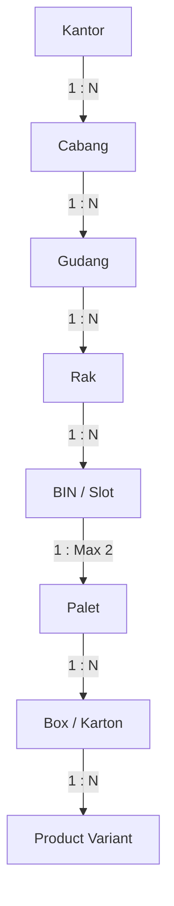

# Analisis dan Rancangan Kebutuhan Sistem
## Warehouse Management System (WMS) - Indraco

Dokumen ini berisi analisis kebutuhan, struktur data, aturan validasi, dan rancangan fitur untuk aplikasi WMS Indraco.

---

## 1. Struktur Data & Hierarki Lokasi

Sistem penyimpanan dirancang secara hierarkis dengan hubungan *One-to-Many* dari tingkat teratas (Kantor) hingga tingkat terkecil (Produk), dengan beberapa relasi *Many-to-Many* untuk fleksibilitas kemasan dan varian.

### A. Hierarki Penyimpanan


### B. Hubungan Kardinalitas Entitas
1. **Kantor & Cabang**: 1 Kantor dapat memiliki banyak Cabang.
2. **Cabang & Gudang**: 1 Cabang dapat memiliki banyak Gudang.
3. **Gudang & Rak**: 1 Gudang dapat memiliki banyak Rak.
4. **Rak & BIN**: 1 Rak dapat memiliki banyak BIN.
5. **BIN & Palet**: 1 BIN maksimal hanya boleh menampung **2 Palet**.
6. **Palet & Box**: 1 Palet dapat memuat banyak Box.
7. **Box & Product**: 1 Box dapat berisi banyak Product.
8. **Product Variant & Box**: 1 Varian Product bisa didistribusikan ke banyak Box (Many-to-Many).
9. **Box Variant & Palet**: 1 Varian Box bisa ditempatkan di banyak Palet (Many-to-Many).

### C. Kunci Unik & Identitas (Unique Codes / Barcodes)
Berikut adalah entitas yang wajib memiliki **Kode Unik / Barcode** tersendiri:
- **Kantor** (e.g., `KTR-001`)
- **Cabang** (e.g., `CBG-SUB`)
- **Gudang** (e.g., `GSK.678.I`)
- **Rak / BIN** (e.g., `B.10.2` - terdiri dari format: **Nama Rak . Nomor Kolom . Tingkat/SAP**)
- **Palet** (e.g., `PLT-0001` - memiliki barcode unik)
- **Product** (e.g., `PRD-99812` - SKU / Barcode unik)

---

## 2. Aturan Bisnis & Validasi (Business Rules)

1. **Kapasitas BIN (Kritis)**:
   - Setiap BIN hanya boleh menampung maksimal **2 palet** aktif.
   - Jika suatu BIN sudah terisi 2 palet, sistem harus **menolak (block)** penambahan palet baru ke BIN tersebut. Status BIN akan menjadi **"Penuh / Terisi"**.
2. **Format Kode Nomor Rak**:
   - Kode rak merepresentasikan lokasi spasial dengan format: `<Nama_Rak>.<Kolom>.<Tingkat_SAP>`
   - Contoh:
     - `B.10.2` -> Rak B, Kolom 10, Tingkat 2 (SAP 2).
     - `C.1.1` -> Rak C, Kolom 1, Tingkat 1.
3. **Parameter Satuan Barang**:
   - Pilihan satuan resmi: `Karton`, `Bag`, `Box`, `Pcs`, `Kg`.
4. **Jenis Palet**:
   - Pilihan jenis palet: `Loscam`, `Kayu 125x125`, `Kayu 135x125`, `Plastik`.

---

## 3. Fitur Utama Sistem (System Features)

### A. Barang Masuk (Inbound / Goods Receipt)
Mencatat penerimaan barang ke dalam gudang dan penempatan (*putaway*) ke lokasi rak/BIN tertentu.
- **Data yang dicatat (sesuai Gambar 2 - Tarikan Data)**:
  - Nomor (Auto Increment)
  - PIC Input (User yang menginput)
  - Shift (1 / 2 / 3)
  - Tanggal Input
  - Nama Barang / Varian Product
  - Qty (Jumlah)
  - Satuan (Karton / Bag / Box / Pcs / Kg)
  - Expired Date (Tanggal Kedaluwarsa)
  - Kode Mesin (Kode Produksi / Mesin Pengolah, e.g., `1I0PB01`, `1G0PB07`)
  - Kode Rak / BIN Location (`B.10.2`, `K.1.1`, dsb.)
  - Status (`In` untuk Barang Masuk)
  - Jenis Palet (`Loscam`, `Kayu 125x125`, dsb.)
  - Gudang Penerima (`GSK.678.I`)
- **Validasi**: Cek kapasitas BIN saat barang ditaruh di palet yang dimasukkan ke BIN tersebut.

### B. Barang Keluar (Outbound / Goods Issue)
Mencatat pengeluaran barang dari gudang untuk pengiriman atau proses produksi.
- **Data yang dicatat**:
  - Kolom data serupa dengan Barang Masuk, namun dengan Status `Out`.
  - Mengurangi jumlah stok akhir pada lokasi Rak/BIN bersangkutan.
  - Mengubah status Rak kembali menjadi `Kosong` jika Qty Akhir = 0 dan Palet diturunkan.

### C. Transfer / Pindah Lokasi (Move / Relocation)
Memfasilitasi pemindahan barang (bisa berupa pemindahan Palet secara utuh atau pemindahan Box antar palet/rak).
- **Data yang dicatat**:
  - Palet Asal / Rak Asal
  - Palet Tujuan / Rak Tujuan
  - Qty Barang yang dipindahkan
  - PIC Pemindah
  - Waktu Transfer
- **Validasi**:
  - Memastikan BIN tujuan transfer tidak melebihi kapasitas maksimal (2 palet).

### D. Pencarian Lokasi Barang & Rekap Stok (Stock Locator & Summary)
Menampilkan lokasi presisi barang berdasarkan Gambar 1 & Gambar 2.
- **Pencarian Cepat**: Cari berdasarkan Nama Barang, Kode Rak, Jenis Palet, atau Gudang.
- **Tampilan Rekap Bin Location**:
  - Menyandingkan data `In` dan `Out` untuk menghasilkan `Qty Akhir`.
  - Menampilkan **Status Rak** secara otomatis:
    - `Terisi` jika terdapat sisa barang / ada palet aktif.
    - `Kosong` jika Qty Akhir = 0 dan tidak ada palet terdaftar di BIN tersebut.
  - Memperlihatkan metadata seperti Tanggal Expired dan Kode Mesin.

### E. Manajemen Hak Akses & Keamanan (Role-Based Access Control - RBAC)
Sistem memiliki kontrol akses yang ketat berdasarkan peran pengguna.
- **Struktur Pengguna**: Multi-User & Multi-Role.
- **Matriks Hak Akses Modul**:
  Setiap Role dikonfigurasikan dengan hak akses granular pada setiap modul:
  - **Akses Modul** (View)
  - **Tambah Data** (Create)
  - **Edit Data** (Update)
  - **Hapus Data** (Delete)
- **Contoh Role**:
  - *Super Admin*: Akses penuh ke semua modul, konfigurasi hak akses, dan manajemen user.
  - *Warehouse Supervisor*: Akses modul transaksi, approval transfer, rekap data, log history.
  - *Operator / PIC Gudang*: Akses input Barang Masuk (In), Barang Keluar (Out), dan Transfer (Move). Hanya bisa View dan Create.

### F. Log History & Audit Trail
Setiap perubahan data (tambah, edit, hapus, pemindahan barang) harus mencatat riwayat ke dalam log:
- **Timestamp** (Waktu Kejadian)
- **User / PIC** yang melakukan aksi
- **Modul** yang diakses (e.g., Inbound, Outbound, RBAC)
- **Tipe Aksi** (CREATE, UPDATE, DELETE, MOVE)
- **Keterangan Perubahan** (e.g., *“Mengubah lokasi Palet PLT-001 dari Rak B.10.2 ke C.1.1”*)

---

## 4. Struktur Database Logis (Conceptual Entity Relationship)

```sql
-- Contoh skema logis dasar untuk referensi pengembangan UI/State

CREATE TABLE kantor (
    id VARCHAR(50) PRIMARY KEY, -- Kode Unik
    nama VARCHAR(100) NOT NULL
);

CREATE TABLE cabang (
    id VARCHAR(50) PRIMARY KEY, -- Kode Unik
    kantor_id VARCHAR(50) REFERENCES kantor(id),
    nama VARCHAR(100) NOT NULL
);

CREATE TABLE gudang (
    id VARCHAR(50) PRIMARY KEY, -- Kode Unik (e.g., GSK.678.I)
    cabang_id VARCHAR(50) REFERENCES cabang(id),
    nama VARCHAR(100) NOT NULL
);

CREATE TABLE rak (
    id VARCHAR(50) PRIMARY KEY, -- Kode Unik Barcode Rak
    gudang_id VARCHAR(50) REFERENCES gudang(id),
    kode_rak VARCHAR(50) NOT NULL -- e.g., B.10.2 (Rak, Kolom, Tingkat)
);

CREATE TABLE bin (
    id VARCHAR(50) PRIMARY KEY,
    rak_id VARCHAR(50) REFERENCES rak(id),
    nomor_bin VARCHAR(10) NOT NULL,
    max_pallet INT DEFAULT 2
);

CREATE TABLE palet (
    id VARCHAR(50) PRIMARY KEY, -- Kode Unik / Barcode Palet (e.g., PLT-0001)
    jenis_palet VARCHAR(50) NOT NULL, -- Loscam, Kayu, Plastik, dll
    bin_id VARCHAR(50) REFERENCES bin(id) NULL -- Lokasi BIN saat ini (Bisa NULL jika sedang tidak di rak)
);

CREATE TABLE product (
    id VARCHAR(50) PRIMARY KEY, -- SKU / Barcode Unik
    nama_barang VARCHAR(150) NOT NULL,
    kode_mesin VARCHAR(50),
    satuan VARCHAR(20) NOT NULL -- Karton, Bag, Box, Pcs, Kg
);

CREATE TABLE box (
    id VARCHAR(50) PRIMARY KEY, -- Barcode Box
    palet_id VARCHAR(50) REFERENCES palet(id),
    product_id VARCHAR(50) REFERENCES product(id),
    qty INT NOT NULL,
    expired_date DATE NOT NULL
);

CREATE TABLE stock_log (
    id INT AUTO_INCREMENT PRIMARY KEY,
    pic_input VARCHAR(100) NOT NULL,
    shift INT NOT NULL,
    tanggal_input DATETIME NOT NULL,
    product_id VARCHAR(50) REFERENCES product(id),
    qty INT NOT NULL,
    satuan VARCHAR(20) NOT NULL,
    expired_date DATE,
    kode_mesin VARCHAR(50),
    rak_id VARCHAR(50) REFERENCES rak(id),
    status VARCHAR(5) NOT NULL, -- 'In' atau 'Out'
    jenis_palet VARCHAR(50),
    gudang_id VARCHAR(50) REFERENCES gudang(id),
    palet_id VARCHAR(50) REFERENCES palet(id)
);

CREATE TABLE audit_log (
    id INT AUTO_INCREMENT PRIMARY KEY,
    timestamp DATETIME DEFAULT CURRENT_TIMESTAMP,
    pic VARCHAR(100) NOT NULL,
    action_type VARCHAR(20) NOT NULL, -- CREATE, UPDATE, DELETE, MOVE
    module VARCHAR(50) NOT NULL,
    description TEXT NOT NULL
);
```

---

## 5. Rancangan Antarmuka Pengguna (UI Wireframe & User Flow)

Aplikasi akan dibangun sebagai Single Page Application (SPA) yang interaktif, menggabungkan kemudahan layouting **Bootstrap 5.3** (untuk grid, form, dan komponen modal) dan keindahan visual utilitas **TailwindCSS** untuk styling premium modern, gradasi warna, efek glassmorphism, dan transisi halus.

### Halaman / Tab yang Tersedia di Dashboard WMS:
1. **Dashboard Overview & Analisis Ringkas**: Statistik total barang masuk/keluar hari ini, kapasitas gudang secara umum, chart tren.
2. **Pencarian Lokasi & Rekap Stok (Stock Locator)**:
   - Pencarian berdasarkan Nama Barang, Gudang, atau Rak.
   - Tabel Rekap Bin Location (sesuai Gambar 1 & Gambar 2) dengan indikator visual status rak (`Terisi` = Hijau, `Kosong` = Abu-abu).
3. **Barang Masuk (Inbound Form & History)**:
   - Form input barang masuk dilengkapi deteksi validasi kapasitas BIN otomatis (mengecek apakah BIN terpilih sudah terisi 2 palet).
   - Tabel riwayat barang masuk.
4. **Barang Keluar (Outbound Form & History)**:
   - Form input barang keluar untuk mengurangi stok dari lokasi tertentu.
   - Tabel riwayat barang keluar.
5. **Transfer / Move (Relokasi Barang)**:
   - Form interaktif pemindahan palet/barang antar BIN/Rak dengan validasi tujuan.
   - Tabel riwayat perpindahan barang.
6. **Manajemen Hak Akses & User (RBAC Dashboard)**:
   - Pengaturan Role (Admin, Supervisor, Operator) dan hak akses CRUD untuk setiap modul.
   - Form CRUD User dan penentuan Role.
7. **Audit Log / History Aktivitas**:
   - Menampilkan catatan perubahan data realtime, siapa yang mengubahnya, kapan, dan deskripsi detail perubahannya.

---

## 6. Kebutuhan Responsivitas Antarmuka (Mobile/Handheld)

Mengingat sebagian besar operator gudang beroperasi secara dinamis di lapangan menggunakan perangkat genggam (*handheld scanner* atau smartphone), antarmuka sistem wajib dioptimalkan untuk performa responsif:

1. **Navigasi Utama Mobile**:
   - **Slide-out Drawer (Hamburger Menu)**: Sidebar navigasi dipadatkan menjadi tombol hamburger di pojok kiri atas. Saat ditekan, memicu drawer navigasi lateral yang menutupi konten utama secara temporer dengan sistem backdrop sensitif sentuhan.
   - **Bottom Navigation Bar**: Antarmuka navigasi utama dipindahkan ke bagian bawah layar untuk jangkauan ibu jari yang ergonomis. Navigasi bawah memuat modul Dashboard, Inventory, Scanner Simulator, dan Profil.
2. **Optimalisasi Konten**:
   - Konten tabel diubah menjadi scrollable horizontal (`table-responsive`) atau dikonversi menjadi layout kartu (*card list*) untuk kenyamanan membaca di layar sempit.
   - Penambahan ruang sela (*safe area padding*) di bagian bawah (`pb-20`) untuk memastikan navigasi bawah tidak menutupi informasi penting tabel atau form transaksi.
