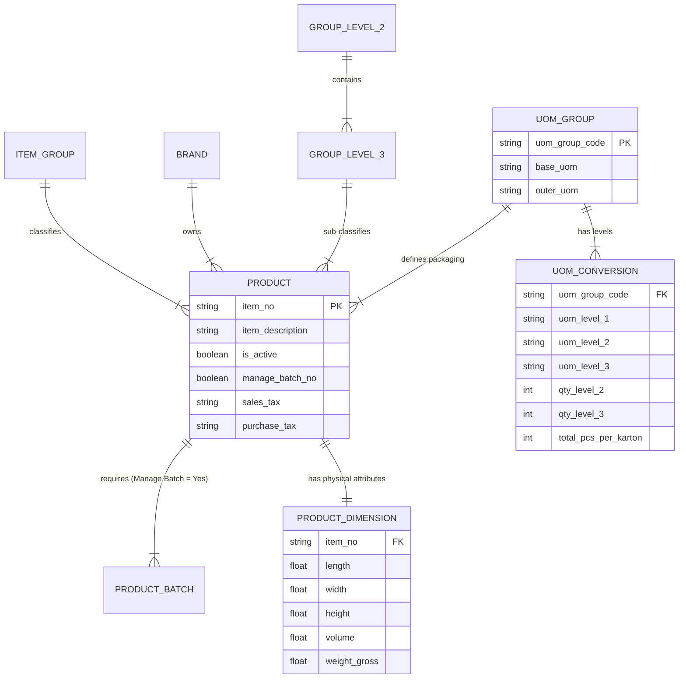

# ANALISA MASTER DATA ITEM DENGAN STRUKTUR UOM UNTUK WMS INDRACO

> **Dokumen Referensi Sistem**: Warehouse Management System (WMS)  
> **Sumber Data**: `C:\laragon\www\WMS Indraco\document\MASTER DATA ITEM.xlsx`  
> **Jumlah Data**: 646 Record Item (Finished Goods / Manufaktur)  
> **Tanggal Analisa**: 28 September 2026  

---

## 1. Ringkasan Eksekutif

Dokumen ini menyajikan analisa komprehensif terhadap master data produk (*Master Data Item*) PT Indraco yang akan diintegrasikan ke dalam sistem **Warehouse Management System (WMS)**. Master data berasal dari ekspor ERP (SAP Business One) dan memuat **646 produk aktif/non-aktif** pada grup barang `FINISHED GOODS (MANUFAKTUR)`.

Fokus utama dari analisa ini adalah membedah **35 field master data**, hierarki pengelompokan produk, aturan **Manage Batch Number**, spesifikasi dimensi fisik & berat, serta yang paling krusial: **Sistem Tingkatan UOM (Unit of Measure), UoM Group, dan Formulasi Konversi Multilevel**.

---

## 2. Analisis Field-Field Data (35 Fields)

Berikut adalah rincian lengkap dari seluruh 35 kolom/field yang ada pada file Excel `MASTER DATA ITEM.xlsx`:

| No | Nama Field | Tipe Data | Non-Null Count | Variasi Nilai / Contoh | Deskripsi & Peran dalam WMS |
|:--:|:---|:---:|:---:|:---|:---|
| 1 | **Item No.** | String | 646 (100%) | `FGD00001`, `FGD00487` | **Primary Key** item di SAP & WMS. Kode unik identifikasi barang. |
| 2 | **Item Description** | String | 646 (100%) | `BaliCafé Arabica Gold 10 Capsules x 6g Box` | Nama deskriptif lengkap produk untuk tampilan UI & dokumen cetak. |
| 3 | **Active Remarks** | String | 2 (0.3%) | Catatan status aktif | Catatan alasan non-aktifasi item tertentu. |
| 4 | **Item Group** | String | 646 (100%) | `FINISHED GOODS (MANUFAKTUR)` | Pengelompokan utama ERP SAP. Seluruh data adalah barang jadi manufaktur. |
| 5 | **Purchasing UoM** | String | 15 (2.3%) | `Karton`, `KG`, `None` | Satuan standar saat pembelian/penerimaan barang dari supplier/pabrik. |
| 6 | **No. of Items per Purchase Unit** | Integer | 646 (100%) | `1`, `12`, `20` | Jumlah satuan terkecil dalam 1 unit pembelian. |
| 7 | **ITEM QTY UOM 1** | Integer | 646 (100%) | `1` | Pengali kuantitas UOM 1 (outer packaging/Karton). Selalu bernilai 1. |
| 8 | **UOM 1** | String | 420 (65.0%) | `Karton`, `KG`, `SACHET`, `PCS`, `SET` | Kemasan paling luar / kemasan induk (*Master Outer Packaging*). |
| 9 | **ITEM QTY UOM 2** | Int / String | 123 (19.0%) | `5`, `8`, `10`, `12`, `20`, `25` | Jumlah UOM 2 (kemasan menengah) di dalam 1 UOM 1. |
| 10 | **UOM 2** | String | 123 (19.0%) | `Renceng`, `BoxBNS`, `RencengBNS` | Kemasan intermediate/bundling (misal: Renceng di dalam Karton). |
| 11 | **ITEM QTY UOM 3** | Integer | 646 (100%) | `1`, `2`, `4`, `5`, `10`, `12`, `15`, `20`, `24`, `36` | Kuantitas UOM 3 (Base Unit) per UOM 2 (jika ada) atau per UOM 1. |
| 12 | **UOM 3** | String | 646 (100%) | `Bag`, `Sachet`, `Box`, `Can`, `KG`, `Pieces`, `Set` | **Base UOM / Stocking Unit**. Satuan terkecil penyimpanan & penjualan. |
| 13 | **ITEM QTY KARTON TO PCS** | Int / String | 646 (100%) | `24`, `120`, `250`, `Manual` | **Faktor Konversi Utama**: Jumlah Base UOM (Pcs/Sachet/Box) per 1 Karton. |
| 14 | **UoM Group** | String | 646 (100%) | `BAG20`, `BOX24`, `SACHET120`, `Manual` | **Master UoM Group SAP**. Kode pola konversi kemasan produk. |
| 15 | **No. of Units** | Integer | 646 (100%) | `2400`, `12000`, `1` | Faktor pengali skala unit ERP (seringkali $100 \times \text{Karton to PCS}$). |
| 16 | **Sales Tax Definition** | String | 646 (100%) | `PPN Out 10%` | Definisi pajak penjualan SAP (PPN Keluaran). |
| 17 | **Purchase Tax Definition** | String | 646 (100%) | `PPN In 11%` | Definisi pajak Pembelian SAP (PPN Masukan). |
| 18 | **Purchase Item** | String | 646 (100%) | `Yes` (19), `No` (627) | Flag apakah produk ini dapat dibeli langsung melalui Purchasing Order. |
| 19 | **Sales Item** | String | 646 (100%) | `Yes` | Flag apakah produk ini dijual ke pelanggan (semua = Yes). |
| 20 | **Inventory Item** | String | 646 (100%) | `Yes` | Flag apakah barang dicatat stoknya di gudang WMS & SAP (semua = Yes). |
| 21 | **Manage Batch No. [Yes/No]**| String | 646 (100%) | `Yes` | **KRUSIAL**: Semua produk wajib dilacak nomor batch / lot & expired date-nya! |
| 22 | **Group Level 2 Name** | String | 641 (99.2%) | `Coffee` (586), `Chocolate` (27), `Ginger` (22) | Kategori tingkat 2 (Jenis Komoditas). |
| 23 | **Group Level 3 Name** | String | 641 (99.2%) | `Ground Coffee` (260), `Roasted Beans` (193) | Kategori tingkat 3 (Bentuk/Olahan Produk). |
| 24 | **Brand Name** | String | 638 (98.8%) | `Supresso` (270), `Ucafe` (79), `Rasa Sayang` (69) | Merk/Brand dagang Indraco. |
| 25 | **Bar Code** | BigInt | 7 (1.1%) | EAN/UPC Barcode | Kode batang EAN13/UPC untuk scan barcode WMS (perlu dilengkapi). |
| 26 | **Weight 1 - Inventory** | Float | 646 (100%) | `60`, `50`, `1000` | Berat kotor/netto persatuan inventaris dalam gram. |
| 27 | **Active** | String | 646 (100%) | `Yes` (585), `No` (61) | Status keaktifan barang (Active / Inactive). |
| 28 | **In Stock** | Float | 646 (100%) | `0`, `10`, `24`, `1010` | Saldo awal stok saat snapshot data diekspor. |
| 29 | **Foreign Name** | String | 0 (0%) | `NULL` | Nama barang dalam bahasa asing (saat ini kosong). |
| 30 | **Weight 1 - Inventory Unit**| Integer | 641 (99.2%) | `2` | ID Kode Satuan Berat (2 = Gram/Kg). |
| 31 | **Length** | Float | 646 (100%) | Panjang (cm) | Dimensi panjang kemasan outer (Karton) untuk perhitungan volume kubikasi. |
| 32 | **Width** | Float | 646 (100%) | Lebar (cm) | Dimensi lebar kemasan outer (Karton). |
| 33 | **Height** | Float | 646 (100%) | Tinggi (cm) | Dimensi tinggi kemasan outer (Karton). |
| 34 | **Volume - Sales Unit** | Float | 646 (100%) | `0.01`, `0.02` ($m^3$) | Volume kubikasi 1 Karton dalam meter kubik ($m^3$) untuk rekomendasi lokasi gudang. |
| 35 | **Weight** | Float | 646 (100%) | `2.61`, `2.09` (kg) | Berat total per Karton (Kg) untuk kalkulasi beban Pallet & Armada Kirim. |

---

## 3. Hubungan Antar Data (Data Relationships)

Relasi entitas master data item dirancang secara hirarkis dari pengelompokan produk hingga pengelolaan inventaris fisik gudang:



### Analisa Kunci Hubungan Data:
1. **Hierarki Kategori Produk**:
   `Item Group` (`FINISHED GOODS (MANUFAKTUR)`) $\rightarrow$ `Group Level 2 Name` (Commodity: Coffee, Chocolate, Ginger, Santan) $\rightarrow$ `Group Level 3 Name` (Process Type: Ground Coffee, Roasted Beans, Instant Coffee Mix) $\rightarrow$ `Brand Name` (Supresso, Ucafe, Rasa Sayang, Uang Emas, Tugu Buaya, BaliCafé, dll).
2. **Aturan Manajemen Stok WMS (`Manage Batch No. = Yes`)**:
   **100% dari 646 item wajib menggunakan nomor batch!** Artinya di dalam WMS, transaksi *Inbound (Penerimaan)*, *Putaway*, *Picking*, dan *Outbound (Pengiriman)* tidak bisa hanya mencatat jumlah barang, tetapi **wajib merekam Nomor Batch & Expiry Date** untuk prinsip FEFO (*First Expired, First Out*).
3. **Logistik Fisik & Perhitungan Ruang Gudang**:
   Setiap produk memiliki relasi ke atribut dimensi fisik (`Length`, `Width`, `Height`, `Volume`, `Weight`). Atribut ini terhubung langsung dengan kemasan UOM 1 (Karton) untuk kalkulasi **Kapasitas Pallet** (*Pallet Stacking Limit*) dan algoritma **Suggested Putaway Location** berdasarkan volume kubikasi slot rak.

---

## 4. Analisis Mendalam UOM Group

`UoM Group` (*Unit of Measure Group*) adalah struktur konversi kemasan standar dari SAP Business One yang mengelompokkan barang berdasarkan rasio kemasan luar ke kemasan terkecil.

Terdapat **55 UoM Group unik** pada master data Indraco.

### Tipe & Pola Penamaan UoM Group:

1. **Pola Kemasan Sachet dengan Renceng (3-Tier)**:
   *Format*: `SACHET` + `[Total Sachet per Karton]` (+ optional suffix)
   - `SACHET120`: 1 Karton = 12 Renceng = 120 Sachet (12 Renceng x 10 Sachet)
   - `SACHET250`: 1 Karton = 25 Renceng = 250 Sachet (25 Renceng x 10 Sachet)
   - `SACHET180`: 1 Karton = 12 RencengBNS = 180 Sachet (12 Renceng x 15 Sachet)
   - `SACHET375`: 1 Karton = 25 RencengBNS = 375 Sachet (25 Renceng x 15 Sachet)
   - `SACHET80`: 1 Karton = 8 Renceng = 80 Sachet (8 Renceng x 10 Sachet)

2. **Pola Kemasan Bag / Pouch Tanpa Renceng (2-Tier)**:
   *Format*: `BAG` + `[Jumlah Bag per Karton]`
   - `BAG20`: 1 Karton = 20 Bag
   - `BAG10`: 1 Karton = 10 Bag
   - `BAG25`: 1 Karton = 25 Bag
   - `BAG12`: 1 Karton = 12 Bag
   - `BAG15`: 1 Karton = 15 Bag

3. **Pola Kemasan Box / Tin Can (2-Tier)**:
   *Format*: `BOX` / `CAN` + `[Jumlah Box/Can per Karton]`
   - `BOX24`: 1 Karton = 24 Box
   - `BOX20`: 1 Karton = 20 Box
   - `BOX36`: 1 Karton = 36 Box
   - `CAN36`: 1 Karton = 36 Can (Kaleng)
   - `CAN12`: 1 Karton = 12 Can (Kaleng)

4. **Pola Kemasan Curah / Non-Standar (`Manual`)**:
   - `Manual`: Digunakan untuk produk curah/kemasan khusus (misal: Roasted Beans 10 kg, Kopi Biji dalam KG). Konversi Karton to PCS bersifat fleksibel atau berdasar satuan KG.

### Distribusi UoM Group Terbanyak (Top 20):

| Nama UoM Group | Jumlah Item | UOM 1 (Outer) | UOM 2 (Intermediate) | UOM 3 (Base) | Rasio Total (Karton to Pcs) |
|:---|:---:|:---:|:---:|:---:|:---:|
| **BAG20** | 57 | Karton / None | - | Bag | 20 Bag |
| **BOX24** | 47 | Karton | - | Box | 24 Box |
| **BAG10** | 40 | Karton / None | - | Bag | 10 Bag |
| **CAN36** | 34 | None | - | Can | 36 Can |
| **CAN12** | 31 | None | - | Can | 12 Can |
| **SACHET120** | 28 | Karton | Renceng (12) | Sachet (10) | 120 Sachet |
| **BAG25** | 26 | Karton | - | Bag | 25 Bag |
| **Manual** | 26 | KG | - | KG | Flexible / 1 |
| **BAG12** | 25 | Karton | - | Bag | 12 Bag |
| **SACHET20** | 25 | Karton | - | Sachet | 20 Sachet |
| **BOX20** | 24 | Karton | - | Box | 20 Box |
| **BAG15** | 23 | Karton | - | Bag | 15 Bag |
| **SACHET250**| 20 | Karton | Renceng (25) | Sachet (10) | 250 Sachet |
| **SACHET50** | 20 | Karton | Renceng (5) | Sachet (10) | 50 Sachet |
| **BAG26** | 20 | Karton | - | Bag | 26 Bag |
| **SACHET180**| 14 | Karton | RencengBNS (12) | Sachet (15) | 180 Sachet |
| **BOX12** | 14 | Karton | - | Box | 12 Box |
| **BAG5** | 14 | Karton | - | Bag | 5 Bag |
| **SACHET10** | 14 | None | - | Sachet | 10 Sachet |
| **BOX36** | 12 | Karton | - | Box | 36 Box |

---

## 5. Jenis-Jenis UOM & Perannya dalam WMS

Dalam pengelolaan gudang Indraco, UOM dibagi menjadi 3 tingkatan hirarki ditambah fungsi transaksi khusus:

```
[Level 1: Outer UOM]  --> Karton / Master Box (Satuan Penyimpanan Pallet & Inbound)
         │
[Level 2: Interm. UOM] --> Renceng / BoxBNS (Satuan Bundling & Display Sub-Gross)
         │
[Level 3: Base UOM]   --> Sachet / Bag / Box / Can / KG / Set (Satuan Stok Terkecil & Eceran)
```

### A. Hirarki Tingkatan Kemasan UOM

1. **UOM 1 (Outer / Master Unit)**:
   - **Jenis**: `Karton` (397 item), `KG` (18 item), `SACHET` (3 item), `PCS` (1 item), `SET` (1 item), serta 226 item tersirat (Implicit Karton/Master Unit).
   - **Fungsi WMS**: Unit penerimaan barang di loading dock, unit penyusunan di atas Pallet, dan unit perhitungan dimensi penempatan rak (Putaway).

2. **UOM 2 (Intermediate Packaging Unit)**:
   - **Jenis**: `Renceng` (72 item), `RencengBNS` (31 item), `BoxBNS` (20 item).
   - **Fungsi WMS**: Unit penjualan menengah/grosir (misal: Toko membeli per Renceng berisi 10 Sachet, bukan 1 Karton utuh).

3. **UOM 3 (Base UOM / Innermost Stocking Unit)**:
   - **Jenis**: `Bag` (229 item), `Sachet` (206 item), `Box` (103 item), `Can` (65 item), `KG` (18 item), `Pieces` (13 item), `Set` (5 item).
   - **Fungsi WMS**: **Base Inventory Unit** tempat saldo persediaan dihitung secara akurat dalam database. Semua pengambilan barang (*Picking*) berbasis pecahan wajib dikonversi ke Base UOM ini.

### B. Satuan Transaksi (Purchasing & Sales UOM)

- **Purchasing UoM**: Mayoritas bernilai `None` (artinya mengikuti UOM 1 / Karton), 12 item bernilai `Karton`, dan 3 item bernilai `KG`.
- **Sales UoM**: Menggunakan Base UOM (UOM 3) atau UOM 1 depending pada pesanan (Sales Order Grosir / Retail).

---

## 6. Hubungan & Formulasi Konversi Antar UOM

### A. Rumus Konversi Bertingkat (Multilevel UOM Formula)

1. **Kasus 2-Tier (Karton $\rightarrow$ Base Unit)**:
   $$\text{Total Base Qty} = \text{Qty Karton} \times \text{ITEM QTY UOM 3}$$
   *Contoh (BOX24)*: 5 Karton $\times 24 \text{ Box} = 120 \text{ Box}$.

2. **Kasus 3-Tier (Karton $\rightarrow$ Renceng $\rightarrow$ Sachet)**:
   $$\text{Total Sachet} = \text{Qty Karton} \times (\text{ITEM QTY UOM 2}) \times (\text{ITEM QTY UOM 3})$$
   $$\text{ITEM QTY KARTON TO PCS} = \text{ITEM QTY UOM 2} \times \text{ITEM QTY UOM 3}$$
   *Contoh (SACHET120)*:
   - ITEM QTY UOM 2 (Renceng per Karton) = 12
   - ITEM QTY UOM 3 (Sachet per Renceng) = 10
   - ITEM QTY KARTON TO PCS = $12 \times 10 = 120 \text{ Sachet}$.
   - 10 Karton = $10 \times 120 = 1,200 \text{ Sachet}$.

3. **Kasus Special Bonus Bundling (`RencengBNS` / `BoxBNS`)**:
   *Contoh (SACHET180)*:
   - UOM 2 = RencengBNS (Qty = 12)
   - UOM 3 = Sachet (Qty = 15)
   - KARTON TO PCS = $12 \times 15 = 180 \text{ Sachet}$.

### B. Analisa Karakteristik Special Column

- **`ITEM QTY KARTON TO PCS`**: Field ini memuat faktor pengali langsung dari UOM 1 ke UOM 3. Untuk 620 item nilainya berupa angka murni (24, 120, 250, dll), sedangkan untuk 26 item bernilai string `'Manual'`.
- **`No. of Units`**: Field bawaan SAP yang mewakili pengali kuantitas unit dasar untuk modul produksi/harga SAP. Pada mayoritas item konvensional, nilainya sama dengan $100 \times \text{Karton to PCS}$.
- **Pengecualian Item `Manual`**: Untuk item berstatus `Manual` (seperti Kopi Biji/Raw Bag), 1 Karton/Bag memiliki berat bervariasi (misal 50 KG atau 60 KG). Di WMS, stok item ini wajib dikelola dengan **Dual-UOM (KG & Bag)**.

---

## 7. Rekomendasi Arsitektur Database & Implementasi WMS Indraco

Berdasarkan struktur data Excel di atas, berikut adalah rekomendasi skema database relasional (Laravel Eloquent / MySQL) yang fleksibel dan aman untuk WMS Indraco:

### A. Skema Tabel `products`

```sql
CREATE TABLE `products` (
  `id` VARCHAR(50) NOT NULL PRIMARY KEY, -- Item No. (e.g. FGD00001)
  `name` VARCHAR(255) NOT NULL, -- Item Description
  `brand` VARCHAR(100) NULL, -- Brand Name (Supresso, Ucafe, dll)
  `group_level_2` VARCHAR(100) NULL, -- Coffee, Chocolate, Ginger
  `group_level_3` VARCHAR(100) NULL, -- Ground Coffee, Roasted Beans
  `item_group` VARCHAR(100) NOT NULL DEFAULT 'FINISHED GOODS (MANUFAKTUR)',
  `uom_group` VARCHAR(50) NULL, -- BOX24, SACHET120, BAG20, Manual
  `base_uom` VARCHAR(50) NOT NULL, -- UOM 3 (Bag, Sachet, Box, Can, KG)
  `outer_uom` VARCHAR(50) NULL DEFAULT 'Karton', -- UOM 1
  `karton_to_pcs` INT NULL, -- ITEM QTY KARTON TO PCS (e.g. 120)
  `is_manual_uom` BOOLEAN NOT NULL DEFAULT FALSE, -- TRUE jika UoM Group = 'Manual'
  `manage_batch_no` BOOLEAN NOT NULL DEFAULT TRUE, -- Selalu TRUE
  `is_active` BOOLEAN NOT NULL DEFAULT TRUE,
  
  -- Dimensi & Logistik Fisik per Karton
  `length_cm` DECIMAL(10,2) DEFAULT 0.00,
  `width_cm` DECIMAL(10,2) DEFAULT 0.00,
  `height_cm` DECIMAL(10,2) DEFAULT 0.00,
  `volume_m3` DECIMAL(10,4) DEFAULT 0.0000,
  `weight_gross_kg` DECIMAL(10,2) DEFAULT 0.00,
  `weight_net_g` DECIMAL(10,2) DEFAULT 0.00,
  
  `created_at` TIMESTAMP NULL,
  `updated_at` TIMESTAMP NULL
);
```

### B. Skema Tabel `product_uom_conversions` (Multilevel Conversion)

```sql
CREATE TABLE `product_uom_conversions` (
  `id` BIGINT UNSIGNED AUTO_INCREMENT PRIMARY KEY,
  `product_id` VARCHAR(50) NOT NULL,
  `level` INT NOT NULL COMMENT '1: Outer (Karton), 2: Intermediate (Renceng), 3: Base (Sachet)',
  `uom_name` VARCHAR(50) NOT NULL, -- Karton, Renceng, Sachet
  `conversion_qty` DECIMAL(10,2) NOT NULL COMMENT 'Jumlah unit terhadap level di bawahnya',
  `multiplier_to_base` DECIMAL(10,2) NOT NULL COMMENT 'Faktor pengali akumulatif ke Base UOM',
  `created_at` TIMESTAMP NULL,
  `updated_at` TIMESTAMP NULL,
  
  FOREIGN KEY (`product_id`) REFERENCES `products`(`id`) ON DELETE CASCADE
);
```

### C. Rule Bisnis Pengolahan Transaksi WMS

1. **Aturan Saldo Stok Database (Always Store in Base UOM)**:
   Seluruh saldo stok di lokasi rak gudang (`inventory_balances`) wajib disimpan dalam satuan **Base UOM (UOM 3)**. Saat user melakukan pencatatan dalam Karton atau Renceng, sistem WMS secara otomatis mengalikan dengan `multiplier_to_base` sebelum diposting.
2. **Mandatory Batch & Expiration Tracking**:
   Karena `Manage Batch No. = Yes` pada 100% item, form Inbound/GrN WMS **wajib mengunci input Nomor Batch dan Expiry Date**. Algoritma Picking wajib mengurutkan lote berdasarkan FEFO (*First Expired First Out*).
3. **Kalkulasi Berat Pallet & Optimasi Slotting Gudang**:
   - Total Volume Slot = $\text{Jumlah Karton} \times \text{Volume Sales Unit } (m^3)$.
   - Total Berat Pallet = $\text{Jumlah Karton} \times \text{Weight } (kg)$.
   Sistem WMS dapat memperingatkan staf gudang jika total berat barang menumpuk melebihi kapasitas beban maksimum pallet (misal 1,000 kg).

---

## 8. Kesimpulan

Master Data Item Indraco memiliki struktur data yang kaya dan sangat rapi, dirancang khusus untuk memfasilitasi manufaktur kopi dan produk konsumen berkecepatan tinggi (*FMCG*). Kunci keberhasilan implementasi WMS Indraco terletak pada:

1. **Fleksibilitas Konversi UOM Multilevel**: Mendukung konversi 2-tier (Karton-Box) maupun 3-tier (Karton-Renceng-Sachet).
2. **Penanganan Kasus UOM `Manual`**: Menerapkan penanganan khusus *Dual-UOM* untuk barang berbobot dinamis/curah.
3. **Penguncian Wajib Nomor Batch**: Memastikan pelacakan Lot/Batch 100% terintegrasi di seluruh pergerakan gudang.
4. **Pemanfaatan Data Dimensi Fisik**: Menggunakan atribut panjang, lebar, tinggi, volume, dan berat untuk otomatisasi lokasi simpan gudang (*Smart Putaway Rule*).
