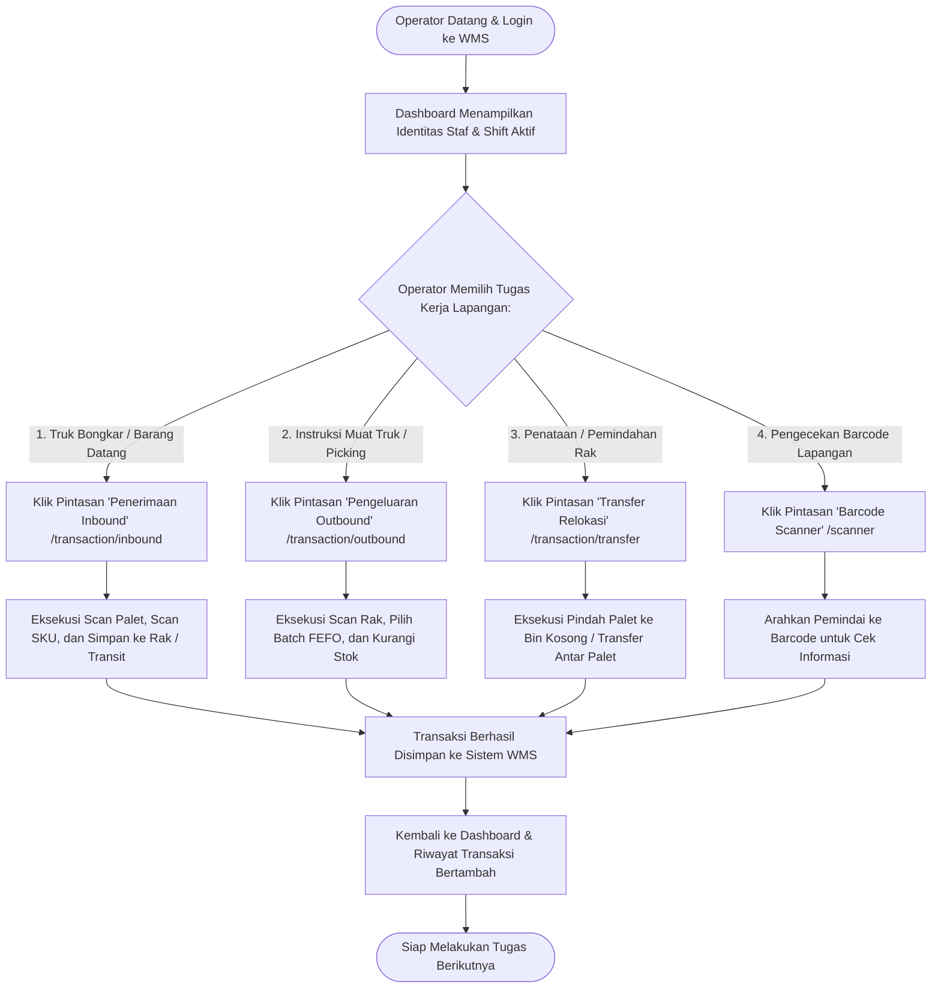

# Modul Dashboard Shift & Panduan Kerja (Operator Gudang)

## 1. Deskripsi Fitur
Dashboard Operator Gudang dirancang khusus untuk memfasilitasi kebutuhan kerja harian operator di lantai gudang. Antarmuka menyajikan pintasan cepat (*quick action shortcuts*) untuk memulai tugas pemindaian barang masuk (*Inbound*), pengambilan barang keluar (*Outbound Picking*), pemindahan antar rak (*Transfer*), serta alat pemindai barcode (*Scanner Simulator*), dilengkapi pemantauan transaksi terkini yang telah diselesaikan pada shift yang bersangkutan.

---

## 2. Hak Akses & Role Permission
- **Role:** `operator` (Operator Gudang)
- **Middleware:** `auth`
- **Fokus Pengguna:** Kemudahan navigasi layar sentuh (*touchscreen friendly*), kecepatan eksekusi tugas fisik, dan kepatuhan terhadap nomor shift kerja.

---

## 3. Komponen Teknis & Tampilan Antarmuka

### File Terkait:
- Controller: [DashboardController.php](file:///C:/laragon/www/%23Project2026/wms-indraco/app/Http/Controllers/DashboardController.php)
- View: `resources/views/dashboard/index.blade.php`
- Route: `GET /` (`name('dashboard')`)

### Elemen Dashboard Operator:
1. **Identitas Pengguna & Shift Aktif:** Menampilkan nama operator yang sedang login beserta nomor shift kerja (Shift 1, 2, atau 3).
2. **Pintasan Cepat Operasional (Action Cards):**
   - **Tombol Penerimaan (Inbound):** Akses langsung ke formulir penerimaan barang masuk.
   - **Tombol Pengeluaran (Outbound):** Akses langsung ke proses picking pengiriman.
   - **Tombol Relokasi (Transfer):** Akses langsung ke pemindahan palet dan bin.
   - **Tombol Barcode Scanner:** Membuka simulator pemindai genggam.
3. **Ringkasan Riwayat Kerja Pribadi:** Menampilkan 10 transaksi terakhir yang dicatat dengan ID operator yang sedang login.

---

## 4. Flowchart Alur Kerja Shift Operator Gudang

---

## 5. Panduan Praktis Operator Lapangan

1. **Awal Pergantian Shift:**
   - Masuk menggunakan akun operator Anda.
   - Pastikan nomor shift yang tampil di sudut atas antarmuka sesuai dengan jadwal kerja Anda (Shift 1: Pagi, Shift 2: Siang/Sore, Shift 3: Malam).
2. **Menjalankan Pekerjaan:**
   - Gunakan tombol kartu besar (*Quick Action Cards*) di tengah layar untuk langsung menuju formulir kerja tanpa harus mencari menu di bilah navigasi samping.
3. **Memeriksa Riwayat Pekerjaan:**
   - Gulir ke bawah pada tabel riwayat transaksi untuk memastikan transaksi yang baru saja Anda simpan telah tercatat dengan status *Success*.
