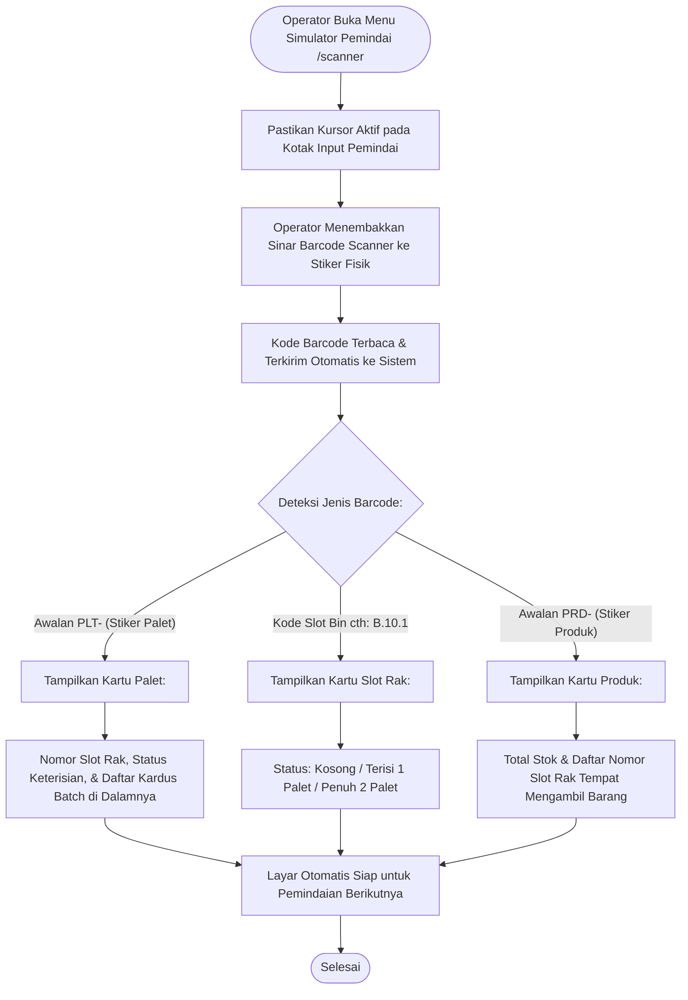

# Modul Simulator Pemindai Barcode (Operator Gudang)

## 1. Deskripsi Fitur
Modul Simulator Barcode Scanner merupakan alat kerja utama bagi Operator Gudang yang menggunakan perangkat *handheld scanner* nirkabel di lorong-lorong rak penyimpanan. Fitur ini memungkinkan operator untuk memeriksa identitas suatu kardus barang yang tidak memiliki label jelas, mengecek isi sebuah palet tanpa harus menurunkan palet dari rak tinggi, atau mencari tahu slot rak mana yang masih kosong untuk menaruh palet.

---

## 2. Hak Akses & Role Permission
- **Role:** `operator` (Operator Gudang)
- **Middleware:** `auth`
- **Fokus Penggunaan:** Akses cepat satu sentuhan (*one-touch scanning*), pembacaan cepat barcode Code128 / QR Code, dan tampilan informasi yang ringkas dan jelas di layar perangkat genggam.

---

## 3. Komponen Teknis & Pola Kode yang Dikenali

### File Terkait:
- Controller: [ScannerController.php](file:///C:/laragon/www/%23Project2026/wms-indraco/app/Http/Controllers/ScannerController.php) (Metode `index()`, `scan()`)
- Route:
  - `GET /scanner` (`name('scanner.index')`)
  - `POST /scanner/scan` (`name('scanner.scan')`)

### 3 Tipe Barcode yang Bisa Discan Operator:
1. **Scan Barcode Palet (Awalan `PLT-`, misal: `PLT-0021`):**
   - Menampilkan slot rak tempat palet itu terdaftar.
   - Menampilkan daftar seluruh kardus yang ada di atas palet beserta nama produk dan tanggal kedaluwarsa.
2. **Scan Barcode Rak / Slot Bin (Misal: `B.10.1` atau `RK-A`):**
   - Menampilkan apakah slot rak tersebut kosong, terisi 1 palet, atau sudah penuh (terisi 2 palet).
   - Membantu operator forklift menemukan slot kosong dengan cepat.
3. **Scan Barcode Produk / SKU (Awalan `PRD-`, misal: `PRD-KOPI-01`):**
   - Menampilkan total stok barang di gudang dan daftar nomor rak tempat barang tersebut bisa diambil.

---

## 4. Flowchart Alur Kerja Pemindaian Barcode oleh Operator

---

## 5. Panduan Praktis Operator Lapangan

1. Buka menu **Peralatan** > **Simulator Barcode Scanner** pada browser tablet / komputer genggam Anda.
2. Pastikan lampu indikator pemindai berwarna hijau (siap memindai).
3. **Mengecek Isi Palet di Rak:**
   - Arahkan pemindai ke stiker palet (contoh: `PLT-0010`).
   - Layar akan langsung menampilkan produk apa saja yang ada di atas palet tersebut tanpa perlu membongkar tumpukan kardus.
4. **Mencari Rak Kosong:**
   - Scan barcode pada tiang rak (contoh: `A.01.2`).
   - Jika layar bertuliskan *Status: Kosong* atau *Terisi: 1/2 Palet*, maka slot tersebut aman digunakan untuk menaruh palet baru.
   - Jika layar berwarna merah bertuliskan *Status: Penuh (2/2 Palet)*, cari slot rak lain.
