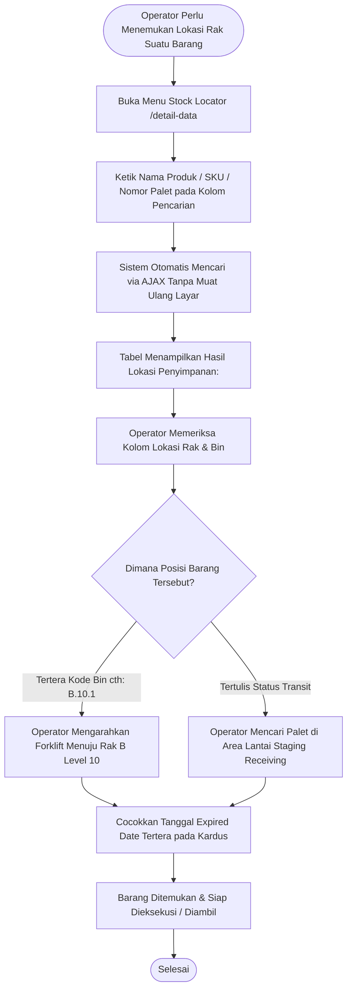

# Modul Pencarian Lokasi Stok / Stock Locator (Operator Gudang)

## 1. Deskripsi Fitur
Modul Pencarian Lokasi Stok (*Stock Locator*) membantu Operator Gudang untuk mencari posisi fisik suatu barang dengan cepat. Ketika operator diminta mengambil produk tertentu namun tidak mengetahui letak raknya, atau saat mencari apakah ada kardus yang tertinggal di area transit, operator dapat mengetik nama produk atau memindai barcode untuk mengetahui nomor rak dan nomor palet tempat barang tersebut berada.

---

## 2. Hak Akses & Role Permission
- **Role:** `operator` (Operator Gudang)
- **Middleware:** `auth`, `permission:detail,read`
- **Fokus Penggunaan:** Pencarian cepat tanpa reload layar (*SPA Zero Page Reload*), tampilan lokasi rak yang mudah dibaca, dan pengecekan tanggal kedaluwarsa kardus.

---

## 3. Komponen Teknis & Cara Pencarian

### File Terkait:
- Controller: [DetailDataController.php](file:///C:/laragon/www/%23Project2026/wms-indraco/app/Http/Controllers/DetailDataController.php) (Metode `index()`)
- View: `resources/views/detail/index.blade.php` dan `resources/views/detail/partials/table.blade.php`
- Route: `GET /detail-data` (`name('detail.index')`)

### Kolom Data yang Sangat Membantu Operator:
1. **Barcode Kardus / Box ID:** Nomor seri kardus unik (cth: `BOX-A8F21B`).
2. **Barcode Palet:** Mengetahui di palet mana kardus itu tersusun.
3. **Nomor Slot Rak (Bin ID):** Menunjukkan di tiang dan level rak berapa palet diletakkan (cth: `RK-A`, `A.10.1`). Jika bertuliskan *Transit*, berarti barang masih berada di lantai gudang.
4. **Kuantitas Sisa:** Mengetahui apakah stok di kardus tersebut masih utuh atau sudah terambil sebagian.
5. **Tanggal Expired Date:** Memastikan operator mengambil kardus yang tepat sesuai prinsip FEFO.

---

## 4. Flowchart Alur Pencarian Lokasi Barang oleh Operator

---

## 5. Panduan Praktis Langkah demi Langkah

1. Buka menu **Informasi Stok** > **Stock Locator / Detail Data**.
2. **Mencari Lokasi Produk:**
   - Ketikkan sebagian nama produk pada kolom pencarian (misal: ketik `Arabika`).
   - Tabel seketika memfilter dan menampilkan di mana saja produk tersebut tersimpan.
3. **Membaca Alamat Rak:**
   - Lihat kolom **Slot BIN**.
   - Contoh `B.04.1` memiliki arti: **Gedung Utama, Rak B, Level 4 (Tingkat 4), Kolom 1**.
   - Naikkan garpu forklift ke tingkat 4 kolom 1 untuk mengambil palet tersebut.
4. **Mencari Kardus di Area Lantai:**
   - Jika kolom **Slot BIN** menunjukkan tulisan *Transit* atau kosong, periksa area garis kuning di lantai *staging area* tempat barang baru diturunkan dari truk.
