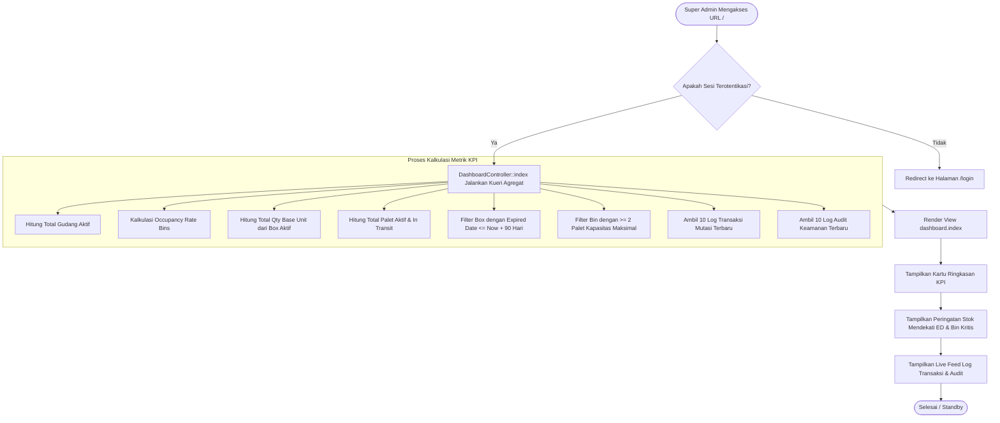

# Modul Dashboard & Executive KPI (Super Admin)

## 1. Deskripsi Fitur
Modul Dashboard Super Admin menyajikan tampilan analitik eksekutif tingkat tinggi yang mengonsolidasikan data dari seluruh gudang, rak, bin, dan palet yang beroperasi di WMS Indraco. Dashboard ini memungkinkan Super Admin untuk memonitor tingkat utilisasi gudang (*Occupancy Rate*), melacak barang yang mendekati tanggal kedaluwarsa (*Expiring Soon* dalam < 90 hari), mendeteksi bin kritis yang telah terisi penuh (*Critical Full Bins* dengan 2 palet), serta memantau arus aktivitas log transaksi dan audit trail terkini secara real-time.

---

## 2. Hak Akses & Role Permission
- **Role:** `super_admin` (Super Admin)
- **Middleware:** `auth`
- **Izin Modul:** Akses otomatis ke seluruh widget analitik tanpa batasan plant atau gudang tertentu.

---

## 3. Komponen Teknis & Arsitektur Database

### File Terkait:
- Controller: [DashboardController.php](file:///C:/laragon/www/%23Project2026/wms-indraco/app/Http/Controllers/DashboardController.php) (Metode `index()`)
- View: `resources/views/dashboard/index.blade.php`
- Route: `GET /` (`name('dashboard')`)

### Model & Relasi Database:
1. [Warehouse](file:///C:/laragon/www/%23Project2026/wms-indraco/app/Models/Warehouse.php): Agregasi total gudang fisik.
2. [Bin](file:///C:/laragon/www/%23Project2026/wms-indraco/app/Models/Bin.php): Agregasi total slot rak dan kalkulasi keterisian (`has('pallets')`).
3. [Pallet](file:///C:/laragon/www/%23Project2026/wms-indraco/app/Models/Pallet.php): Menghitung palet aktif (`where('is_active', true)`).
4. [Box](file:///C:/laragon/www/%23Project2026/wms-indraco/app/Models/Box.php): Menghitung total volume stok (`sum('qty')`) dan filter kedaluwarsa:
   $$\text{expired\_date} \le \text{now}() + 90\text{ hari}$$
5. [TransactionLog](file:///C:/laragon/www/%23Project2026/wms-indraco/app/Models/TransactionLog.php): 10 transaksi mutasi barang terbaru.
6. [AuditLog](file:///C:/laragon/www/%23Project2026/wms-indraco/app/Models/AuditLog.php): 10 aktivitas pengguna/perubahan data sistem terkini.

### Formula Perhitungan Occupancy Rate:
$$\text{Occupancy Rate (\%)} = \left( \frac{\text{Jumlah Bin Terisi Palet}}{\text{Total Seluruh Bin}} \right) \times 100\%$$

---

## 4. Flowchart Alur Kerja Dashboard Super Admin

---

## 5. Rincian Antarmuka & Tindakan Pengguna

1. **Kartu Statistik Utama:**
   - **Total Gudang:** Menampilkan jumlah total warehouse yang aktif.
   - **Occupancy Rate Bins:** Persentase slot rak yang terisi dengan indikator warna (Hijau < 70%, Kuning 70-85%, Merah > 85%).
   - **Total Stok Unit:** Akumulasi kuantitas stok dalam satuan dasar terkecil (*base unit*).
   - **Palet Aktif:** Total palet yang sedang menampung produk di gudang maupun transit.
2. **Tabel Peringatan Barang Kritis (Expiring Soon):**
   - Menampilkan SKU, nama barang, nomor palet, slot Bin, kuantitas, dan hitungan mundur hari menuju tanggal kedaluwarsa.
3. **Tabel Bin Penuh (Critical Bins):**
   - Menyoroti slot rak yang mencapai kapasitas maksimal (2 palet per bin) untuk memudahkan manajemen kapasitas gudang.
4. **Feed Log Transaksi & Audit:**
   - Menyajikan informasi pengguna yang bertindak (PIC), shift kerja, jenis transaksi (Inbound/Outbound/Transfer), dan waktu pencatatan.
