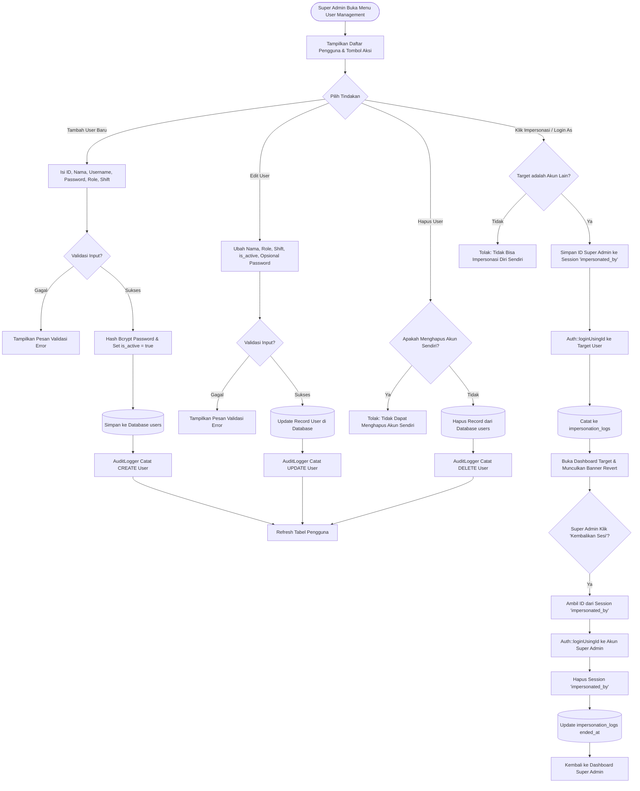

# Modul User Management & Impersonasi (Super Admin)

## 1. Deskripsi Fitur
Modul ini memberikan kewenangan eksklusif kepada Super Admin untuk:
1. **Manajemen Pengguna (User CRUD):** Mengelola akun seluruh staf gudang, menentukan peran kerja (*Role*: Super Admin, Supervisor Gudang, Operator Gudang), mengatur pembagian shift (Shift 1, 2, atau 3), serta mengaktifkan/menonaktifkan status akun (`is_active`).
2. **Impersonasi Pengguna (Login-As):** Mengambil alih sesi pengguna lain tanpa memerlukan password mereka untuk kebutuhan audit operasional, validasi tampilan antarmuka spesifik peran, atau penyelidikan kendala lapangan, dengan opsi pengembalian sesi (*revert*) instan ke akun Super Admin semula.

---

## 2. Hak Akses & Role Permission
- **Role:** `super_admin` (Eksklusif)
- **Middleware:** `auth`, `permission:users,read`, `permission:users,create`, `permission:users,update`, `permission:users,delete`
- **Aturan Keamanan:** Super Admin tidak diizinkan untuk menghapus akun dirinya sendiri yang sedang digunakan saat ini (`auth()->id() !== $user->id`).

---

## 3. Komponen Teknis & Skema Database

### File Terkait:
- Controller User: [UserController.php](file:///C:/laragon/www/%23Project2026/wms-indraco/app/Http/Controllers/UserController.php)
- Controller Impersonasi: [ImpersonationController.php](file:///C:/laragon/www/%23Project2026/wms-indraco/app/Http/Controllers/ImpersonationController.php)
- Service Impersonasi: `App\Services\ImpersonationService`
- Service Audit: `App\Services\AuditLogger`
- Route:
  - `GET /users` (`name('users.index')`)
  - `POST /users` (`name('users.store')`)
  - `PUT /users/{user}` (`name('users.update')`)
  - `DELETE /users/{user}` (`name('users.destroy')`)
  - `POST /impersonate/{user}` (`name('impersonate.start')`)
  - `MATCH ['get', 'post'] /impersonate/revert` (`name('impersonate.revert')`)

### Skema Tabel `users`:
| Kolom | Tipe | Deskripsi |
| :--- | :--- | :--- |
| `id` | VARCHAR(50) PRIMARY KEY | Kode unik pengguna (cth: `USR-001`, `OPR-101`) |
| `name` | VARCHAR(100) | Nama lengkap pengguna |
| `username` | VARCHAR(50) UNIQUE | Identitas login |
| `password` | VARCHAR(255) | Hash Bcrypt password |
| `role_id` | VARCHAR(50) FK | Relasi ke tabel `roles.id` |
| `shift` | INT (1, 2, 3) | Penugasan shift operasional |
| `is_active` | BOOLEAN | Status aktif pengguna |

### Mekanisme Sesi Impersonasi:
1. Menyimpan `original_user_id` di dalam sesi pengguna:
   ```php
   session()->put('impersonated_by', auth()->id());
   ```
2. Mengubah otentikasi aktif menggunakan `Auth::loginUsingId($targetUser->id)`.
3. Menulis rekam jejak pada tabel `impersonation_logs` (waktu mulai, IP address, user asal, user target).
4. Saat `revert()`, sistem mengambil `session('impersonated_by')`, melakukan login ulang ke akun Super Admin asli, dan mencatat waktu pengakhiran sesi.

---

## 4. Flowchart Alur Kerja Manajemen User & Impersonasi



---

## 5. Rincian Antarmuka & Langkah Operasional

### A. Langkah Tambah Pengguna Baru:
1. Klik tombol **Tambah User Baru** pada tabel pengguna.
2. Masukkan ID Pengguna unik (contoh: `OPR-025`), Nama Staf, dan Username.
3. Tentukan Password awal (minimal 6 karakter).
4. Pilih peran pada dropdown **Role**:
   - `Super Admin`: Akses tanpa batas.
   - `Supervisor Gudang`: Otorisasi dan manajemen stok.
   - `Operator Gudang`: Eksekusi scan barang masuk, keluar, dan transfer.
5. Tentukan jadwal kerja pada pilihan **Shift** (Shift 1 / Shift 2 / Shift 3).
6. Klik **Simpan User**.

### B. Prosedur Melakukan Impersonasi:
1. Cari pengguna target pada daftar (misalnya operator gudang yang mengalami kendala).
2. Klik ikon/tombol **Login As (Impersonate)**.
3. Sistem seketika mengalihkan sesi aktif ke pengguna tersebut, menampilkan dashboard sesuai batasan akses perannya.
4. Di bagian atas layar akan muncul banner peringatan kuning: *"Anda sedang bertindak sebagai [Nama User] ([Role]) - [Kembalikan Akun Super Admin]"*.
5. Setelah pengujian atau pemeriksaan selesai, klik tombol **Kembalikan Akun Super Admin** untuk kembali ke sesi asal.
