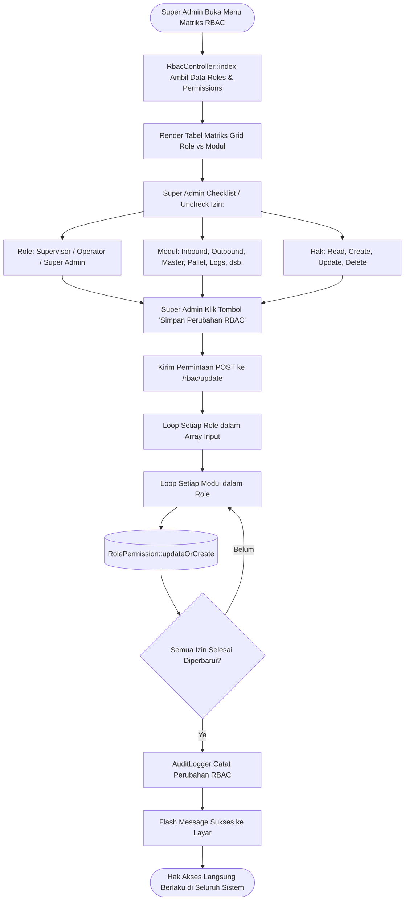

# Modul Matriks Hak Akses RBAC (Super Admin)

## 1. Deskripsi Fitur
Modul Role-Based Access Control (RBAC) memungkinkan Super Admin untuk mengonfigurasi matriks perizinan secara dinamis untuk setiap peran (*Role*) terhadap seluruh modul fungsional di WMS Indraco. Perubahan izin dapat disesuaikan pada 4 tingkat operasi: **Read** (melihat data), **Create** (membuat/menerima transaksi), **Update** (mengubah/mengedit data), dan **Delete** (menghapus/membatalkan data).

---

## 2. Hak Akses & Role Permission
- **Role:** `super_admin` (Eksklusif)
- **Middleware:** `auth`, `permission:rbac,read`, `permission:rbac,update`
- **Tujuan Keamanan:** Memastikan prinsip *Least Privilege*, di mana operator atau staf pihak ketiga hanya memiliki akses pada fungsi yang esensial bagi tugas mereka.

---

## 3. Komponen Teknis & Skema Database

### File Terkait:
- Controller: [RbacController.php](file:///C:/laragon/www/%23Project2026/wms-indraco/app/Http/Controllers/RbacController.php)
- Middleware Otorisasi: `App\Http\Middleware\CheckPermission`
- Route:
  - `GET /rbac` (`name('rbac.index')`)
  - `POST /rbac/update` (`name('rbac.update')`)

### Daftar Modul yang Diatur:
1. `inbound`: Penerimaan barang masuk, putaway palet ke bin, penerimaan box.
2. `outbound`: Pengeluaran barang, picking ekspedisi, dan penurunan ke transit.
3. `transfer`: Pemindahan barang antar slot bin atau transfer antar palet.
4. `master`: Master data gudang (Office, Branch, Warehouse, Rack, Bin, UOM, Produk).
5. `pallet`: Pendaftaran palet, penentuan kapasitas, status palet, dan cetak barcode.
6. `rbac`: Pengaturan matriks hak akses ini sendiri.
7. `users`: Manajemen pengguna dan kata sandi.
8. `settings`: Pengaturan parameter konfigurasi sistem.
9. `logs`: Log mutasi transaksi barang dan audit trail aktivitas staf.
10. `detail` / `locator`: Visualisasi dan pelacakan inventaris (*stock locator*).

### Skema Tabel `role_permissions`:
| Kolom | Tipe | Deskripsi |
| :--- | :--- | :--- |
| `id` | BIGINT AUTO_INCREMENT | Identifier primer |
| `role_id` | VARCHAR(50) FK | Foreign key ke tabel `roles.id` |
| `module` | VARCHAR(50) | Nama modul yang diatur |
| `can_read` | BOOLEAN | Izin menampilkan menu & kueri data |
| `can_create` | BOOLEAN | Izin menambah data atau membuat transaksi |
| `can_update` | BOOLEAN | Izin memodifikasi data |
| `can_delete` | BOOLEAN | Izin menghapus entitas data |

---

## 4. Flowchart Konfigurasi Matriks RBAC

---

## 5. Rincian Antarmuka & Langkah Operasional

1. Navigasikan ke menu **Pengaturan Sistem** > **Hak Akses RBAC**.
2. Tampilan akan menyajikan matriks grid dengan kolom role (`Super Admin`, `Supervisor Gudang`, `Operator Gudang`) dan baris modul.
3. Untuk setiap modul, tandai kotak centang (*checkbox*):
   - **R (Read):** Menampilkan menu di sidebar dan mengizinkan kueri data.
   - **C (Create):** Menampilkan tombol tambah dan mengizinkan penyimpanan transaksi baru.
   - **U (Update):** Mengizinkan pengeditan data atau relokasi barang.
   - **D (Delete):** Mengizinkan penghapusan data master atau pembatalan stok.
4. Klik tombol **Simpan Konfigurasi Hak Akses**.
5. Sistem secara instan memperbarui tabel `role_permissions` dan mencatat jejak audit Super Admin. Pengguna yang terdampak akan langsung merasakan perubahan hak akses pada interaksi berikutnya.
