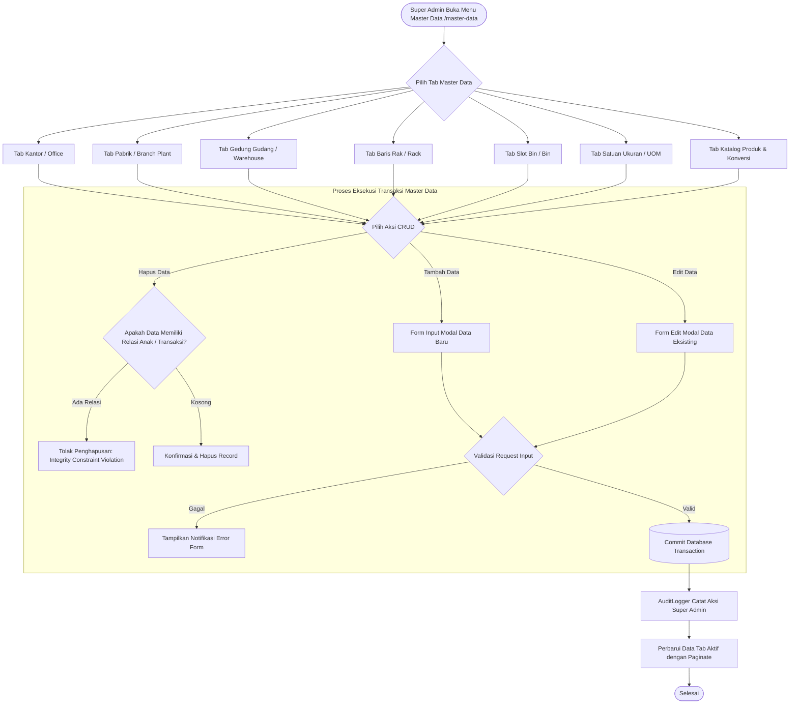

# Modul Master Data Management (Super Admin)

## 1. Deskripsi Fitur
Modul Master Data Management merupakan fondasi struktur pergudangan WMS Indraco. Super Admin memiliki wewenang penuh untuk merancang dan memodifikasi seluruh hierarki fasilitas fisik: Kantor Pusat (*Office*), Cabang/Pabrik (*Branch/Plant*), Gedung Gudang (*Warehouse*), Baris Rak (*Rack*), Slot Bin (*Bin*), Satuan Ukuran (*UOM*), serta Katalog Produk (*Product*) yang dilengkapi tabel konversi multi-UOM fleksibel.

---

## 2. Hak Akses & Role Permission
- **Role:** `super_admin` (CRUD Penuh pada seluruh entitas)
- **Middleware:** `auth`, `permission:master,read`, `permission:master,create`, `permission:master,update`, `permission:master,delete`

---

## 3. Komponen Teknis & Skema Database

### File Terkait:
- Controller: [MasterDataController.php](file:///C:/laragon/www/%23Project2026/wms-indraco/app/Http/Controllers/MasterDataController.php)
- Service Audit: `App\Services\AuditLogger`
- Route:
  - `GET /master-data` (`name('master.index')`)
  - Office: `POST|PUT|DELETE /master-data/office[/{id}]`
  - Branch: `POST|PUT|DELETE /master-data/branch[/{id}]`
  - Warehouse: `POST|PUT|DELETE /master-data/warehouse[/{id}]`
  - Rack: `POST|PUT|DELETE /master-data/rack[/{id}]`
  - Bin: `POST|PUT|DELETE /master-data/bin[/{id}]`
  - Uom: `POST|PUT|DELETE /master-data/uom[/{id}]`
  - Product: `POST|PUT|DELETE /master-data/product[/{id}]`

### Hierarki Relasi Database:
```
offices (id, name, address)
  └── branches (id, office_id, name, plant_code)
        └── warehouses (id, branch_id, name, type)
              └── racks (id, warehouse_id, aisle, name)
                    └── bins (id, rack_id, level, col, max_pallet=2)
```

### Skema Produk & Konversi UOM:
- **Tabel `products`:** `id` (SKU), `name`, `brand`, `item_group`, `group_level2`, `group_level3`, `uom_inventory` (Base Unit terkecil, misal: *Box* atau *Pcs*), `description`.
- **Tabel `product_uom_conversions`:** `product_id`, `uom_convert` (cth: *Karton*, *Ball*), `qty_convert` (cth: 1 Karton = 12 Box), `uom_base`.

---

## 4. Flowchart Alur Kerja Master Data Management



---

## 5. Rincian Antarmuka & Aturan Bisnis Entitas

### A. Bin (Slot Rak):
- **Kode Bin:** Format standar pabrik, misal `B.10.1` (Rak B, Level 10, Kolom 1).
- **Kapasitas Maksimal (`max_pallet`):** Secara baku dibatasi **2 palet** per slot bin untuk mencegah kelebihan muatan rak secara fisik (*overweight risk*).

### B. Produk & Konversi Satuan Dinamis:
- Saat mendaftarkan SKU baru (contoh: Kopi Arabika 250gr), Super Admin mendefinisikan Satuan Inventaris Utama (`uom_inventory`, misal: `Pcs`).
- Menambahkan tabel turunan konversi:
  - 1 `Pack` = 10 `Pcs`
  - 1 `Karton` = 4 `Pack` = 40 `Pcs`
- Hal ini memungkinkan operator menerima atau mengeluarkan barang dalam satuan apapun di lapangan, sementara sistem otomatis mengalikan ke kuantitas dasar (*base unit*).
