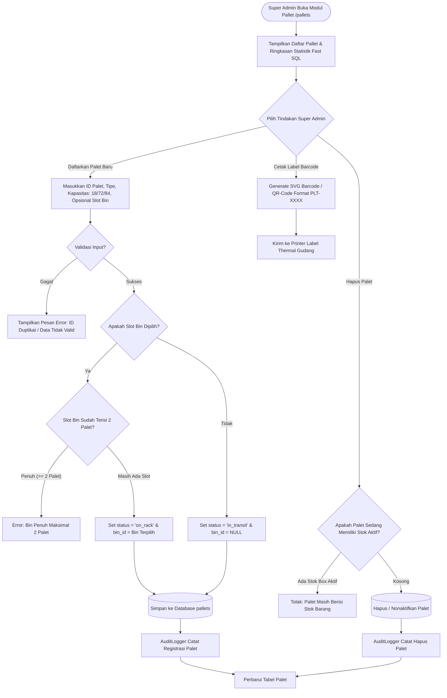

# Modul Pallet Management System (Super Admin)

## 1. Deskripsi Fitur
Modul Pallet Management System mengontrol siklus hidup (*lifecycle*) seluruh palet fisik di WMS Indraco. Sistem ini mencakup pendaftaran kode barcode unik palet (cth: `PLT-001`), penetapan tipe palet (*Loscam*, *Chep*, *Plastic*, *Wooden*), pengaturan batas kapasitas daya tampung standar (18, 72, atau 84 unit), monitoring status keterisian (*in_transit*, *on_rack*, *empty*, *inactive*), serta pencetakan label barcode/QR untuk ditempelkan pada fisik palet.

---

## 2. Hak Akses & Role Permission
- **Role:** `super_admin` (Akses Penuh: Create, Read, Update, Delete)
- **Middleware:** `auth`, `permission:pallet,read`, `permission:pallet,create`, `permission:pallet,update`, `permission:pallet,delete`

---

## 3. Komponen Teknis & Skema Database

### File Terkait:
- Controller: [PalletController.php](file:///C:/laragon/www/%23Project2026/wms-indraco/app/Http/Controllers/PalletController.php)
- Service Audit: `App\Services\AuditLogger`
- Route:
  - `GET /pallets` (`name('pallets.index')`)
  - `POST /pallets` (`name('pallets.store')`)
  - `GET /api/pallets/{id}` (`name('pallets.show')`)
  - `PUT /pallets/{id}` (`name('pallets.update')`)
  - `DELETE /pallets/{id}` (`name('pallets.destroy')`)

### Skema Tabel `pallets`:
| Kolom | Tipe | Deskripsi |
| :--- | :--- | :--- |
| `id` | VARCHAR(50) PRIMARY KEY | Kode unik barcode palet (cth: `PLT-0010`) |
| `pallet_type_id` | VARCHAR(50) FK | Relasi ke tipe palet (`loscam`, `chep`, dll) |
| `bin_id` | VARCHAR(50) FK (Nullable)| Slot rak tempat palet berada (NULL = Transit) |
| `status` | ENUM | Status: `in_transit`, `on_rack`, `empty` |
| `max_capacity` | INT | Standar daya tampung: 18, 72, atau 84 unit |
| `is_active` | BOOLEAN | Status aktif/nonaktif palet |

---

## 4. Flowchart Siklus Hidup & Manajemen Palet

---

## 5. Rincian Antarmuka & Aturan Bisnis Palet

1. **Aturan Kapasitas Baku (Ketentuan 5):**
   - Setiap palet memiliki kuota penampungan standar (18 box untuk palet kecil/display, 72 box untuk palet reguler, atau 84 box untuk palet komoditas padat).
   - Indikator kapasitas visual ditampilkan dalam bentuk persentase progress bar di antarmuka sistem.
2. **Keterkaitan dengan Bin (Ketentuan 7):**
   - Satu slot Bin fisik hanya mampu memuat maksimal **2 palet aktif**. Jika Super Admin atau Operator mencoba menempatkan palet ke-3 pada slot yang sama, sistem secara otomatis menolak transaksi dengan pesan validasi *"BIN [ID] sudah penuh (2 Palet terdaftar)"*.
3. **Pencetakan Barcode & QR Code:**
   - Dilengkapi tombol cetak cepat untuk menghasilkan barcode Code128 / QR Code beresolusi tinggi, siap ditempelkan di fisik palet kayu atau plastik guna pemindaian cepat oleh operator.
