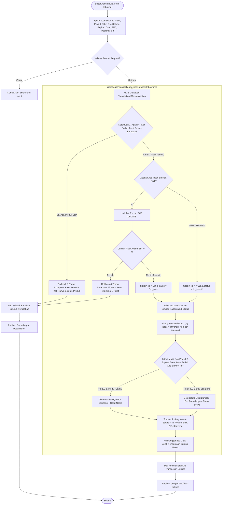

# Modul Transaksi Inbound / Barang Masuk (Super Admin)

## 1. Deskripsi Fitur
Modul Transaksi Inbound mengelola alur penerimaan barang dari lini produksi atau pemasok luar ke dalam sistem pergudangan. Super Admin memiliki wewenang untuk mengeksekusi penerimaan langsung, memantau riwayat barang masuk dari seluruh shift, melakukan *put-away* palet dari area transit ke slot rak (*Bin*), serta memastikan seluruh ketentuan bisnis logistik pergudangan Indraco terpenuhi secara otomatis.

---

## 2. Hak Akses & Role Permission
- **Role:** `super_admin` (Akses Penuh: Eksekusi, Verifikasi, dan Pembatalan Log)
- **Middleware:** `auth`, `permission:inbound,read`, `permission:inbound,create`

---

## 3. Komponen Teknis & Skema Database

### File Terkait:
- Controller: [TransactionController.php](file:///C:/laragon/www/%23Project2026/wms-indraco/app/Http/Controllers/TransactionController.php) (Metode `inboundForm()`, `inbound()`, `inboundPalletToBin()`, `inboundBoxToPallet()`)
- Service Inti: [WarehouseTransactionService.php](file:///C:/laragon/www/%23Project2026/wms-indraco/app/Services/WarehouseTransactionService.php) (Metode `processInboundV2()`, `assignPalletToRack()`)
- Route:
  - Form: `GET /transaction/inbound` (`name('transaction.inbound.form')`)
  - Simpan Inbound: `POST /transaction/inbound` (`name('transaction.inbound')`)
  - Putaway Palet ke Bin: `POST /transaction/inbound/pallet-to-bin` (`name('transaction.inbound.pallet_to_bin')`)
  - Tambah Box ke Palet: `POST /transaction/inbound/box-to-pallet` (`name('transaction.inbound.box_to_pallet')`)

### Aturan Bisnis & Validasi (Business Rules WMS Indraco):
1. **Ketentuan 1 (Single Product Rule):** Jika palet yang dipilih sudah memiliki stok aktif dari produk A, maka penerimaan barang masuk tidak boleh memasukkan produk B ke dalam palet tersebut.
2. **Ketentuan 3 (Konversi Satuan):** Kuantitas input otomatis dikonversi ke kuantitas dasar (*base unit*) berdasarkan faktor perkalian di tabel `product_uom_conversions`.
3. **Ketentuan 5 (Kapasitas Palet):** Kapasitas diatur menjadi 18, 72, atau 84 unit.
4. **Ketentuan 6 (Multi-Expired Date):** Jika produk sama dan expired date sama dimasukkan ke palet yang sama, kuantitas box yang ada akan diakumulasikan. Jika tanggal expired berbeda, sistem membuat record `Box` baru pada palet tersebut.
5. **Ketentuan 7 (Status Transit & Batas Slot Bin):** Jika kolom `bin_id` tidak diisi (atau bernilai `TRANSIT`), status palet menjadi `in_transit`. Jika `bin_id` diisi, slot diperiksa dan tidak boleh melebihi kuota 2 palet.

---

## 4. Flowchart Alur Kerja Transaksi Inbound V2

---

## 5. Rincian Antarmuka & Langkah Operasional

1. Akses menu **Transaksi** > **Penerimaan Barang (Inbound)**.
2. **Pilih / Scan Palet:** Masukkan kode barcode palet (cth: `PLT-0042`). Sistem seketika memanggil API `/api/pallet/{id}/info` untuk memeriksa apakah palet sedang menampung produk tertentu atau berstatus kosong.
3. **Pilih Produk & Satuan:** Pilih SKU produk (misal: `PRD-KOPI-250G`). Sistem memuat satuan konversi yang valid (Karton, Pack, Box).
4. **Isi Detail Produksi:** Masukkan kuantitas, tanggal kedaluwarsa (*Expired Date*), kode mesin cetak/produksi (misal: `MC-01`), dan shift kerja operator.
5. **Tentukan Lokasi Simpan:**
   - Pilih slot Bin fisik jika barang langsung ditaruh di rak (sistem memvalidasi kapasitas maksimal 2 palet).
   - Biarkan kosong / Transit jika palet masih ditampung sementara di area *staging receiving*.
6. Klik **Konfirmasi Simpan Inbound**.
