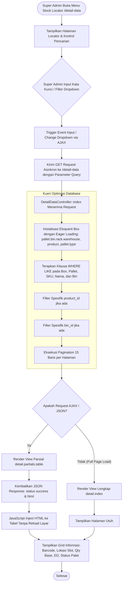

# Modul Stock Locator & Detail Inventaris (Super Admin)

## 1. Deskripsi Fitur
Modul Stock Locator & Detail Data berfungsi sebagai mesin pencarian dan pelacakan posisi inventaris secara presisi di seluruh jaringan fasilitas gudang Indraco. Super Admin dapat melacak keberadaan fisik suatu box hingga ke tingkat nomor slot rak (*Bin*), kode baris (*Rack*), nomor palet, kuantitas satuan terkecil (*Base Unit*), tanggal kedaluwarsa (*Expired Date*), serta kode mesin produksi secara instan dengan dukungan antarmuka asinkron tanpa reload halaman (*SPA Zero Page Reload*).

---

## 2. Hak Akses & Role Permission
- **Role:** `super_admin` (Akses Penuh: Monitoring, Pencarian Global, dan Ekspor Data)
- **Middleware:** `auth`, `permission:detail,read`

---

## 3. Komponen Teknis & Skema Database

### File Terkait:
- Controller: [DetailDataController.php](file:///C:/laragon/www/%23Project2026/wms-indraco/app/Http/Controllers/DetailDataController.php) (Metode `index()`)
- View: `resources/views/detail/index.blade.php` dan `resources/views/detail/partials/table.blade.php`
- Route: `GET /detail-data` (`name('detail.index')`)

### Kemampuan Pencarian & Filter Multi-Kriteria:
1. **Search Keyword Bebas:** Mencari kecocokan sebagian (*partial match*) pada:
   - Barcode Box ID (`boxes.id`)
   - Barcode Pallet ID (`boxes.pallet_id`)
   - Kode SKU Produk (`boxes.product_id`)
   - Nama Produk (`products.name`)
   - Kode Slot Bin (`pallets.bin_id`)
2. **Filter Spesifik Produk:** Dropdown filter SKU terindeks untuk mengisolasi stok satu varian.
3. **Filter Spesifik Slot Bin:** Memeriksa seluruh isi barang di satu titik rak tertentu.
4. **Respon Asinkron (AJAX):** Jika mendeteksi *request header* `X-Requested-With: XMLHttpRequest`, controller mengembalikan payload JSON berisi potongan HTML tabel yang langsung diperbarui pada DOM browser.

---

## 4. Flowchart Alur Kerja Stock Locator & Detail Data

---

## 5. Rincian Antarmuka & Langkah Operasional

1. Akses menu **Informasi Stok** > **Stock Locator / Detail Data**.
2. **Pencarian Cepat:**
   - Masukkan kata kunci pada kolom pencarian (misal: kode palet `PLT-0012` atau nama produk `Cappuccino`).
   - Tabel seketika memfilter data tanpa memuat ulang seluruh halaman.
3. **Pemeriksaan Isi Slot Rak Tertentu:**
   - Pilih slot pada dropdown **Pilih Slot Bin** (misal: `B.10.2`).
   - Sistem akan menyajikan seluruh daftar palet yang menempati slot tersebut beserta rincian box di dalamnya.
4. **Indikator Visual Tanggal Kedaluwarsa:**
   - Baris dengan tanggal expired date kurang dari 90 hari ditandai dengan badge peringatan kuning/merah untuk mempermudah prioritas pengeluaran FIFO/FEFO.
