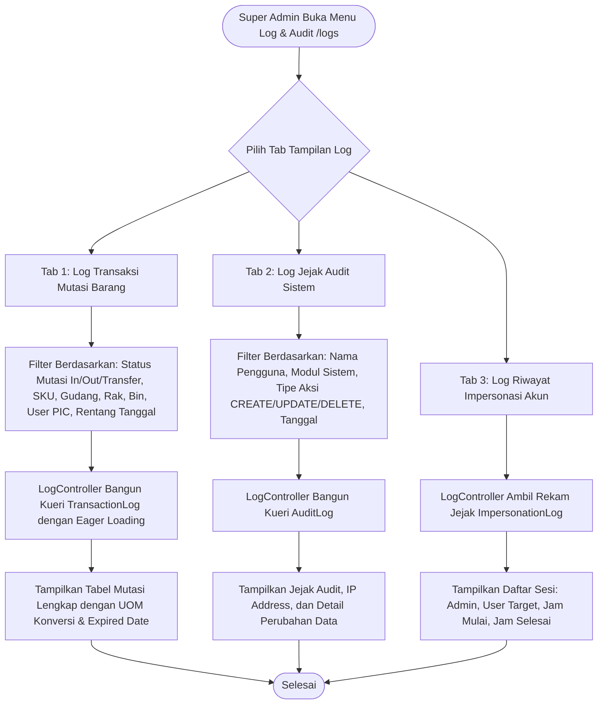

# Modul Audit Trail & Log Transaksi (Super Admin)

## 1. Deskripsi Fitur
Modul Audit Trail & Log Transaksi merupakan pusat rekam jejak (*traceability & accountability hub*) di WMS Indraco. Super Admin dapat memantau, memfilter, dan menganalisis setiap mutasi fisik stok barang (melalui `transaction_logs`) dan setiap tindakan administratif/perubahan data sistem (melalui `audit_logs` dan `impersonation_logs`). Modul ini menjamin transparansi operasional untuk kebutuhan kepatuhan audit internal maupun eksternal.

---

## 2. Hak Akses & Role Permission
- **Role:** `super_admin` (Akses Penuh: Monitoring, Filter Multi-Dimensi, dan Ekspor Laporan)
- **Middleware:** `auth`, `permission:logs,read`

---

## 3. Komponen Teknis & Skema Database

### File Terkait:
- Controller: [LogController.php](file:///C:/laragon/www/%23Project2026/wms-indraco/app/Http/Controllers/LogController.php) (Metode `index()`)
- Service Pencatat: `App\Services\AuditLogger`
- Route: `GET /logs` (`name('logs.index')`)

### Tiga Kategori Log Utama:

#### A. Log Mutasi Transaksi (`transaction_logs`):
Merekam setiap pergerakan barang fisik:
- `pic_user_id`: Staf pelaksana transaksi.
- `shift`: Shift kerja operasional (1, 2, atau 3).
- `transaction_date`: Waktu presisi mutasi.
- `product_id`: SKU barang.
- `uom_input` & `qty_input`: Satuan dan jumlah saat diinput operator di lapangan.
- `conversion_factor`: Pengali konversi ke satuan dasar.
- `uom_base` & `qty_base`: Satuan terkecil inventaris dan volume bersih.
- `expired_date`: Tanggal kedaluwarsa batch barang.
- `machine_code`: Kode mesin cetak/produksi (misal: `MC-01`).
- `bin_id` & `pallet_id`: Posisi slot rak dan nomor palet.
- `status`: Jenis mutasi (`In`, `Out_Ekspedisi`, `Out_Transit`, `Transfer_Pallet`).

#### B. Log Jejak Audit Pengguna (`audit_logs`):
Merekam setiap aksi modifikasi database:
- `user_id`: Pengguna yang melakukan aksi.
- `module`: Modul yang disentuh (`inbound`, `outbound`, `master`, `rbac`, `users`, dll).
- `action`: Tindakan (`CREATE`, `UPDATE`, `DELETE`, `MOVE`).
- `description`: Deskripsi detail perubahan data.
- `ip_address`: Alamat IP perangkat pengguna.

#### C. Log Impersonasi Sesi (`impersonation_logs`):
Merekam pengalihan akun oleh Super Admin:
- `admin_id`: Super Admin yang melakukan login-as.
- `impersonated_user_id`: Pengguna target.
- `started_at` & `ended_at`: Durasi sesi impersonasi.

---

## 4. Flowchart Alur Kerja Audit Trail & Log Transaksi

---

## 5. Rincian Antarmuka & Langkah Operasional

1. Akses menu **Audit & Laporan** > **Pusat Log Sistem**.
2. **Tab Log Transaksi:**
   - Gunakan filter status transaksi untuk menganalisis arus barang keluar (`Out_Ekspedisi`) atau arus penerimaan (`In`).
   - Periksa kolom **Konversi Satuan** untuk melihat transparansi perhitungan dari satuan koli/karton ke satuan dasar box.
3. **Tab Jejak Audit:**
   - Evaluasi jika terjadi penghapusan data master atau perubahan hak akses pada modul RBAC.
   - Kolom alamat IP dan waktu memudahkan identifikasi jika terjadi aktivitas mencurigakan.
4. **Tab Riwayat Impersonasi:**
   - Mengontrol akun Super Admin mana saja yang pernah menggunakan fungsi *Login As* untuk memastikan tidak ada penyalahgunaan wewenang.
