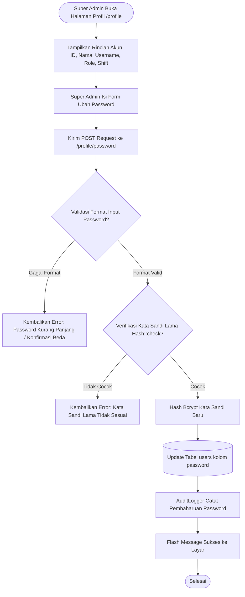

# Modul Profil Pengguna & Pengaturan Sistem (Super Admin)

## 1. Deskripsi Fitur
Modul ini mencakup dua fungsionalitas administratif:
1. **Manajemen Profil Pengguna:** Mengizinkan Super Admin untuk melihat ringkasan identitas akun, role kerja, penugasan shift, serta memperbarui kata sandi akun secara mandiri.
2. **Pengaturan Sistem (System Settings):** Menyediakan pusat kendali konfigurasi global untuk operasional pergudangan Indraco (seperti parameter peringatan masa kedaluwarsa, batas waktu sesi, dan preferensi tampilan).

---

## 2. Hak Akses & Role Permission
- **Role:** `super_admin`
- **Middleware:** `auth`, `permission:settings,read` (khusus menu Settings)
- **Route:**
  - `GET /profile` (`name('profile.index')`)
  - `POST /profile/password` (`name('profile.password')`)
  - `GET /settings` (`name('settings.index')`)

---

## 3. Komponen Teknis & Skema Database

### File Terkait:
- Controller Profil: [ProfileController.php](file:///C:/laragon/www/%23Project2026/wms-indraco/app/Http/Controllers/ProfileController.php)
- Controller Pengaturan: [SettingController.php](file:///C:/laragon/www/%23Project2026/wms-indraco/app/Http/Controllers/SettingController.php)
- Service Audit: `App\Services\AuditLogger`

### Validasi Pembaharuan Kata Sandi:
- `current_password`: Wajib diisi dan harus cocok dengan password terenkripsi di database (`Hash::check`).
- `password`: Password baru minimal 6 karakter.
- `password_confirmation`: Wajib identik dengan password baru (`confirmed`).

---

## 4. Flowchart Alur Kerja Pembaharuan Password & Pengaturan

---

## 5. Rincian Antarmuka & Langkah Operasional

1. Klik foto profil / nama pengguna di pojok kanan atas, lalu pilih **Profil Saya**.
2. **Informasi Akun:** Menampilkan data identitas resmi staf, role otorisasi (`Super Admin`), dan status aktif.
3. **Formulir Ganti Kata Sandi:**
   - Masukkan kata sandi yang sedang digunakan saat ini.
   - Masukkan kata sandi baru yang kuat (kombinasi huruf, angka, dan simbol disarankan).
   - Masukkan ulang kata sandi baru pada kolom konfirmasi.
   - Klik **Perbarui Kata Sandi**. Sistem langsung mengenkripsi password baru dan mencatat aktivitas keamanan pada log audit.
