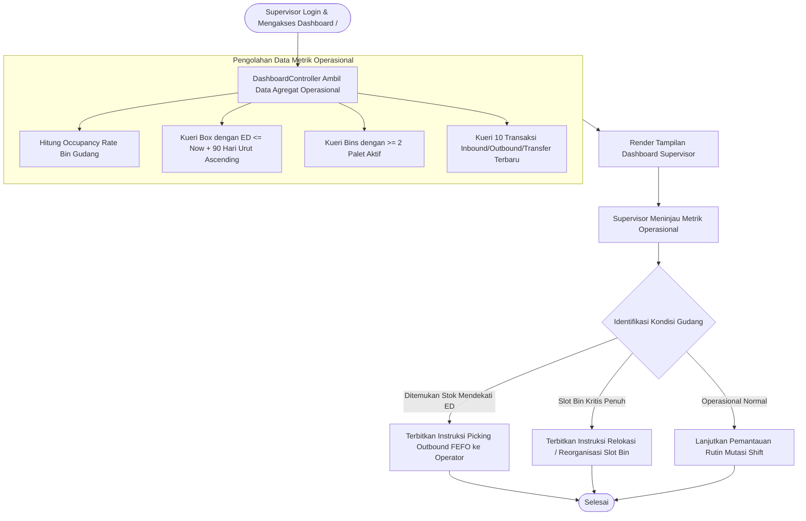

# Modul Dashboard Operasional Gudang (Supervisor Gudang)

## 1. Deskripsi Fitur
Dashboard Supervisor Gudang dirancang khusus untuk mendukung pengawasan operasional harian (*operational supervisory control*) di lantai gudang WMS Indraco. Supervisor dapat secara berkala memantau tingkat keterisian rak (*Occupancy Rate*), mendeteksi slot Bin kritis yang sudah penuh (mencapai batas 2 palet), mengawasi persediaan barang yang mendekati masa kedaluwarsa (*Expiring Soon* dalam 90 hari ke depan untuk prioritas pengeluaran FEFO), serta memantau mutasi transaksi barang yang dilakukan oleh para operator shift.

---

## 2. Hak Akses & Role Permission
- **Role:** `supervisor` (Supervisor Gudang)
- **Middleware:** `auth`
- **Fokus Pengawasan:** Menjamin efisiensi pemanfaatan ruang simpan gudang (*warehouse space utilization*) dan mencegah terjadinya barang rusak/kedaluwarsa di dalam rak.

---

## 3. Komponen Teknis & Metrik Pengawasan

### File Terkait:
- Controller: [DashboardController.php](file:///C:/laragon/www/%23Project2026/wms-indraco/app/Http/Controllers/DashboardController.php)
- View: `resources/views/dashboard/index.blade.php`
- Route: `GET /` (`name('dashboard')`)

### Indikator Kinerja Utama (KPI Operasional):
1. **Tingkat Keterisian Bin (Occupancy Rate):**
   - Menghitung rasio slot Bin yang telah ditempati palet aktif terhadap total seluruh slot Bin.
2. **Peringatan Batch Mendekati Kedaluwarsa (Expiring Soon < 90 Hari):**
   - Mengambil 10 batch box teratas dengan tanggal kedaluwarsa terdekat. Supervisor menggunakan data ini untuk menerbitkan perintah kerja picking (*FEFO Picking Order*) kepada operator.
3. **Peringatan Bin Kritis (Critical Full Bins):**
   - Menampilkan slot Bin yang telah memuat 2 unit palet (kapasitas 100%). Menjadi acuan bagi supervisor agar tidak mengarahkan operator melakukan put-away ke slot tersebut.
4. **Log Transaksi Terkini:**
   - Menyajikan 10 mutasi barang terbaru lengkap dengan informasi PIC operator dan nomor shift kerja.

---

## 4. Flowchart Alur Pengawasan Dashboard Supervisor

---

## 5. Rincian Antarmuka & Langkah Supervisi

1. Masuk ke sistem menggunakan akun peran **Supervisor Gudang**.
2. **Evaluasi Tingkat Utilisasi:**
   - Periksa kartu persentase keterisian rak. Jika angka melampaui 85%, koordinasikan pembukaan area staging atau percepatan pengeluaran barang ekspedisi.
3. **Pemeriksaan Stok Mendekati Kedaluwarsa:**
   - Tinjau tabel *Expiring Soon*. Identifikasi kode palet dan nomor bin batch tersebut untuk segera dijadwalkan dalam dokumen pengeluaran barang berikutnya.
4. **Monitoring Kinerja Shift Operator:**
   - Periksa tabel transaksi terkini untuk memastikan operator shift yang bertugas aktif mengeksekusi penerimaan dan penataan barang.
