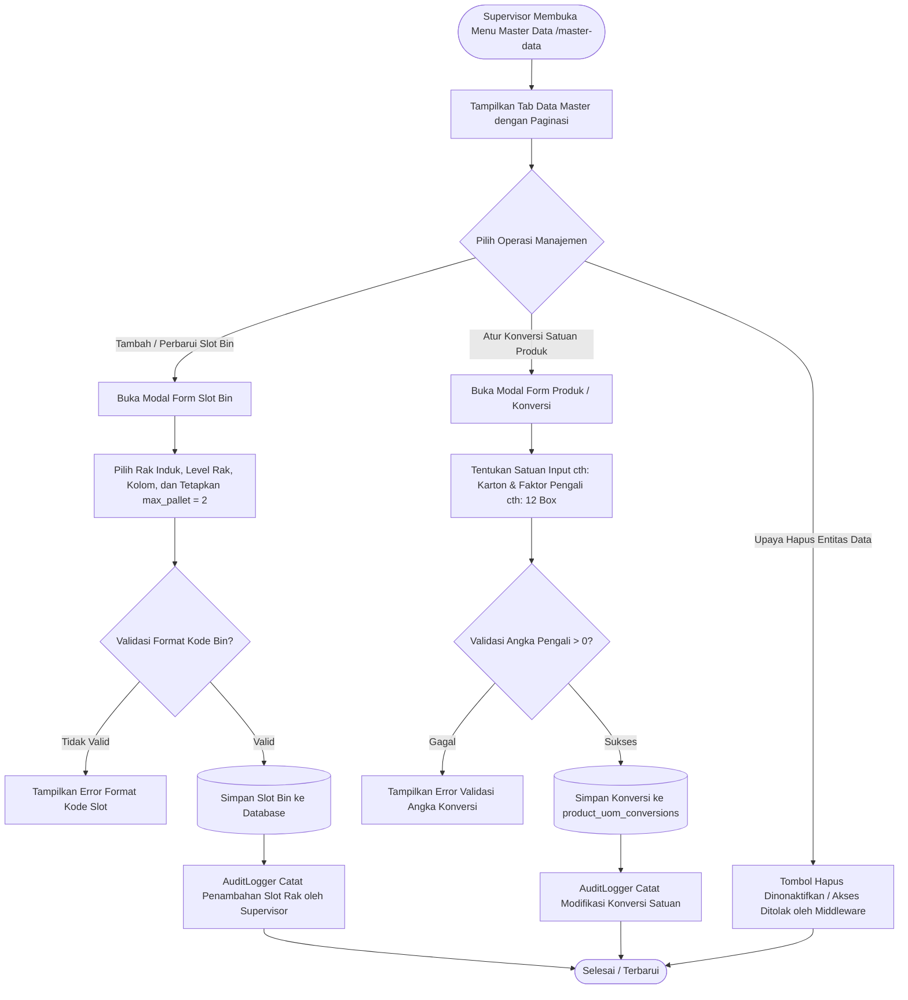

# Modul Tata Letak Gudang & Katalog Master Data (Supervisor Gudang)

## 1. Deskripsi Fitur
Modul ini memungkinkan Supervisor Gudang untuk mengelola struktur tata letak fisik rak dan slot bin, serta memelihara katalog produk dan faktor konversi satuan (*UOM Conversions*). Supervisor memiliki hak untuk membaca (*Read*), menambah (*Create*), dan mengubah (*Update*) konfigurasi slot rak dan produk, namun hak penghapusan (*Delete*) dibatasi secara ketat untuk melindungi integritas riwayat transaksi gudang.

---

## 2. Hak Akses & Role Permission
- **Role:** `supervisor` (Supervisor Gudang)
- **Middleware:** `auth`, `permission:master,read`, `permission:master,create`, `permission:master,update`
- **Batasan Khusus:** Operasi penghapusan data master (`DELETE`) dinonaktifkan (`can_delete = false`).

---

## 3. Komponen Teknis & Skema Database

### File Terkait:
- Controller: [MasterDataController.php](file:///C:/laragon/www/%23Project2026/wms-indraco/app/Http/Controllers/MasterDataController.php)
- Service Audit: `App\Services\AuditLogger`
- Route:
  - `GET /master-data` (`name('master.index')`)
  - Form Rack: `POST|PUT /master-data/rack[/{id}]`
  - Form Bin: `POST|PUT /master-data/bin[/{id}]`
  - Form Product & UOM: `POST|PUT /master-data/product[/{id}]`

### Entitas yang Dikelola Supervisor:
1. **Baris Rak (`racks`):** Menetapkan lorong (*aisle*) dan nama baris rak penyimpanan.
2. **Slot Bin (`bins`):** Mengatur penomoran tingkat (*level*) dan kolom (*column*), serta memastikan nilai kapasitas baku `max_pallet = 2`.
3. **Katalog Produk (`products`):** Meninjau SKU, nama barang, merek (*brand*), dan kategori barang.
4. **Konversi Satuan Dinamis (`product_uom_conversions`):** Menentukan rumus pengali dari satuan pengiriman (Karton/Ball) ke satuan terkecil (*inventory base unit*).

---

## 4. Flowchart Alur Kerja Pengelolaan Layout & Katalog

---

## 5. Rincian Antarmuka & Langkah Supervisi

1. Buka menu **Master Data** di bilah navigasi kiri.
2. **Menambah Slot Bin Baru:**
   - Masuk ke tab **Bins**. Klik tombol **Tambah Slot Bin**.
   - Pilih rak induk (contoh: `RK-B`), masukkan nomor level (misal: `10`) dan kolom (misal: `3`).
   - Sistem secara otomatis membentuk format kode `B.10.3` dan mengunci kuota maksimal 2 palet.
3. **Menambahkan Konversi Satuan SKU:**
   - Masuk ke tab **Produk**. Klik ikon edit pada produk yang diinginkan.
   - Pada bagian tabel konversi, tambahkan satuan baru (misal: `1 Ball = 20 Box`).
   - Simpan data untuk memastikan operator dapat menerima barang dalam satuan *Ball* di lapangan.
