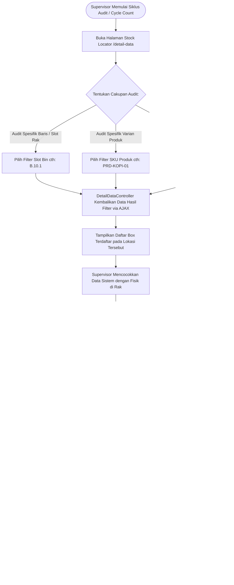

# Modul Stock Locator & Audit Inventaris (Supervisor Gudang)

## 1. Deskripsi Fitur
Modul Stock Locator & Audit Inventaris menyediakan fasilitas penelusuran stok secara komprehensif bagi Supervisor Gudang untuk keperluan audit operasional, rekonsiliasi stok fisik harian (*Stock Opname / Cycle Count*), serta investigasi selisih barang. Modul ini menyajikan visualisasi posisi setiap unit box hingga ke tingkat baris rak dan slot bin secara real-time dengan dukungan antarmuka asinkron tanpa reload layar.

---

## 2. Hak Akses & Role Permission
- **Role:** `supervisor` (Supervisor Gudang)
- **Middleware:** `auth`, `permission:detail,read`
- **Fungsi Utama:** Melakukan audit sampling berkala, memverifikasi kesesuaian tanggal kedaluwarsa fisik terhadap data sistem, dan memeriksa ketersediaan slot bin kosong.

---

## 3. Komponen Teknis & Skema Database

### File Terkait:
- Controller: [DetailDataController.php](file:///C:/laragon/www/%23Project2026/wms-indraco/app/Http/Controllers/DetailDataController.php) (Metode `index()`)
- View: `resources/views/detail/index.blade.php` dan `resources/views/detail/partials/table.blade.php`
- Route: `GET /detail-data` (`name('detail.index')`)

### Data yang Ditampilkan pada Audit:
1. **Barcode Box ID & Pallet ID:** Identitas fisik kemasan.
2. **SKU & Deskripsi Produk:** Nama varian dan merek komoditas Indraco.
3. **Kuantitas Satuan Terkecil (Base Unit):** Jumlah stok terkonversi (cth: *Box*).
4. **Tanggal Kedaluwarsa (Expired Date):** Dilengkapi penanda warna untuk membedakan batch aman vs mendekati masa usang (< 90 hari).
5. **Posisi Rak & Bin:** Nama gedung gudang, kode rak lorong, dan nomor slot bin.

---

## 4. Flowchart Alur Kerja Audit Inventaris Fisik

---

## 5. Rincian Antarmuka & Langkah Supervisi

1. Akses menu **Informasi Stok** > **Stock Locator / Detail Data**.
2. **Audit Slot Tertentu (Bin Check):**
   - Pilih slot Bin yang ingin diperiksa (misal: `B.10.1`).
   - Sistem secara instan menampilkan seluruh palet dan box yang terdaftar di slot tersebut tanpa memuat ulang layar.
3. **Pencocokan Fisik di Rak:**
   - Periksa apakah palet yang bertengger di rak fisik sesuai dengan nomor palet di layar.
   - Pindai barcode box untuk memastikan nomor batch dan expired date tertera sama.
4. **Deteksi Palet Menggantung (In Transit):**
   - Periksa baris data yang kolom Bin-nya bertuliskan *Transit*. Pastikan fisik palet memang berada di lantai staging dan tidak tertinggal di rak tanpa tercatat.
