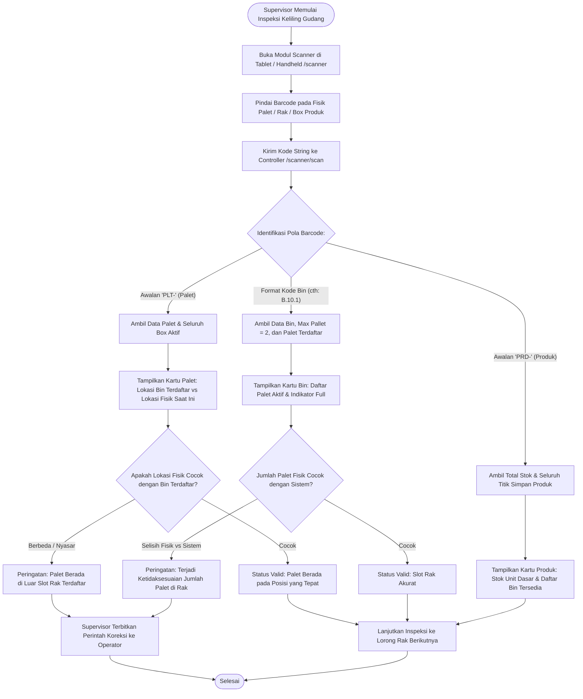

# Modul Alat Audit Barcode Scanner (Supervisor Gudang)

## 1. Deskripsi Fitur
Modul Alat Audit Barcode Scanner digunakan oleh Supervisor Gudang saat melakukan inspeksi keliling (*floor walk rounds*) menggunakan perangkat genggam (*tablet* atau *handheld mobile computer*). Dengan memindai stiker barcode fisik di lapangan, supervisor dapat secara instan melihat isi muatan palet, status kapasitas slot rak, atau persebaran stok SKU produk tertentu tanpa perlu membuka komputer desktop.

---

## 2. Hak Akses & Role Permission
- **Role:** `supervisor` (Supervisor Gudang)
- **Middleware:** `auth`
- **Fungsi Utama:** Verifikasi barcode fisik di lantai gudang, validasi label palet, dan inspeksi langsung saat proses loading/unloading.

---

## 3. Komponen Teknis & Logika Pemindaian

### File Terkait:
- Controller: [ScannerController.php](file:///C:/laragon/www/%23Project2026/wms-indraco/app/Http/Controllers/ScannerController.php) (Metode `index()`, `scan()`)
- Route:
  - `GET /scanner` (`name('scanner.index')`)
  - `POST /scanner/scan` (`name('scanner.scan')`)

### Logika Verifikasi Tiga Objek Fisik:
1. **Inspeksi Palet (`PLT-`):** Menampilkan rincian slot bin tempat palet seharusnya berada, tipe palet, dan seluruh daftar box di atasnya beserta tanggal kedaluwarsa.
2. **Inspeksi Slot Bin (Format Rak, cth: `B.10.1`):** Menampilkan status apakah slot kosong, terisi 1 palet, atau penuh 2 palet (`is_full`), memvalidasi bahwa tidak ada palet liar yang diletakkan tanpa tercatat.
3. **Inspeksi SKU Produk (`PRD-`):** Menampilkan total stok pabrik dan peta posisi palet serta bin di mana produk tersebut tersimpan.

---

## 4. Flowchart Alur Kerja Inspeksi Barcode oleh Supervisor

---

## 5. Rincian Antarmuka & Langkah Supervisi

1. Buka menu **Peralatan** > **Simulator Barcode Scanner** pada perangkat genggam supervisor.
2. Arahkan sinar scanner ke label barcode palet (misal: `PLT-0015`).
3. Periksa informasi yang muncul di layar:
   - Jika kolom **Slot Bin** bertuliskan `B.10.2`, pastikan palet tersebut memang diletakkan di rak B level 10 kolom 2.
   - Periksa tanggal expired date box di layar dengan stiker label pada fisik kardus.
4. Jika ditemukan palet yang berada di slot yang salah, supervisor dapat langsung membuka menu Transfer untuk mengoreksi penempatan bin di sistem.
