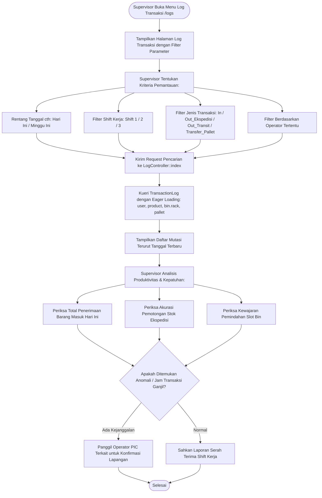

# Modul Pemantauan Log Transaksi Operasional (Supervisor Gudang)

## 1. Deskripsi Fitur
Modul Pemantauan Log Transaksi memungkinkan Supervisor Gudang untuk mengaudit seluruh arus mutasi barang masuk, keluar, dan pemindahan antar rak yang dieksekusi selama jam operasional gudang. Supervisor dapat memfilter transaksi berdasarkan nomor shift (Shift 1, 2, atau 3), nama staf pelaksana (PIC Operator), jenis transaksi, maupun rentang tanggal tertentu guna mengevaluasi produktivitas shift dan ketertiban pelaporan mutasi fisik barang.

---

## 2. Hak Akses & Role Permission
- **Role:** `supervisor` (Supervisor Gudang)
- **Middleware:** `auth`, `permission:logs,read`
- **Fokus Pengawasan:** Memastikan tidak ada pergerakan barang fisik yang tidak tercatat di dalam sistem (*unauthorized stock movement*).

---

## 3. Komponen Teknis & Skema Database

### File Terkait:
- Controller: [LogController.php](file:///C:/laragon/www/%23Project2026/wms-indraco/app/Http/Controllers/LogController.php) (Metode `index()`)
- Model: [TransactionLog](file:///C:/laragon/www/%23Project2026/wms-indraco/app/Models/TransactionLog.php)
- Route: `GET /logs` (`name('logs.index')`)

### Parameter Mutasi yang Dipantau:
| Field Log | Makna Pengawasan |
| :--- | :--- |
| `transaction_date` | Waktu pencatatan mutasi di sistem |
| `pic_user_id` | Operator yang bertanggung jawab atas transaksi |
| `shift` | Shift operasional (Shift 1 / 2 / 3) |
| `product_id` | SKU barang yang dipindahkan |
| `qty_input` & `unit` | Kuantitas dan satuan yang diinput operator |
| `qty_base` & `uom_base` | Kuantitas baku dalam satuan terkecil |
| `status` | Jenis transaksi: `In`, `Out_Ekspedisi`, `Out_Transit`, `Transfer_Pallet` |
| `bin_id` & `pallet_id` | Slot rak dan palet yang terlibat |

---

## 4. Flowchart Alur Pemantauan Log Transaksi oleh Supervisor

---

## 5. Rincian Antarmuka & Langkah Supervisi

1. Akses menu **Audit & Laporan** > **Pusat Log Sistem**.
2. **Evaluasi Serah Terima Shift (Shift Handover):**
   - Sebelum pergantian shift, pilih nomor shift yang sedang berakhir pada filter **Shift**.
   - Periksa total transaksi barang masuk (`In`) dan barang keluar (`Out_Ekspedisi`).
   - Cocokkan jumlah surat jalan fisik dengan jumlah baris transaksi di sistem.
3. **Pemeriksaan Catatan Khusus (Notes):**
   - Periksa kolom **Catatan Transaksi** untuk melihat keterangan tambahan yang ditulis operator saat bertugas (seperti nomor batch, kondisi kemasan, atau alasan relokasi).
