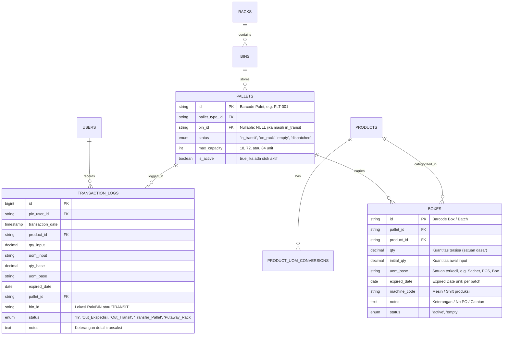
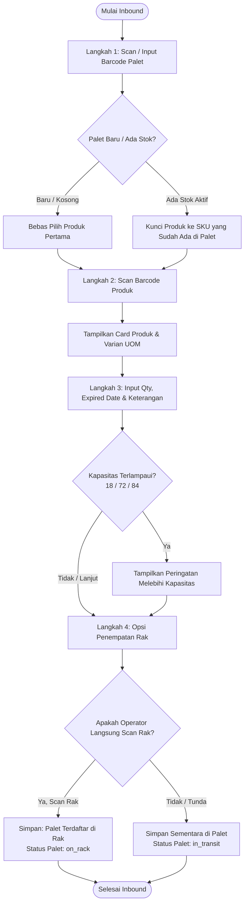
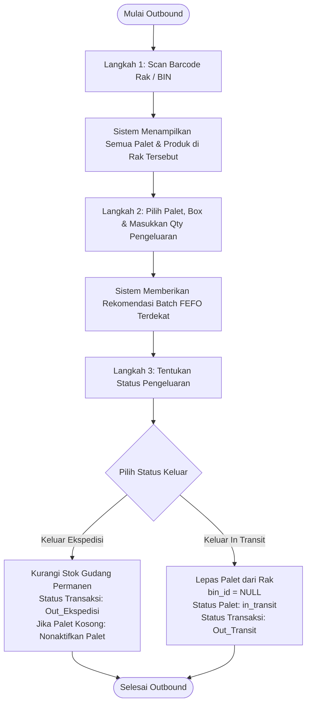

# Rencana Implementasi Fitur Inbound & Outbound V2
**Warehouse Management System (WMS) INDRACO**  
*Dokumen Rencana Arsitektur & Panduan Teknis Implementasi*  
**File Target:** `implementation_inbond_outbond_v2.md`  
**Status Dokumen:** Proposed & Architectural Plan  

---

## 1. Ringkasan Eksekutif & Tujuan

Dokumen ini memuat arsitektur dan rancangan teknis menyeluruh untuk pembaruan modul transaksi **Barang Masuk (Inbound)** dan **Barang Keluar (Outbound)** versi 2 (V2) pada sistem WMS Indraco. Pembaruan ini dirancang untuk menjawab proses operasional nyata di lantai gudang, meningkatkan efisiensi operator scan barcode, menjaga integritas kapasitas penyimpanan, serta memisahkan alur bongkar muat (*receiving/staging*) dari alur penempatan rak (*putaway*).

---

## 2. Matriks 7 Ketentuan Bisnis & Pemetaan Solusi Teknis

| No | Ketentuan Bisnis | Implikasi Logika Sistem & Solusi Teknis |
|---|---|---|
| **1** | **Satu palet pertama kali terima hanya bisa input satu macam produk** | Saat penerimaan awal (*initial inbound*), palet baru atau palet kosong **dikunci untuk 1 SKU produk**. Sistem memblokir jika operator mencoba memasukkan produk berbeda ke palet yang sama pada form Inbound reguler. |
| **2** | **Bisa terima transfer produk dari palet lain** | Palet dapat menjadi *mixed-pallet* (berisi lebih dari satu macam produk) **hanya melalui fitur Transfer Antar Palet (*Pallet-to-Pallet Transfer*)**. Validasi "1 produk" dikecualikan khusus untuk aksi transfer/konsolidasi stok. |
| **3** | **Urutan Inbound: Scan Palet &rarr; Scan Produk (Varian) &rarr; Input Qty, ED, Keterangan &rarr; Scan Rak** | Alur Wizard/Step-by-Step 4 tahap yang ergonomis: <br>1. *Scan Palet* (identifikasi palet & kapasitas). <br>2. *Scan Produk* (tampilkan data produk & varian satuan UOM). <br>3. *Input Transaksi* (Qty, Expired Date, Keterangan/Batch/PO). <br>4. *Scan Rak* (penempatan rak opsional/langsung). |
| **4** | **Urutan Outbound: Scan Rak &rarr; Pilih Keluar &rarr; Status Keluar (Ekspedisi / In Transit)** | Alur pengeluaran berbasis lokasi rak fisik: <br>1. *Scan Rak* (memuat semua palet/box pada rak tersebut). <br>2. *Pilih Produk & Qty Keluar* (rekomendasi FEFO). <br>3. *Pilih Status Keluar*: <br>&bull; **Keluar Ekspedisi**: Barang keluar untuk dikirim ke customer (stok gudang berkurang permanen). <br>&bull; **Keluar In Transit**: Barang/palet dikeluarkan dari rak untuk staging / transit antar area / repack (status palet kembali ke *in transit*). |
| **5** | **1 palet isi 18, 72, atau 84 unit** | Kapasitas palet dikelola secara otomatis di sistem (default 72 atau sesuai master palet). Pilihan manual tombol kapasitas di UI dihilangkan sesuai permintaan agar alur scan operator mobile lebih ringkas, cepat, dan tidak membebani operator. |
| **6** | **1 palet memungkinkan lebih dari 1 Expired Date (Multi-ED)** | Satu palet dapat menyimpan beberapa batch/lot dengan tanggal kedaluwarsa berbeda. Struktur data `boxes` / *batch records* mencatat ED masing-masing, dan ditampilkan dalam visualisasi breakdown per batch. |
| **7** | **Barang yang ditaruh di palet status default adalah In Transit (bisa belum di rak)** | Alur *Decoupled Storing*: Setelah barang dimuat ke palet di area *Receiving/Bongkar Muat*, status default palet adalah **`in_transit`** (`bin_id = null`). Palet baru berstatus **`on_rack`** setelah operator forklift melakukan *Scan Rak*. |

---

## 3. Arsitektur Data & Skema Database

Untuk mendukung 7 ketentuan di atas, diperlukan penyesuaian kolom dan struktur relasi database sebagai berikut:



### 3.1. Rincian Perubahan Kolom Migrasi Database

1. **Tabel `pallets`**:
   - Menambahkan kolom `status`:
     ```php
     $table->enum('status', ['in_transit', 'on_rack', 'empty', 'dispatched'])->default('in_transit')->after('bin_id');
     ```
   - Menambahkan kolom `max_capacity`:
     ```php
     $table->integer('max_capacity')->default(72)->after('status'); // Pilihan: 18, 72, 84, custom
     ```
   - Memastikan kolom `bin_id` bersifat `nullable()` (jika palet berstatus *in transit*, `bin_id` bernilai `null`).

2. **Tabel `boxes`**:
   - Menambahkan kolom `notes` (untuk keterangan inputan dari operator saat scan produk):
     ```php
     $table->text('notes')->nullable()->after('status');
     ```
   - Multi-ED didukung secara inheren karena setiap batch barang yang dimasukkan dengan ED berbeda akan membuat/menambah record `box` baru di bawah `pallet_id` yang sama.

3. **Tabel `transaction_logs`**:
   - Memperluas enum status transaksi:
     ```php
     $table->enum('status', ['In', 'Out_Ekspedisi', 'Out_Transit', 'Transfer_Pallet', 'Putaway_Rack'])->change();
     ```
   - Memastikan `bin_id` dapat bernilai `TRANSIT` atau `null` jika transaksi dilakukan saat palet masih *in transit*.

---

## 4. Alur Kerja Detil & Rancangan Antarmuka (UI/UX)

---

### 4.1. ALUR KERJA INBOUND V2 (Barang Masuk)



#### Langkah-Langkah Detil Inbound V2:

1. **Langkah 1: Scan / Input Palet**
   - Operator memindai barcode fisik pada palet (misal: `PLT-001`).
   - Sistem melakukan pengecekan:
     - Apakah palet baru/kosong atau sudah memiliki box aktif?
     - Kapasitas palet dikelola otomatis (default 72 atau sesuai master palet; pilihan manual tombol kapasitas di UI dihilangkan).
     - Jika sudah terisi produk X, sistem mengunci produk dan menampilkan badge informasi: *"Palet berisi Produk: [Kode] - [Nama Produk]. Penerimaan inbound baru harus produk yang sama."*

2. **Langkah 2: Scan Produk & Pemilihan Varian**
   - Operator memindai barcode produk (SKU / UPC / Barcode Box).
   - Validasi Ketentuan 1: Jika palet sudah terisi produk X, dan yang di-scan adalah produk Y, sistem langsung memblokir dengan modal/alert merah: *"Ditolak: Satu palet saat penerimaan pertama hanya bisa 1 macam produk. Gunakan fitur Transfer Antar Palet jika ingin mencampur produk."*
   - Jika valid: Muncul panel rincian produk beserta daftar konversi satuan (misal: *1 Karton = 24 Pack = 144 Sachet*).

3. **Langkah 3: Input Qty, Expired Date & Keterangan**
   - **Quantity & Satuan Transaksi**: Operator memasukkan angka jumlah dan memilih satuan (Karton/Box/PCS). Sistem otomatis menghitung ekuivalensi ke satuan dasar (*base qty*).
   - **Expired Date (ED)**: Input tanggal kedaluwarsa barang. (Mendukung Multi-ED: jika palet sudah punya ED 2026-10-10, operator bebas memasukkan batch baru dengan ED 2027-01-15).
   - **Keterangan**: Catatan opsional namun disarankan (No. PO, No. Surat Jalan, No. Batch Manufaktur, Shift kerja, atau catatan fisik barang).
   - **Ringkasan Muatan Palet**: Tampilan visual jumlah stok pada palet (muatan sebelumnya dan tambahan input saat ini) secara bersih tanpa memaksa operator memilih kapasitas.

4. **Langkah 4: Scan Rak (Fleksibel & Decoupled)**
   - Opsi A (**Langsung Scan Rak**): Operator langsung memindai barcode Rak/BIN (misal: `B.10.2`). Palet langsung ditempatkan di rak tersebut, dan status palet diset menjadi **`on_rack`**.
   - Opsi B (**Simpan Sementara Tanpa Rak / In Transit**): Operator menekan tombol *"Simpan Palet (Belum Masuk Rak)"*. Barang resmi tercatat di palet tersebut, namun lokasi rak adalah `NULL` dan status palet diset menjadi **`in_transit`** (Ketentuan 7).

---

### 4.2. ALUR KERJA OUTBOUND V2 (Barang Keluar)



#### Langkah-Langkah Detil Outbound V2:

1. **Langkah 1: Scan Rak Fisik**
   - Operator mendatangi lorong rak target dan memindai barcode Rak / BIN (misal: `RK-B` atau `B.10.1`).
   - Sistem langsung memuat semua palet yang tersimpan di rak tersebut.

2. **Langkah 2: Pilih Barang & Kuantitas Pengeluaran**
   - Operator memilih box/produk yang akan diambil.
   - **Fitur Smart FEFO**: Sistem mengurutkan batch berdasarkan tanggal kedaluwarsa terdekat (*First Expired, First Out*) dan menandai batch prioritas dengan badge hijau/kuning.
   - Operator mengisi **Qty Diambil** dan **Satuan** (bisa mengambil sebagian isi palet / granular picking atau mengeluarkan 1 palet penuh).

3. **Langkah 3: Pemilihan Status Pengeluaran**
   - Operator memilih salah satu dari dua tombol opsi status keluar:
     - **A. Tombol "Keluar Ekspedisi"**:
       - Digunakan saat barang dimuat ke armada ekspedisi / pengiriman distributor.
       - Stok barang dipotong permanen dari inventory.
       - Jika kuantitas palet habis (0), palet ditandai *empty / inactive*.
       - Log tercatat sebagai: `status = Out_Ekspedisi`.
     - **B. Tombol "Keluar In Transit"**:
       - Digunakan saat barang/palet diturunkan dari rak untuk dibawa ke area transit (misal: staging area, persiapan pengiriman, relokasi lorong, atau proses sortir).
       - Palet dilepaskan dari rak (`bin_id = null`), status palet beralih menjadi **`in_transit`**.
       - Stok barang tetap ada di gudang, namun berstatus *transit/unassigned to rack*.
       - Log tercatat sebagai: `status = Out_Transit`.

---

### 4.3. ALUR KERJA TRANSFER ANTAR PALET (Fitur Pendukung Ketentuan 2)

Fitur ini disediakan pada menu **"Transfer & Relokasi"** untuk memenuhi kebutuhan penggabungan produk / mixed-pallet:

1. **Scan Palet Asal (*Source Pallet*)**:
   - Memilih box dan menentukan kuantitas produk yang ingin dipindahkan.
2. **Scan Palet Tujuan (*Target Pallet*)**:
   - Sistem **TIDAK MEMBATASI** macam produk pada palet tujuan (bisa menerima produk berbeda dari produk yang sudah ada di palet tujuan).
   - Validasi yang diperiksa: Kapasitas palet tujuan (tidak melampaui limit 18, 72, atau 84 unit).
3. **Konfirmasi & Pemindahan**:
   - Qty pada palet asal dipotong, dan record box baru/terupdate dibuat pada palet tujuan.
   - Jika palet asal habis, palet asal beralih menjadi kosong (*empty*).
   - Tercatat log `Transfer_Pallet`.

---

## 5. Rencana Arsitektur Backend & Service Logic

### 5.1. File Service: `app/Services/WarehouseTransactionService.php`

Metode-metode yang akan dibuat dan diperbarui:

```php
namespace App\Services;

class WarehouseTransactionService
{
    /**
     * Validasi Ketentuan 1: 1 Palet saat penerimaan pertama hanya 1 macam produk
     */
    public function validateSingleProductRule(string $palletId, string $newProductId): void
    {
        $existingBox = Box::where('pallet_id', $palletId)
                          ->where('status', 'active')
                          ->first();

        if ($existingBox && $existingBox->product_id !== $newProductId) {
            $existingProductName = $existingBox->product->name ?? $existingBox->product_id;
            throw new \Exception("Validasi Gagal: Palet {$palletId} saat penerimaan pertama hanya dapat diisi satu macam produk ({$existingProductName}). Gunakan menu Transfer Antar Palet untuk mencampur produk.");
        }
    }

    /**
     * Memproses Inbound V2 dengan dukungan Decoupled Rack Storing & Kapasitas Palet
     */
    public function processInboundV2(array $data, string $userId): Box
    {
        return DB::transaction(function () use ($data, $userId) {
            // 1. Validasi 1 macam produk saat penerimaan pertama
            $this->validateSingleProductRule($data['pallet_id'], $data['product_id']);

            // 2. Tentukan status palet & relasi rak
            $hasRack = !empty($data['bin_id']) && $data['bin_id'] !== 'TRANSIT';
            $palletStatus = $hasRack ? 'on_rack' : 'in_transit';
            $binId = $hasRack ? $data['bin_id'] : null;

            // 3. Upsert Palet dengan kapasitas (18/72/84) dan status in_transit/on_rack
            $pallet = Pallet::updateOrCreate(
                ['id' => $data['pallet_id']],
                [
                    'pallet_type_id' => $data['pallet_type_id'] ?? 'loscam',
                    'bin_id' => $binId,
                    'status' => $palletStatus,
                    'max_capacity' => $data['max_capacity'] ?? 72,
                    'is_active' => true,
                ]
            );

            // 4. Hitung Konversi UOM ke Satuan Terkecil
            $qtyInput = (float) $data['qty'];
            $uomInput = $data['unit'] ?? 'Box';
            $convInfo = $this->resolveConversion($data['product_id'], $uomInput);
            $qtyBase = $qtyInput * $convInfo['conversion_factor'];
            $uomBase = $convInfo['uom_base'];

            // 5. Cek Batas Kapasitas Palet (Ketentuan 5)
            $currentTotalQty = Box::where('pallet_id', $pallet->id)->where('status', 'active')->sum('qty');
            if (($currentTotalQty + $qtyBase) > ($pallet->max_capacity * $convInfo['conversion_factor'])) {
                // Warning / Validasi batas kapasitas
            }

            // 6. Buat Record Box Baru (Mendukung Multi-ED per batch)
            $boxId = $data['box_id'] ?? ('BOX-' . strtoupper(substr(md5(uniqid()), 0, 6)));
            $box = Box::create([
                'id' => $boxId,
                'pallet_id' => $pallet->id,
                'product_id' => $data['product_id'],
                'qty' => $qtyBase,
                'initial_qty' => $qtyBase,
                'uom_base' => $uomBase,
                'expired_date' => $data['expired_date'],
                'machine_code' => $data['machine_code'] ?? 'MC-01',
                'status' => 'active',
                'notes' => $data['notes'] ?? null,
            ]);

            // 7. Pencatatan Log Transaksi
            TransactionLog::create([
                'pic_user_id' => $userId,
                'shift' => $data['shift'] ?? 1,
                'transaction_date' => now(),
                'product_id' => $data['product_id'],
                'qty' => $qtyBase,
                'unit' => $uomInput,
                'uom_input' => $uomInput,
                'qty_input' => $qtyInput,
                'conversion_factor' => $convInfo['conversion_factor'],
                'uom_base' => $uomBase,
                'qty_base' => $qtyBase,
                'expired_date' => $data['expired_date'],
                'bin_id' => $binId ?? 'TRANSIT',
                'status' => 'In',
                'pallet_id' => $pallet->id,
                'pallet_type_id' => $pallet->pallet_type_id,
                'box_id' => $box->id,
                'warehouse_id' => $data['warehouse_id'] ?? 'GSK.678.I',
                'notes' => $data['notes'] ?? "Inbound {$qtyInput} {$uomInput} ke Palet {$pallet->id} (Status: {$palletStatus})",
            ]);

            return $box;
        });
    }

    /**
     * Memproses Outbound V2: Keluar Ekspedisi atau Keluar In Transit
     */
    public function processOutboundV2(array $data, string $userId): bool
    {
        return DB::transaction(function () use ($data, $userId) {
            $pallet = Pallet::where('id', $data['pallet_id'])->lockForUpdate()->firstOrFail();
            $outboundType = $data['outbound_type']; // 'ekspedisi' atau 'in_transit'

            $box = Box::where('id', $data['box_id'])->lockForUpdate()->firstOrFail();
            $qtyInput = (float) $data['qty'];
            $convInfo = $this->resolveConversion($box->product_id, $data['unit'] ?? $box->uom_base);
            $qtyBaseNeeded = $qtyInput * $convInfo['conversion_factor'];

            if ($box->qty < $qtyBaseNeeded) {
                throw new \Exception("Stok tidak mencukupi pada Box {$box->id}.");
            }

            if ($outboundType === 'ekspedisi') {
                // Potong stok permanen
                $box->qty -= $qtyBaseNeeded;
                if ($box->qty <= 0) {
                    $box->qty = 0;
                    $box->status = 'empty';
                }
                $box->save();

                // Jika palet sudah kosong total
                $activeCount = Box::where('pallet_id', $pallet->id)->where('status', 'active')->count();
                if ($activeCount === 0) {
                    $pallet->status = 'empty';
                    $pallet->is_active = false;
                    $pallet->bin_id = null;
                    $pallet->save();
                }

                $logStatus = 'Out_Ekspedisi';
            } else {
                // Keluar In Transit: Palet dilepaskan dari rak dan berstatus in_transit
                $pallet->bin_id = null;
                $pallet->status = 'in_transit';
                $pallet->save();

                $logStatus = 'Out_Transit';
            }

            // Catat Log
            TransactionLog::create([
                'pic_user_id' => $userId,
                'shift' => $data['shift'] ?? 1,
                'transaction_date' => now(),
                'product_id' => $box->product_id,
                'qty' => $qtyBaseNeeded,
                'unit' => $data['unit'] ?? $box->uom_base,
                'uom_input' => $data['unit'] ?? $box->uom_base,
                'qty_input' => $qtyInput,
                'conversion_factor' => $convInfo['conversion_factor'],
                'uom_base' => $box->uom_base,
                'qty_base' => $qtyBaseNeeded,
                'expired_date' => $box->expired_date,
                'bin_id' => $data['rack_id'] ?? ($pallet->bin_id ?? 'TRANSIT'),
                'status' => $logStatus,
                'pallet_id' => $pallet->id,
                'box_id' => $box->id,
                'warehouse_id' => $data['warehouse_id'] ?? 'GSK.678.I',
                'notes' => "Outbound ({$outboundType}): {$qtyInput} {$data['unit']} dari Rak {$data['rack_id']}",
            ]);

            return true;
        });
    }

    /**
     * Transfer Produk Antar Palet (Mendukung Campur Produk / Mixed-Pallet)
     */
    public function transferProductBetweenPallets(string $sourceBoxId, string $targetPalletId, float $qtyToMove, string $userId): void
    {
        // Memindahkan Qty dari Source Box ke Target Pallet tanpa pembatasan 1 macam produk
    }
}
```

---

## 6. Rancangan Tampilan Pengguna (UI Wireframe & Interaksi)

### 6.1. UI Form Inbound V2 (`resources/views/transactions/inbound.blade.php`)

```text
+-------------------------------------------------------------------------+
| FORM INBOUND PUTAWAY V2                                                 |
| Penerimaan Barang Masuk, Multi-ED & Kapasitas Palet                     |
+-------------------------------------------------------------------------+
| [ STEP 1: SCAN PALET ]                                                  |
| Barcode Palet: [ PLT-001             ] [ Kamera ]                       |
| Pilihan Kapasitas Palet: ( ) 18 Unit   (*) 72 Unit   ( ) 84 Unit        |
| Status Palet: [ In Transit - Belum Ada Rak ]                            |
+-------------------------------------------------------------------------+
| [ STEP 2: SCAN PRODUK ]                                                 |
| Barcode Produk/SKU: [ FGD00519       ] [ Kamera ]                       |
| Info Produk: Kopi Kapal Api Special 165g (Brand: Kapal Api)             |
| Varian Satuan Tersedia: Karton (x144) | Pack (x24) | Sachet (x1)        |
+-------------------------------------------------------------------------+
| [ STEP 3: DETAIL INPUTAN BARANG ]                                       |
| Qty Input:   [ 72        ] Satuan: [ Karton        v ]                  |
| Expired Date:[ 2027-04-15] Keterangan / Batch: [ PO-8891 / Batch B-02 ] |
| Kapasitas Palet: [====================================] 72/72 (FULL)   |
+-------------------------------------------------------------------------+
| [ STEP 4: SCAN RAK (OPSIONAL) ]                                         |
| Barcode Rak / BIN: [ B.10.1          ] [ Kamera ]                       |
|                                                                         |
| [ Tombol: Simpan In Transit (Belum ke Rak) ]  [ Tombol: Simpan ke Rak ] |
+-------------------------------------------------------------------------+
```

### 6.2. UI Form Outbound V2 (`resources/views/transactions/outbound.blade.php`)

```text
+-------------------------------------------------------------------------+
| FORM OUTBOUND PICKING V2                                                |
| Pengeluaran Berbasis Scan Rak, Ekspedisi & In Transit                   |
+-------------------------------------------------------------------------+
| [ LANGKAH 1: SCAN RAK / LOKASI ]                                        |
| Barcode Rak / BIN: [ B.10.1          ] [ Kamera ]                       |
| Lokasi Terpilih: Gudang GSK.678.I - Rak B Kolom 10 Level 1              |
+-------------------------------------------------------------------------+
| [ DAFTAR PALET & BATCH PADA RAK INI ]                                   |
| Palet: PLT-001 (Kapasitas: 72/72)                                       |
|  - Box 1: Kopi Kapal Api 165g | Qty: 40 Karton | ED: 2026-11-20 [FEFO]  |
|  - Box 2: Kopi Kapal Api 165g | Qty: 32 Karton | ED: 2027-04-15         |
+-------------------------------------------------------------------------+
| [ LANGKAH 2: RINCIAN PENGAMBILAN ]                                      |
| Box Target: [ BOX-001 (ED: 2026-11-20) v ]                              |
| Qty Diambil: [ 20        ] Satuan: [ Karton        v ]                  |
| Sisa Stok Box Setelah Outbound: 20 Karton                               |
+-------------------------------------------------------------------------+
| [ LANGKAH 3: PILIH STATUS KELUAR ]                                      |
|                                                                         |
| [ KELUAR EKSPEDISI ]               [ KELUAR IN TRANSIT ]                |
| (Potong stok gudang permanen)      (Turunkan dari rak ke status transit)|
+-------------------------------------------------------------------------+
```

---

## 7. Penanganan Kasus Khusus (*Edge Cases*)

1. **Kasus Palet Campur Produk via Penerimaan Awal (Ilegal)**:
   - *Pencegahan*: Sistem mengecek database secara ketat saat submit Inbound. Jika palet memiliki box aktif dengan produk berbeda, sistem me-reject dengan HTTP 422 / pesan error jelas dan tidak mengizinkan bypass frontend.
2. **Kasus Multi-ED dalam Satu Palet**:
   - Jika satu palet menerima barang dengan ED `2026-10-10` dan kemudian menerima lagi dengan ED `2027-05-15`, sistem membuat 2 record `Box` berbeda yang sama-sama terikat pada `pallet_id` yang sama.
   - Pada halaman Stock Locator / Pallet Detail, ditampilkan tabel rincian batch ED per palet.
3. **Kasus Palet Tidak Pernah Masuk Rak (Tertahan di Transit)**:
   - Pada halaman Dashboard & Stock Locator, disediakan filter khusus *"Palet In Transit"* dengan indikator lama waktu transit (misal: `> 24 Jam di Receiving Dock`) agar supervisor gudang dapat memerintahkan operator forklift segera melakukan putaway ke rak.
4. **Kasus Kapasitas Palet Melampaui Standar (Over-Capacity)**:
   - Operator dapat memilih opsi kapasitas 18, 72, atau 84. Jika jumlah box yang dimasukkan melebihi kapasitas standar tersebut, sistem memunculkan dialog konfirmasi *"Peringatan: Jumlah muatan melebihi kapasitas standar palet ([18/72/84]). Tetap simpan sebagai Over-Capacity?"*.

---

## 8. Rencana Tahapan Implementasi (*Roadmap*)

| Fase | Kegiatan Utama | Estimasi & Luaran |
|---|---|---|
| **Fase 1: Database Migration & Model Update** | &bull; Buat migrasi penambahan kolom `status`, `max_capacity` pada `pallets`.<br>&bull; Buat migrasi penambahan kolom `notes` pada `boxes`.<br>&bull; Update enum `status` pada `transaction_logs`.<br>&bull; Update casting & relasi model Eloquent (`Pallet`, `Box`, `TransactionLog`). | Script migrasi & model siap dieksekusi tanpa merusak data lama. |
| **Fase 2: Backend Service Logic** | &bull; Implementasikan `validateSingleProductRule()`.<br>&bull; Implementasikan `processInboundV2()`.<br>&bull; Implementasikan `processOutboundV2()` (Keluar Ekspedisi vs In Transit).<br>&bull; Implementasikan `transferProductBetweenPallets()`. | Unit tests & service method teruji valid. |
| **Fase 3: Controller & API Endpoint** | &bull; Update `TransactionController::inboundV2` & `outboundV2`.<br>&bull; Endpoint AJAX untuk deteksi produk palet, validasi kapasitas, dan query isi rak. | API siap dikonsumsi frontend. |
| **Fase 4: Frontend UI Inbound V2** | &bull; Bangun antarmuka Inbound Step-by-Step (Scan Palet &rarr; Scan Produk &rarr; Qty/ED/Notes &rarr; Scan Rak).<br>&bull; Gauge indikator kapasitas palet (18/72/84).<br>&bull; Tombol opsi simpan In Transit vs simpan Rak. | Halaman `transactions/inbound.blade.php` diperbarui. |
| **Fase 5: Frontend UI Outbound V2** | &bull; Bangun antarmuka Outbound berbasis Scan Rak lebih dulu.<br>&bull; Panel pemilihan palet & box dengan badge smart FEFO.<br>&bull; Tombol aksi "Keluar Ekspedisi" dan "Keluar In Transit". | Halaman `transactions/outbound.blade.php` diperbarui. |
| **Fase 6: Monitoring Palet In Transit** | &bull; Tambahkan tab/filter "Palet In Transit" pada halaman Stock Locator (`detail-data`).<br>&bull; Aksi cepat *"Putaway ke Rak"* langsung dari daftar palet in transit. | Visibilitas staging area receiving maksimal. |

---

## 9. Kesimpulan & Langkah Berikutnya

Rencana implementasi V2 ini menyelaraskan sistem WMS Indraco dengan kebutuhan operasional fisik gudang:
- **Disiplin Produk**: Menjaga 1 macam produk per palet di awal, namun fleksibel menerima transfer antar palet.
- **Kapasitas Terukur**: Standarisasi 18, 72, dan 84 unit per palet.
- **Transparansi Stok**: Dukungan multi-ED per palet dan visibilitas palet yang masih berstatus *in transit* sebelum diletakkan di rak.
- **Alur Outbound Akurat**: Berbasis scan rak fisik dengan diferensiasi tujuan ekspedisi vs transit.

Rencana ini siap dieksekusi secara bertahap mulai dari Fase 1 hingga Fase 6 setelah konfirmasi dan persetujuan.
