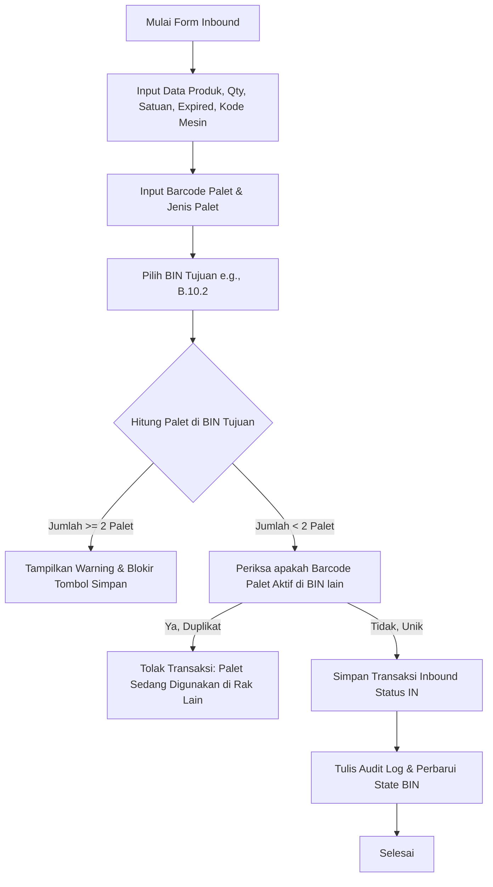
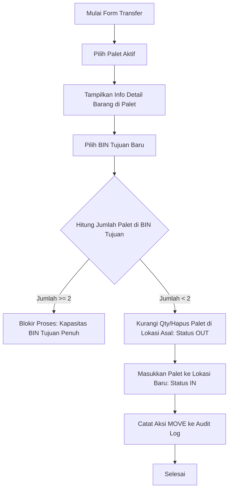
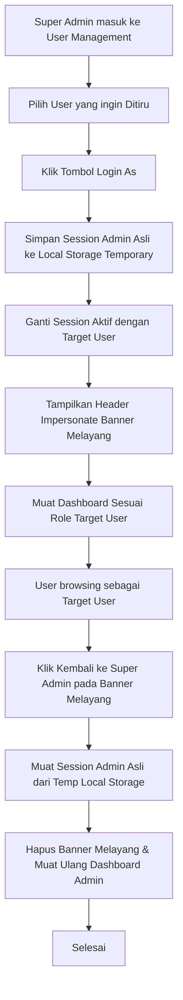

# Rencana Implementasi WMS Indraco
## Warehouse Management System (WMS) - Enterprise Suite

Dokumen ini berisi rencana implementasi, perancangan database fisik, arsitektur UI/UX, flowchart logika bisnis, rancangan halaman spesifik, serta tahap-tahap pengembangan prototype WMS Indraco.

---

## 1. Desain Database Fisik (Physical Database Schema)

Skema database dirancang untuk mendukung struktur organisasi berhirarki, pelacakan inventaris presisi pada level palet/box, sistem otorisasi berbasis peran (RBAC), log aktivitas, dan fitur peniruan identitas (*impersonation*).

```sql
-- 1. Tabel Kantor (Kantor Pusat/Wilayah)
CREATE TABLE offices (
    id VARCHAR(50) PRIMARY KEY, -- e.g., 'KTR-SBY'
    name VARCHAR(100) NOT NULL,
    address TEXT,
    created_at TIMESTAMP DEFAULT CURRENT_TIMESTAMP,
    updated_at TIMESTAMP DEFAULT CURRENT_TIMESTAMP ON UPDATE CURRENT_TIMESTAMP
);

-- 2. Tabel Cabang (di bawah Kantor)
CREATE TABLE branches (
    id VARCHAR(50) PRIMARY KEY, -- e.g., 'CBG-GSK'
    office_id VARCHAR(50) NOT NULL,
    name VARCHAR(100) NOT NULL,
    city VARCHAR(100),
    FOREIGN KEY (office_id) REFERENCES offices(id) ON DELETE CASCADE
);

-- 3. Tabel Gudang (di bawah Cabang)
CREATE TABLE warehouses (
    id VARCHAR(50) PRIMARY KEY, -- e.g., 'GSK.678.I'
    branch_id VARCHAR(50) NOT NULL,
    name VARCHAR(100) NOT NULL,
    address TEXT,
    FOREIGN KEY (branch_id) REFERENCES branches(id) ON DELETE CASCADE
);

-- 4. Tabel Rak (di bawah Gudang)
CREATE TABLE racks (
    id VARCHAR(50) PRIMARY KEY, -- Barcode Rak e.g. 'RK-A'
    warehouse_id VARCHAR(50) NOT NULL,
    rack_name VARCHAR(50) NOT NULL, -- e.g., 'B'
    created_at TIMESTAMP DEFAULT CURRENT_TIMESTAMP,
    FOREIGN KEY (warehouse_id) REFERENCES warehouses(id) ON DELETE CASCADE
);

-- 5. Tabel BIN / Slot Penyimpanan (di bawah Rak)
-- Nomor BIN direpresentasikan dengan format: [Rak].[Kolom].[Tingkat/SAP]
CREATE TABLE bins (
    id VARCHAR(50) PRIMARY KEY, -- Barcode BIN e.g. 'B.10.2'
    rack_id VARCHAR(50) NOT NULL,
    column_no INT NOT NULL, -- e.g., 10
    level_no INT NOT NULL, -- e.g., 2 (SAP / Tingkat)
    max_pallet INT DEFAULT 2, -- Batasan bisnis maks 2 palet
    created_at TIMESTAMP DEFAULT CURRENT_TIMESTAMP,
    FOREIGN KEY (rack_id) REFERENCES racks(id) ON DELETE CASCADE
);

-- 6. Tabel Jenis Palet
CREATE TABLE pallet_types (
    id VARCHAR(50) PRIMARY KEY, -- e.g., 'loscam', 'plastik', 'kayu_125'
    name VARCHAR(50) NOT NULL -- Loscam, Plastik, Kayu 125x125, Kayu 135x125
);

-- 7. Tabel Palet
CREATE TABLE pallets (
    id VARCHAR(50) PRIMARY KEY, -- Barcode Palet e.g. 'PLT-0001'
    pallet_type_id VARCHAR(50) NOT NULL,
    bin_id VARCHAR(50) NULL, -- NULL jika palet sedang berada di area Transit/Dispatch
    is_active BOOLEAN DEFAULT TRUE,
    created_at TIMESTAMP DEFAULT CURRENT_TIMESTAMP,
    FOREIGN KEY (pallet_type_id) REFERENCES pallet_types(id),
    FOREIGN KEY (bin_id) REFERENCES bins(id) ON DELETE SET NULL
);

-- 8. Tabel Produk
CREATE TABLE products (
    id VARCHAR(50) PRIMARY KEY, -- SKU / Barcode Produk e.g. 'PRD-99812'
    name VARCHAR(150) NOT NULL,
    default_unit VARCHAR(20) NOT NULL, -- Karton, Bag, Box, Pcs, Kg
    created_at TIMESTAMP DEFAULT CURRENT_TIMESTAMP
);

-- 9. Tabel Box (di bawah Palet)
CREATE TABLE boxes (
    id VARCHAR(50) PRIMARY KEY, -- Barcode Box e.g. 'BOX-0023'
    pallet_id VARCHAR(50) NOT NULL,
    product_id VARCHAR(50) NOT NULL,
    qty INT NOT NULL,
    expired_date DATE NOT NULL,
    machine_code VARCHAR(50) NOT NULL, -- Kode Mesin produksi
    created_at TIMESTAMP DEFAULT CURRENT_TIMESTAMP,
    updated_at TIMESTAMP DEFAULT CURRENT_TIMESTAMP ON UPDATE CURRENT_TIMESTAMP,
    FOREIGN KEY (pallet_id) REFERENCES pallets(id) ON DELETE CASCADE,
    FOREIGN KEY (product_id) REFERENCES products(id)
);

-- 10. Tabel Role
CREATE TABLE roles (
    id VARCHAR(50) PRIMARY KEY, -- e.g., 'super_admin', 'operator', 'supervisor'
    name VARCHAR(50) NOT NULL,
    description TEXT
);

-- 11. Tabel Permissions (Hak Akses Matriks)
CREATE TABLE role_permissions (
    id INT AUTO_INCREMENT PRIMARY KEY,
    role_id VARCHAR(50) NOT NULL,
    module VARCHAR(50) NOT NULL, -- e.g., 'inbound', 'outbound', 'transfer', 'rbac', 'settings'
    can_read BOOLEAN DEFAULT FALSE,
    can_create BOOLEAN DEFAULT FALSE,
    can_update BOOLEAN DEFAULT FALSE,
    can_delete BOOLEAN DEFAULT FALSE,
    FOREIGN KEY (role_id) REFERENCES roles(id) ON DELETE CASCADE,
    UNIQUE KEY uq_role_module (role_id, module)
);

-- 12. Tabel User
CREATE TABLE users (
    id VARCHAR(50) PRIMARY KEY,
    name VARCHAR(100) NOT NULL,
    username VARCHAR(50) UNIQUE NOT NULL,
    password_hash VARCHAR(255) NOT NULL,
    role_id VARCHAR(50) NOT NULL,
    shift INT NOT NULL DEFAULT 1, -- Shift 1, 2, 3
    is_active BOOLEAN DEFAULT TRUE,
    created_at TIMESTAMP DEFAULT CURRENT_TIMESTAMP,
    FOREIGN KEY (role_id) REFERENCES roles(id)
);

-- 13. Tabel Log Mutasi Transaksi Barang (Inbound/Outbound)
CREATE TABLE transaction_logs (
    id INT AUTO_INCREMENT PRIMARY KEY,
    pic_user_id VARCHAR(50) NOT NULL,
    shift INT NOT NULL,
    transaction_date TIMESTAMP DEFAULT CURRENT_TIMESTAMP,
    product_id VARCHAR(50) NOT NULL,
    qty INT NOT NULL,
    unit VARCHAR(20) NOT NULL,
    expired_date DATE,
    machine_code VARCHAR(50),
    bin_id VARCHAR(50) NOT NULL,
    status ENUM('In', 'Out') NOT NULL,
    pallet_id VARCHAR(50) NOT NULL,
    pallet_type_id VARCHAR(50) NOT NULL,
    warehouse_id VARCHAR(50) NOT NULL,
    FOREIGN KEY (pic_user_id) REFERENCES users(id),
    FOREIGN KEY (product_id) REFERENCES products(id),
    FOREIGN KEY (bin_id) REFERENCES bins(id),
    FOREIGN KEY (pallet_id) REFERENCES pallets(id),
    FOREIGN KEY (warehouse_id) REFERENCES warehouses(id)
);

-- 14. Tabel Log Impersonasi (Login As)
CREATE TABLE impersonation_logs (
    id INT AUTO_INCREMENT PRIMARY KEY,
    admin_user_id VARCHAR(50) NOT NULL, -- ID Super Admin asli
    target_user_id VARCHAR(50) NOT NULL, -- ID User yang ditiru
    started_at TIMESTAMP DEFAULT CURRENT_TIMESTAMP,
    ended_at TIMESTAMP NULL,
    FOREIGN KEY (admin_user_id) REFERENCES users(id),
    FOREIGN KEY (target_user_id) REFERENCES users(id)
);

-- 15. Tabel Audit Log Global
CREATE TABLE audit_logs (
    id INT AUTO_INCREMENT PRIMARY KEY,
    timestamp TIMESTAMP DEFAULT CURRENT_TIMESTAMP,
    user_id VARCHAR(50) NOT NULL,
    module VARCHAR(50) NOT NULL,
    action_type VARCHAR(20) NOT NULL, -- CREATE, UPDATE, DELETE, MOVE, IMPERSONATE, LOGIN
    description TEXT NOT NULL
);
```

---

## 2. Desain UI/UX & Konsep Estetika

Untuk membuat aplikasi terasa premium, modern, dan canggih, desain visual mengacu pada konsep *Glassmorphic Dark Interface*.

### A. Palet Warna & Variabel
- **Warna Latar Utama**: `#070a13` (Deep space black)
- **Warna Latar Panel**: `rgba(15, 23, 42, 0.6)` (Dark slate blue dengan opacity 60%)
- **Warna Border & Pembatas**: `rgba(255, 255, 255, 0.08)` (Sangat tipis, memberikan kontur tajam)
- **Warna Aksen Utama**: `#38bdf8` (Neon Sky Blue untuk link aktif, scanner laser, tombol konfirmasi)
- **Warna Sukses**: `#10b981` (Emerald Green untuk status `Terisi` dan `Inbound`)
- **Warna Peringatan**: `#f59e0b` (Amber Orange untuk status `Penuh` dan `Transfer`)
- **Warna Bahaya**: `#ef4444` (Rose Red untuk tombol hapus, status `Outbound`, dan akses ditolak)

### B. Tipografi & Ikon
- **Font Google**: Menggunakan **'Outfit'** (atau alternatif **'Inter'**) untuk tampilan modern bersudut dinamis.
- **Ikonografi**: **Bootstrap Icons** & **FontAwesome** untuk simbol seragam di sidebar dan form.

### C. Integrasi Framework UI (Tailwind + Bootstrap 5.3)
Untuk mencegah konflik antar CSS:
1. **Struktur Grid & Modal**: Menggunakan komponen bawaan **Bootstrap 5.3** (karena memiliki JS modal, dropdown, dan sistem col-grid yang stabil).
2. **Kustomisasi & Desain Kartu**: Menggunakan **TailwindCSS** untuk utility class seperti padding, margin, border-radius, blur, gradient, dan micro-animations.
3. **Reset CSS**: Menambahkan class pembungkus khusus jika diperlukan atau mendefinisikan custom style di file `styles.css`.

### D. Fitur Tema: Default Light Mode & Opsional Dark Mode
Sistem dikonfigurasi dengan tema default **Mode Terang (Light Mode)** dan opsi untuk beralih ke **Mode Gelap (Dark Mode)**:
1. **Default Light Mode (Tema Terang)**:
   - **Warna Latar Utama**: `#f1f5f9` (Slate Light Gray)
   - **Warna Latar Panel**: `rgba(255, 255, 255, 0.7)` (Semi-transparan putih dengan backdrop-blur)
   - **Warna Border**: `rgba(15, 23, 42, 0.08)` (Tipis)
   - **Warna Teks Utama**: `#0f172a` (Slate Dark)
   - **Warna Aksen**: `#0284c7` (Sky Blue)
2. **Opsional Dark Mode (Tema Gelap)**:
   - Diaktifkan secara dinamis dengan menambahkan kelas `.dark` pada elemen `<body>` atau `<html>` tag.
   - Menggunakan warna *Glassmorphic Dark Interface* yang terinci pada bagian A.
3. **Mekanisme Toggle Pengalih Tema**:
   - Switcher tombol ikon (Matahari <i class="bi bi-sun-fill"></i> / Bulan <i class="bi bi-moon-fill"></i>) diletakkan pada area top-bar header di dekat status user.
   - Preferensi tema disimpan di dalam `localStorage` (key: `WMS_THEME_PREFERENCE`) sehingga tetap bertahan saat navigasi halaman.

### E. Responsivitas Mobile Layout
Sistem dikonfigurasi untuk menyesuaikan antarmuka secara elegan saat diakses melalui perangkat mobile (layar < 768px):
1. **Hamburger Menu & Slide-out Drawer**:
   - Menu sidebar desktop (`md:w-64`) disembunyikan secara default pada perangkat seluler.
   - Tombol hamburger menu (<i class="bi bi-list"></i>) ditambahkan pada sisi kiri navbar header utama.
   - Mengeklik tombol hamburger akan memicu slide-out drawer sidebar navigasi dari arah kiri layar dengan transisi CSS yang mulus (`transition-transform duration-300`).
   - Menyediakan tombol tutup cepat (Close button) dan backdrop transparan (`#sidebar-backdrop`) yang sensitif sentuhan di luar drawer untuk menutup sidebar kembali.
2. **Bottom Navigation Bar (Navigasi Bawah)**:
   - Sebuah bar navigasi melayang disematkan secara permanen di bagian bawah layar perangkat mobile (`block md:hidden`).
   - Berisi akses cepat ke 4 modul utama untuk operator gudang: Dashboard, Inventory (Data Detail), Scanner Simulator (QR Code), dan Profile.
   - Status aktif icon navigasi disinkronisasikan secara real-time dengan tab utama dan mengikuti pewarnaan skema tema yang aktif (Light/Dark).
   - Konten halaman (`<main>`) otomatis ditambahkan padding bawah (`pb-20`) untuk memastikan data tidak tertutup oleh navigasi bawah.

---

## 3. Flowchart Logika Bisnis (Mermaid)

### A. Alur Inbound (Penerimaan Barang) & Putaway dengan Batasan 2 Palet per BIN


### B. Alur Transfer / Move Palet & Box


### C. Alur Impersonasi (Login As) oleh Super Admin


---

## 4. Perencanaan Prototype & Spesifikasi Halaman

Aplikasi ini akan diimplementasikan sebagai Single Page Application (SPA) multi-role interaktif yang menggunakan state engine JavaScript di sisi klien untuk menyimpan seluruh operasi CRUD master data di memori / LocalStorage.

### 1. Halaman Login (Login Page)
*   **Tampilan**: Panel tengah kaca mengambang (*glassmorphism*) dengan animasi partikel di latar belakang.
*   **Fitur**:
    *   Form input Username dan Password.
    *   Tautan pintas (*Shortcut simulator login*) untuk langsung masuk sebagai Super Admin, Gudang Supervisor, atau Operator Gudang tanpa mengetik.
    *   Pengecekan enkripsi sandi tiruan di JavaScript.

### 2. Dashboard Super Admin
*   **Tampilan**: Grid dashboard 3 kolom dengan panel ringkasan visual.
*   **Widget**:
    *   *KPI Cards*: Total Cabang, Total Gudang, Palet Aktif, Pengguna Online.
    *   *Kapasitas Global*: Grafik okupansi gudang agregat.
    *   *Recent Logs*: Alur mutasi terbaru di seluruh sistem.
    *   *Impersonation Hub*: Panel cepat untuk meniru user yang sedang aktif bertugas.
    *   *Quick Scanner Cards*: Panel pemindaian barcode terintegrasi untuk melacak SKU produk, koordinat rak/BIN, palet, dan box secara langsung dengan fallback auto-scan simulasi jika input kosong.

### 3. Halaman Data Master & CRUD (Modal)
*   **Konten**: Tabel data induk untuk **Kantor, Cabang, Gudang, Rak, BIN, dan Produk**.
*   **Operasi**:
    *   **Pencarian (Search)**: Pencarian dinamis berdasarkan nama entitas, ID kantor/cabang, SKU produk, dan kode koordinat lokasi.
    *   **Penyaringan (Filtering)**: Dropdown filter adaptif berbasis hierarki (misal: Cabang difilter dari Kantor Induk, Gudang berdasarkan Cabang, Rak berdasarkan Gudang, Status BIN berdasarkan keterisian kosong/sebagian/penuh, dan Produk berdasarkan unit default).
    *   **Tampilan Responsif Mobile Layout**: Deteksi responsif otomatis untuk menyembunyikan grid tabel pada perangkat seluler (lebar layar < 768px) dan mengonversi data menjadi card list (.glass-card) dengan layout data terstruktur dan tombol aksi pencarian, edit, dan hapus yang ramah sentuhan.
    *   **Halaman (Pagination)**: Client-side pagination dengan penyesuaian jumlah data per halaman (5, 10, 20, atau 50 entri) dan info data yang presisi.
    *   **Tambah/Ubah (CRUD)**: Tombol Tambah/Edit membuka modal Bootstrap dengan validasi form (misalnya kode unik gudang harus berformat barcode atau kode khusus, tipe tingkat SAP pada BIN dibatasi berupa angka).
    *   **Hapus**: Tombol Hapus dengan konfirmasi modal.

### 4. Halaman Data Detail & CRUD (Modal)
*   **Konten**: Pelacakan posisi persis dari **Palet, Box, Varian Produk per Box, dan Palet per BIN**.
*   **Operasi**:
    *   Struktur tabel bertingkat (*nested tables*) di mana baris Palet dapat diklik untuk mengekspansi daftar Box di dalamnya.
    *   Modal pemindahan Box antar palet.
    *   Modal modifikasi jumlah isi box (Qty) dan Expired Date secara instan.

### 5. Halaman User Management
*   **Konten**: Daftar pengguna sistem (PIC).
*   **Fitur**:
    *   CRUD Pengguna (Nama, Username, Peran/Role, Shift Kerja, Status Aktif).
    *   Pendeteksi apakah user sedang terikat pada transaksi inbound/outbound hari ini.

### 6. Halaman Role User Management & Hak Akses
*   **Tampilan**: Matriks perizinan (*Permission Grid*).
*   **Fitur**:
    *   Daftar Role (*Super Admin, Warehouse Supervisor, Operator Gudang*).
    *   Tabel hak akses per modul (*dashboard, inbound, outbound, transfer, rbac, settings, logs*).
    *   Checkbox kolom CRUD: Buka Modul (Read), Tambah (Create), Ubah (Update), Hapus (Delete).
    *   Perubahan checkbox langsung memengaruhi otorisasi simulator secara real-time.

### 7. Halaman Setting (Pengaturan)
*   **Fitur**:
    *   Konfigurasi sistem global (Toggle validasi ketat 2 palet per BIN).
    *   Simulator penyetelan sensitivitas barcode scanner.
    *   Pilihan mode visual (pilihan warna tema aksen neon).

### 8. Halaman Profile User
*   **Tampilan**: Kartu biodata personal pegawai.
*   **Fitur**:
    *   Informasi nama, role, shift kerja aktif, dan statistik kinerja (jumlah transaksi yang diselesaikan hari ini).
    *   Form simulasi ubah kata sandi.
    *   Tabel riwayat aktivitas personal (*Personal Audit Trail*).

### 9. Dashboard Khusus untuk Masing-masing Role
*   Ketika user berganti role, sistem memuat widget kustom di tab utama:
    *   **Dashboard Super Admin**: Fokus pada rekap log global, utilitas server, dan manajemen otorisasi sistem.
    *   **Dashboard Warehouse Supervisor**: Menampilkan utilitas rak/BIN yang kritis, grafik stok kedaluwarsa (*expired alert*), rekap rekam data (Gambar 3), dan tombol persetujuan transfer.
    *   **Dashboard Operator Gudang**: Antarmuka ringkas yang dioptimalkan untuk perangkat mobile/handheld. Menampilkan antrean putaway, antrean *picking* barang keluar, dan tombol cepat pemindai barcode.

### 10. Fitur Impersonate (Login As) & Revert
*   **Logika**:
    *   Saat Super Admin mengeklik "Login As" pada seorang user (misal: Gilang - Operator), state `original_admin` diisi dengan data akun Super Admin.
    *   State `currentUser` diubah menjadi target user.
    *   Sistem memicu *Re-render layout* secara instan.
    *   Sebuah banner melayang (*floating alert bar*) berwarna oranye terang muncul di atas layar dengan tulisan: `"Anda sedang masuk sebagai: [Gilang] (Operator Gudang). Klik di sini untuk kembali ke sesi Super Admin."`
    *   Tombol "Kembali" akan mengembalikan `currentUser` ke Super Admin dan membersihkan memori sementara.

### 11. Barcode Scanner Simulator
*   **Tampilan**: Panel tiruan pemindai genggam dengan laser merah animasi.
*   **Logika**:
    *   User dapat mengetikkan teks barcode secara manual atau mengeklik tombol "Generate Contoh Barcode" (e.g. `PLT-005` untuk Palet, `B.10.2` untuk Rak/BIN, atau `PRD-001` untuk Produk).
    *   Saat tombol "Scan" ditekan, sistem mendeteksi tipe barcode berdasarkan format regex (e.g. Awalan `PLT-` = Palet, format `X.Y.Z` = BIN, `PRD-` = Produk).
    *   Sistem secara otomatis membuka modal pop-up detail data master yang bersangkutan, menunjukkan posisi koordinatnya saat ini, isi barang di dalamnya, beserta tombol cepat untuk melakukan mutasi/edit.

---

## 5. Tahapan Implementasi Prototype

```
Tingkat Penyelesaian
| 
| [Tahap 6] Demo Akhir & Uji Skenario
| [Tahap 5] Integrasi Barcode Scanner Simulator
| [Tahap 4] Logika Impersonate & Dashboard Multi-Role
| [Tahap 3] Modul Manajemen Master Data, Detail & Hak Akses
| [Tahap 2] Desain Shell Layout, Sidebar & User Switcher
| [Tahap 1] Inisialisasi Database Mock di app.js
+------------------------------------------------------------> Waktu
```

1.  **Tahap 1: Struktur State & Model Database** (Inisialisasi dataset bawaan dalam JavaScript, termasuk user bawaan, role matrix, detail palet, dan box sesuai Gambar 2).
2.  **Tahap 2: Navigasi & Kerangka Layout** (Membangun kerangka sidebar dinamis, header responsive, dan switch user simulator).
3.  **Tahap 3: Halaman Master, Detail, & Hak Akses** (Membuat view CRUD menggunakan modal Bootstrap untuk masing-masing master/detail data serta perizinan RBAC).
4.  **Tahap 4: Impersonasi & Dashboard Multi-Role** (Mengaktifkan banner melayang "Login As" dan melengkapi antarmuka dashboard khusus operator/supervisor).
5.  **Tahap 5: Barcode Scanner Simulator** (Menambahkan simulasi pemindai barcode regex untuk mempermudah pencarian visual lokasi barang).
6.  **Tahap 6: Smoke Testing & Demo Skenario** (Memvalidasi logika kapasitas 2 palet, alur transfer, serta mengekspor data rekapitulasi).
