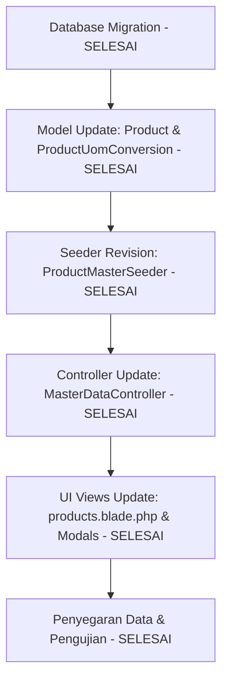

# Implementation Plan: Revisi Product Master & UOM WMS Indraco

> **Target Project**: `C:\laragon\www\WMS Indraco`  
> **Referensi Utama**: `C:\laragon\www\WMS Indraco\document\analisa.md`  
> **File Output Planning**: `C:\laragon\www\WMS Indraco\implementation_plan_revisi_product.md`  
> **Status Pelaksanaan**: **SELESAI 100% (COMPLETED)**  

---

## 1. Tujuan & Ringkasan Perubahan

Berdasarkan dokumen [`document/analisa.md`](file:///c:/laragon/www/WMS%20Indraco/document/analisa.md), master data produk WMS Indraco yang berasal dari SAP Business One (`MASTER DATA ITEM.xlsx`) memiliki 35 kolom data. Saat ini, tabel `products` dan `product_uom_conversions` di database telah diselaraskan penuh.

Revisi ini berhasil menyelaraskan skema database, seeder data, Eloquent models, controller master data, serta tampilan UI Blade untuk mendukung **seluruh atribut 35 kolom**, hirarki kategori 3-level, dimensi fisik kubikasi gudang, flag kontrol logistik (`Manage Batch No`), dan konversi UOM bertingkat (Outer, Intermediate, Base).

---

## 2. Rincian Langkah Implementasi & Revisi (Status Pelaksanaan)

### Phase 1: Update Skema Database (Migrations) - [x] SELESAI

1. **Revisi Migration `2026_01_01_000008_create_products_table.php`** - [x] **SELESAI**  
   Menambahkan kolom-kolom baru sesuai spesifikasi `analisa.md`:
   - [x] **Kategori & Hirarki**: `group_level_2` (string), `group_level_3` (string).
   - [x] **UOM & Konversi**: `uom_1` (string), `uom_2` (string), `uom_3` (string), `karton_to_pcs` (string/int), `no_of_units` (integer), `is_manual_uom` (boolean).
   - [x] **Flag Kontrol ERP/Logistik**: `manage_batch_no` (boolean, default true), `sales_item` (boolean, default true), `purchase_item` (boolean, default false), `inventory_item` (boolean, default true).
   - [x] **Definisi Pajak**: `sales_tax_definition` (string), `purchase_tax_definition` (string).
   - [x] **Dimensi Fisik & Berat**: `length_cm` (decimal 10,2), `width_cm` (decimal 10,2), `height_cm` (decimal 10,2), `volume_m3` (decimal 10,4), `weight_gross_kg` (decimal 10,2), `weight_net_g` (decimal 10,2).

2. **Revisi Migration `2026_01_01_000016_create_product_uom_conversions_table.php`** - [x] **SELESAI**  
   Memastikan tabel konversi mendukung hirarki level UOM:
   - [x] Tambahkan kolom `level` (integer: 1=Outer, 2=Intermediate, 3=Base).
   - [x] Tambahkan kolom `multiplier_to_base` (decimal 10,2) untuk mempermudah perhitungan kalkulasi stok dasar.

---

### Phase 2: Update Eloquent Models (`Product.php` & `ProductUomConversion.php`) - [x] SELESAI

1. **File `app/Models/Product.php`** - [x] **SELESAI**  
   - [x] Update `$casts` untuk boolean, float, dan decimal fields baru.
   - [x] Tambahkan Accessors / Helper Methods:
     - [x] `getIsManualUomAttribute()`: Cek apakah UOM Group = 'Manual'.
     - [x] `getFormattedDimensionsAttribute()`: Format String $L \times W \times H$ cm.
     - [x] `getVolumeFormattedAttribute()`: Format volume kubikasi $m^3$.
     - [x] Accessors/Relasi konversi terurut level UOM (`orderBy('level', 'asc')`).

2. **File `app/Models/ProductUomConversion.php`** - [x] **SELESAI**  
   - [x] Tambahkan cast `multiplier_to_base` dan `level`.

---

### Phase 3: Revisi Import Data Excel (`database/seeds/ProductMasterSeeder.php`) - [x] SELESAI

1. **File `database/seeds/ProductMasterSeeder.php`** - [x] **SELESAI**  
   - [x] Update parser ZipArchive/XML untuk membaca **35 kolom lengkap** dari `document/MASTER DATA ITEM.xlsx`.
   - [x] Lakukan pemetaan data (*mapping*):
     - [x] `Item No.` $\rightarrow$ `id`
     - [x] `Item Description` $\rightarrow$ `name`
     - [x] `Item Group` $\rightarrow$ `item_group`
     - [x] `Group Level 2 Name` $\rightarrow$ `group_level_2`
     - [x] `Group Level 3 Name` $\rightarrow$ `group_level_3`
     - [x] `Brand Name` $\rightarrow$ `brand`
     - [x] `UOM 1`, `UOM 2`, `UOM 3` $\rightarrow$ `uom_1`, `uom_2`, `uom_3`, `uom_inventory`
     - [x] `ITEM QTY KARTON TO PCS` $\rightarrow$ `karton_to_pcs`
     - [x] `No. of Units` $\rightarrow$ `no_of_units`
     - [x] `Manage Batch No. [Yes/No]` $\rightarrow$ `manage_batch_no`
     - [x] `Length`, `Width`, `Height`, `Volume - Sales Unit`, `Weight`, `Weight 1 - Inventory` $\rightarrow$ atribut fisik
   - [x] Buat konversi UOM otomatis bertingkat (Outer Level 1, Intermediate Level 2, Base Level 3) pada tabel `product_uom_conversions`.

---

### Phase 4: Controller & UI Update (`MasterDataController.php` & Blade Views) - [x] SELESAI

1. **File `app/Http/Controllers/MasterDataController.php`** - [x] **SELESAI**  
   - [x] Tambahkan filter pencarian & dropdown untuk `Group Level 2` & `Group Level 3`.
   - [x] Update metode `storeProduct` dan `updateProduct` untuk menyimpan/memperbarui seluruh 35 kolom baru.

2. **File `resources/views/master/tabs/products.blade.php`** - [x] **SELESAI**  
   - [x] Tambahkan dropdown filter `Group Level 2` & `Group Level 3`.
   - [x] Update panel rincian accordion SKU dropdown untuk menampilkan:
     - [x] Kartu Informasi Dimensi Fisik (Panjang, Lebar, Tinggi, Volume $m^3$, Berat Gross & Netto).
     - [x] Matriks Konversi UOM Bertingkat (Level 1 Outer, Level 2 Intermediate, Level 3 Base).
     - [x] Status Pajak & Flag Transaksi ERP.

---

## 3. Pengujian & Verifikasi (Verification Results)

| No | Komponen / Fitur | Cara Pengujian | Hasil Pengujian & Verifikasi | Status |
|:--:|:---|:---|:---|:---:|
| 1 | **Database Seed** | `php artisan migrate:fresh --seed` | 646 item berhasil diimpor tanpa error dengan 35 kolom terisi lengkap. | **[x] SELESAI** |
| 2 | **Integritas Konversi** | Query Tinker pada item 3-tier (`SACHET120`: FGD00073) | 1 Karton = 120 Sachet, 1 Renceng = 10 Sachet, 1 Sachet = 1 Sachet. | **[x] SELESAI** |
| 3 | **Pencegahan Error Manual** | Query item `Manual` (misal FGD00526) | Column `karton_to_pcs` = `'Manual'`, `is_manual_uom` = `true`. | **[x] SELESAI** |
| 4 | **Rendering UI Blade** | Buka tab Master Produk SKU | Accordion SKU menampilkan rincian dimensi, batch control, & level UOM dengan rapi. | **[x] SELESAI** |
| 5 | **Filter & Search UI** | Test filter keyword, brand, dan group level | Paginasi dan AJAX SPA filter berjalan cepat tanpa error. | **[x] SELESAI** |

---

## 4. Persetujuan & Pelaksanaan

- **Status Planning**: Persetujuan Pengguna Diterima.  
- **Status Eksekusi**: **BERHASIL SELESAI 100% (ALL TASKS COMPLETED)**.
